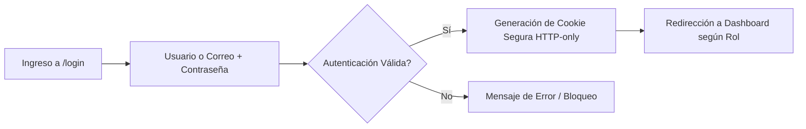
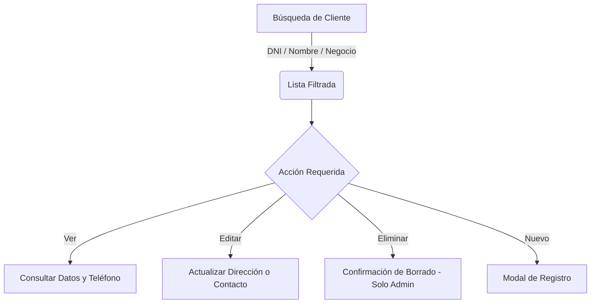
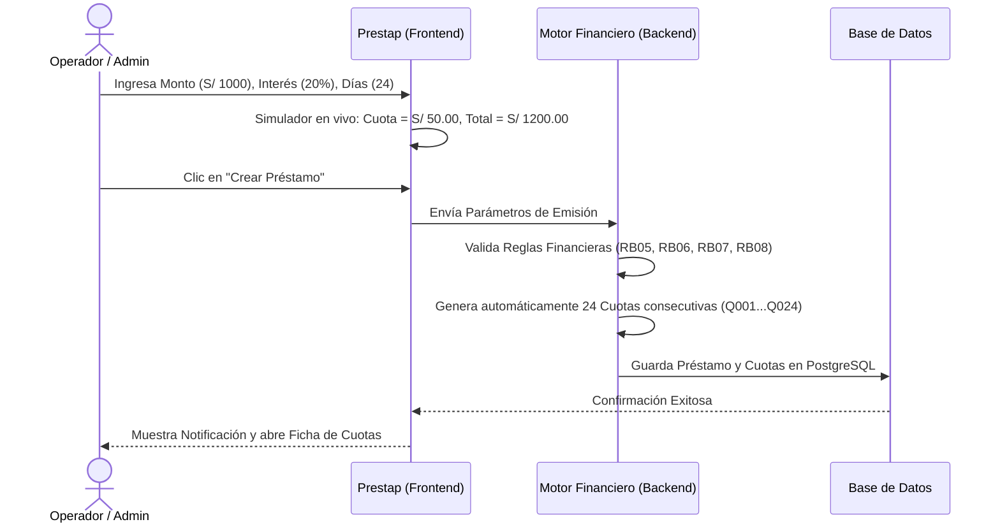
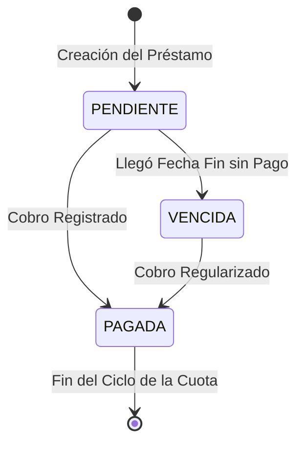
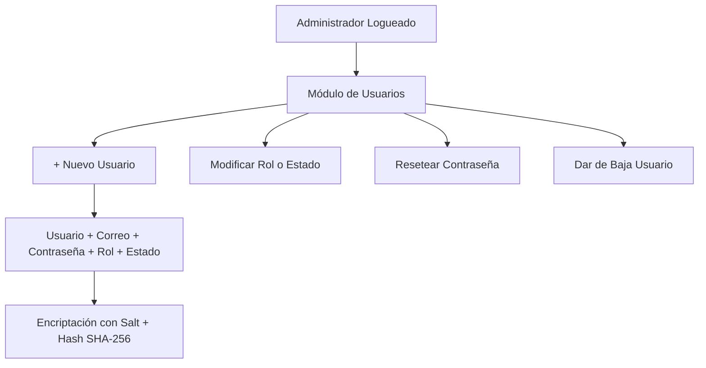

# Manual de Usuario del Sistema Prestap
## Sistema de Gestión de Microcréditos y Cobranzas Diarias

---

## Tabla de Contenidos

1. [Introducción y Objetivos](#1-introducción-y-objetivos)
2. [Roles de Usuario y Matriz de Permisos](#2-roles-de-usuario-y-matriz-de-permisos)
3. [Acceso al Sistema y Seguridad](#3-acceso-al-sistema-y-seguridad)
   - 3.1 [Inicio de Sesión](#31-inicio-de-sesión)
   - 3.2 [Entorno Visual y Modo Oscuro/Claro](#32-entorno-visual-y-modo-oscuroclaro)
   - 3.3 [Cierre de Sesión Seguro](#33-cierre-de-sesión-seguro)
4. [Navegación General y Panel Principal (Dashboard)](#4-navegación-general-y-panel-principal-dashboard)
   - 4.1 [Estructura del Menú Lateral](#41-estructura-del-menú-lateral)
   - 4.2 [Indicadores Clave de Desempeño (KPIs)](#42-indicadores-clave-de-desempeño-kpis)
   - 4.3 [Accesos Directos Operativos](#43-accesos-directos-operativos)
5. [Módulo de Clientes](#5-módulo-de-clientes)
   - 5.1 [Consulta y Búsqueda de Clientes](#51-consulta-y-búsqueda-de-clientes)
   - 5.2 [Registro de un Nuevo Cliente](#52-registro-de-un-nuevo-cliente)
   - 5.3 [Edición de Datos de un Cliente](#53-edición-de-datos-de-un-cliente)
   - 5.4 [Eliminación de Clientes](#54-eliminación-de-clientes)
6. [Módulo de Préstamos](#6-módulo-de-préstamos)
   - 6.1 [Consulta y Filtro de Préstamos](#61-consulta-y-filtro-de-préstamos)
   - 6.2 [Emisión de un Nuevo Préstamo](#62-emisión-de-un-nuevo-préstamo)
   - 6.3 [Simulador Financiero en Tiempo Real](#63-simulador-financiero-en-tiempo-real)
   - 6.4 [Registro Rápido de Cliente desde Préstamos](#64-registro-rápido-de-cliente-desde-préstamos)
7. [Detalle de Préstamo y Calendario de Cuotas](#7-detalle-de-préstamo-y-calendario-de-cuotas)
   - 7.1 [Ficha del Préstamo y Saldos](#71-ficha-del-préstamo-y-saldos)
   - 7.2 [Cronograma Diario de Cuotas](#72-cronograma-diario-de-cuotas)
   - 7.3 [Cobro de Cuota Directo desde el Cronograma](#73-cobro-de-cuota-directo-desde-el-cronograma)
8. [Módulo de Cobranzas y Pagos](#8-módulo-de-cobranzas-y-pagos)
   - 8.1 [Historial de Pagos y Recaudación Filtrada](#81-historial-de-pagos-y-recaudación-filtrada)
   - 8.2 [Registro de Cobranzas Diarias (Paso a Paso)](#82-registro-de-cobranzas-diarias-paso-a-paso)
   - 8.3 [Reglas y Validaciones de Seguridad en Cobranzas](#83-reglas-y-validaciones-de-seguridad-en-cobranzas)
9. [Módulo de Reportes Financieros](#9-módulo-de-reportes-financieros)
   - 9.1 [Reporte de Cartera de Préstamos](#91-reporte-de-cartera-de-préstamos)
   - 9.2 [Reporte de Cobros Realizados](#92-reporte-de-cobros-realizados)
   - 9.3 [Reporte de Gestión de Morosidad](#93-reporte-de-gestión-de-morosidad)
   - 9.4 [Exportación a Excel (CSV) e Impresión / PDF](#94-exportación-a-excel-csv-e-impresión--pdf)
10. [Módulo de Administración de Usuarios (Solo Administrador)](#10-módulo-de-administración-de-usuarios-solo-administrador)
    - 10.1 [Creación de Usuarios del Sistema](#101-creación-de-usuarios-del-sistema)
    - 10.2 [Modificación y Cambio de Contraseñas](#102-modificación-y-cambio-de-contraseñas)
    - 10.3 [Bloqueo y Eliminación de Usuarios](#103-bloqueo-y-eliminación-de-usuarios)
11. [Flujo Operativo Diario Recomendado](#11-flujo-operativo-diario-recomendado)
12. [Glosario de Términos y Estados del Sistema](#12-glosario-de-términos-y-estados-del-sistema)
13. [Preguntas Frecuentes y Solución de Problemas](#13-preguntas-frecuentes-y-solución-de-problemas)

---

## 1. Introducción y Objetivos

**Prestap** es una plataforma tecnológica diseñada para optimizar y controlar el ciclo integral de microcréditos comerciales y cobranzas diarias (modalidad cuota diaria para comerciantes, ferias y mercados).

### Objetivos principales del sistema:
- **Automatización Financiera:** Eliminar cuadernos manuales y hojas de cálculo propensas a errores, calculando intereses, cuotas y fechas de vencimiento de forma instantánea.
- **Transparencia en Tiempo Real:** Proveer información exacta sobre capital colocado, saldo deudor por cobrar, dinero recaudado en el día y cuotas vencidas.
- **Control de Riesgo y Morosidad:** Identificar clientes atrasados con alertas visuales inmediatas para gestionar cobranzas oportunamente.
- **Seguridad y Trazabilidad:** Proteger la información financiera mediante sesiones autenticadas, permisos por rol y validaciones que impiden sobre-pagos o duplicidad de identificaciones.

---

## 2. Roles de Usuario y Matriz de Permisos

El sistema implementa 4 niveles de acceso según las responsabilidades de cada miembro del equipo de trabajo:

| Funcionalidad / Módulo | ADMINISTRADOR | SUPERVISOR | OPERADOR | COBRADOR |
|:---|:---:|:---:|:---:|:---:|
| **Ver Dashboard y KPIs Generales** | Si | Si | Si | Si (Vista reducida) |
| **Listar y Buscar Clientes** | Si | Si | Si | Si (Solo lectura) |
| **Crear y Editar Clientes** | Si | Si | Si | No |
| **Eliminar Clientes** | Si | No | No | No |
| **Listar y Consultar Préstamos** | Si | Si | Si | No |
| **Crear Préstamos (con simulador)** | Si | Si | Si | No |
| **Consultar Detalle de Cuotas** | Si | Si | Si | Si |
| **Registrar Cobros / Pagos** | Si | Si | Si | Si |
| **Historial de Cobranzas** | Si | Si | Si | Si |
| **Reportes (Cartera, Pagos, Morosos)** | Si | Si | No | No |
| **Exportar Reportes a CSV / PDF** | Si | Si | No | No |
| **Gestión de Usuarios y Roles** | Si | No | No | No |

### Descripción de los Roles:
1. **Administrador (`ADMIN`):** Control total de la plataforma. Configura usuarios, supervisa todas las métricas, aprueba operaciones críticas y es el único autorizado para eliminar registros.
2. **Supervisor (`SUPERVISOR`):** Encargado de la gestión comercial y control financiero. Supervisa a los operadores y cobradores, analiza la cartera y audita los reportes de morosidad.
3. **Operador (`OPERADOR`):** Responsable de la colocación de créditos en oficina o campo. Registra clientes nuevos, emite préstamos con sus calendarios y puede recibir pagos.
4. **Cobrador (`COBRADOR`):** Perfil optimizado para trabajo de campo en ruta. Su función primordial es consultar el estado de las cuotas del día y registrar los abonos recaudados en tiempo real.

---

## 3. Acceso al Sistema y Seguridad



### 3.1 Inicio de Sesión
1. Abra su navegador web e ingrese a la dirección asignada de Prestap (por ejemplo `https://tu-dominio.com` o `http://localhost:3000`).
2. Si no tiene una sesión activa, el sistema le mostrará automáticamente la pantalla de bienvenida e inicio de sesión (`/login`).
3. Ingrese sus credenciales:
   - **Usuario o Correo Electrónico:** Su alias (ej. `admin`, `carlos_cobrador`) o su correo institucional registrado.
   - **Contraseña:** Su clave de acceso personal.
4. Haga clic en el botón **"Iniciar Sesión"**.
5. Si los datos son correctos, el sistema configurará su sesión cifrada de 8 horas de duración y lo dirigirá al panel de control principal.

> [!NOTE]
> Las sesiones cuentan con protección `HTTP-only` firmada digitalmente, lo que evita que su clave o token puedan ser interceptados por extensiones maliciosas del navegador.

### 3.2 Entorno Visual y Modo Oscuro/Claro
Prestap incluye un conmutador de tema visual para trabajar cómodamente en campo con luz solar directa o en oficina:
- En la parte inferior del menú lateral (Sidebar), encontrará el icono de alternancia de tema (**Sol / Luna**).
- Al presionarlo, el sistema alternará entre **Modo Claro** y **Modo Oscuro** (efecto Glassmorphism líquido), guardando automáticamente su preferencia para visitas futuras.

### 3.3 Cierre de Sesión Seguro
Para finalizar su turno o salir del dispositivo:
1. Diríjase a la parte inferior del menú lateral izquierdo.
2. Presione el botón **"Cerrar Sesión"** (icono de salida rojo/gris).
3. Su sesión activa será revocada de inmediato en el servidor y será redirigido al formulario de ingreso.

---

## 4. Navegación General y Panel Principal (Dashboard)

El **Dashboard** (`/dashboard`) es el centro de control inteligente del negocio. Presenta una panorámica global del estado financiero al segundo.

### 4.1 Estructura del Menú Lateral (Sidebar)
El menú lateral permanece fijo en computadoras de escritorio y se contrae como menú desplegable en teléfonos móviles o tabletas:
- **Dashboard:** Métricas globales, flujo operativo y accesos rápidos.
- **Clientes:** Directorio de comerciantes y prestatarios.
- **Préstamos:** Emisión de créditos y cálculo de cronogramas.
- **Pagos:** Registro y consulta de cobranzas diarias.
- **Reportes:** Cartera total, cobros consolidados y semáforo de morosos.
- **Usuarios:** Control de accesos y perfiles (solo administradores).

### 4.2 Indicadores Clave de Desempeño (KPIs)
En la parte superior del Dashboard encontrará 8 tarjetas de indicadores estadísticos:

```
┌─────────────────────────┬─────────────────────────┬─────────────────────────┬─────────────────────────┐
│     TOTAL CLIENTES      │   PRÉSTAMOS EMITIDOS    │    CAPITAL PRESTADO     │  TOTAL CARTERA (c/INT)  │
│           48            │           62            │      S/ 45,000.00       │      S/ 54,000.00       │
├─────────────────────────┼─────────────────────────┼─────────────────────────┼─────────────────────────┤
│      MONTO COBRADO      │    SALDO POR COBRAR     │     CUOTAS VENCIDAS     │    CLIENTES MOROSOS     │
│      S/ 38,200.00       │      S/ 15,800.00       │       14 (S/ 700.00)    │            6            │
└─────────────────────────┴─────────────────────────┴─────────────────────────┴─────────────────────────┘
```

1. **Total Clientes:** Número total de clientes activos en la base de datos.
2. **Préstamos Emitidos:** Conteo histórico de contratos de préstamos creados.
3. **Capital Prestado:** Dinero neto desembolsado de caja sin incluir ganancias.
4. **Total Cartera (c/ Interés):** Monto global exigible (Capital prestado + Intereses calculados).
5. **Monto Cobrado:** Dinero real efectivamente recaudado y registrado en el sistema.
6. **Saldo por Cobrar:** Monto de capital + interés pendiente de recuperar (`Total Cartera - Cobrado`).
7. **Cuotas Vencidas:** Cantidad de cuotas cuya fecha límite expiró y no registran pago, junto con el monto dinerario que representan en mora.
8. **Clientes Morosos:** Conteo de clientes únicos que presentan al menos una cuota en estado vencido.

### 4.3 Accesos Directos Operativos
Según su rol, el banner superior muestra botones rápidos:
- **+ Nuevo Cliente:** Abre directamente el formulario de registro de cliente.
- **+ Crear Préstamo:** Abre el simulador de colocación de crédito.
- **+ Registrar Cobro / Pago:** Lleva de inmediato a la ventana de recaudación (botón prioritario para cobradores).
- **+ Usuarios:** Acceso directo a administración de personal (solo administradores).

---

## 5. Módulo de Clientes

Ubicación: `/dashboard/clientes`

Este módulo centraliza la libreta de comerciantes, prestatarios y dueños de puestos de venta.



### 5.1 Consulta y Búsqueda de Clientes
- Dispone de una barra de búsqueda inteligente en la parte superior.
- Puede escribir el **DNI**, **Nombres o Apellidos**, o el **Nombre del Negocio/Puesto**.
- El filtrado es instantáneo conforme escribe, sin necesidad de recargar la pantalla.

### 5.2 Registro de un Nuevo Cliente
1. Haga clic en el botón **"+ Nuevo Cliente"** en la esquina superior derecha.
2. Complete los campos obligatorios del formulario modal:
   - **DNI:** Documento Nacional de Identidad de 8 dígitos numéricos peruanos (ej. `45678901`).
   - **Nombres y Apellidos:** Nombre completo del cliente (mínimo 2 letras, máximo 100). Solo se admiten letras, espacios y tildes.
   - **Nombre del Negocio:** Razón social o nombre comercial del puesto/tienda (ej. `Abarrotes Don Pepe`, `Puesto 14 - Frutas`).
   - **Celular:** Teléfono móvil del cliente. Debe constar de 9 dígitos y comenzar obligatoriamente con el número `9` (ej. `987654321`).
   - **Dirección o N° de Puesto:** Ubicación física del negocio o domicilio (ej. `Mercado Central Puesto 45 - Pasaje B`).
3. Presione el botón **"Guardar Cliente"**.
4. El sistema validará que el DNI no esté duplicado en la base de datos (Regla `RB02`). Si es válido, emitirá una notificación de éxito y el cliente aparecerá inmediatamente en la lista.

> [!IMPORTANT]
> El sistema no permite dos clientes con el mismo DNI. Si intenta ingresar un DNI ya existente, se mostrará una advertencia impidiendo el registro.

### 5.3 Edición de Datos de un Cliente
1. En la lista de clientes, localice al usuario deseado.
2. Haga clic en el botón **"Editar"** (icono de lápiz).
3. Modifique los campos necesarios (por ejemplo, nuevo número de celular o cambio de puesto comercial).
4. Haga clic en **"Guardar Cambios"**.

### 5.4 Eliminación de Clientes
- **Permiso Exclusivo:** Solo los usuarios con rol `ADMIN` visualizan el botón de eliminación (icono de cesto de basura rojo).
- Al hacer clic, se mostrará un cuadro de confirmación (**ConfirmDialog**) para prevenir eliminaciones accidentales.
- Si confirma, el registro del cliente será retirado del sistema.

---

## 6. Módulo de Préstamos

Ubicación: `/dashboard/prestamos`

Este módulo permite otorgar nuevos financiamientos diarios, configurando montos, porcentajes de ganancia y plazos en días.

### 6.1 Consulta y Filtro de Préstamos
- **Barra de Búsqueda:** Búsqueda por código de préstamo (ej. `P005`), nombre del prestatario o número de DNI.
- **Filtro por Estado:** Menú desplegable para visualizar:
  - `Todos los estados`
  - `Activo`: Créditos vigentes con pagos en curso al día.
  - `Pendiente`: Préstamos por iniciar o en verificación.
  - `Pagado`: Créditos liquidados al 100% de la deuda.
  - `Vencido`: Préstamos que tienen cuotas atrasadas pendientes de abono.
  - `Cancelado`: Préstamos anulados administrativamente.

### 6.2 Emisión de un Nuevo Préstamo
Para otorgar un nuevo préstamo:

1. Presione el botón **"+ Nuevo Préstamo"**.
2. Complete la información solicitada en el formulario:
   - **Cliente / Comerciante:** Seleccione al cliente en el menú desplegable. Muestra el nombre, DNI y nombre del negocio.
   - **Capital a Prestar (S/):** Ingrese el dinero que se entregará al comerciante (rango permitido: de S/ 10.00 hasta S/ 50,000.00).
   - **Interés (%):** Ingrese la tasa porcentual pactada (rango de 0% a 100%, valor por defecto sugerido: `20%`).
   - **Número de Días / Cuotas:** Cantidad de días de plazo del crédito (rango de 1 a 365 días, valor típico comercial: `24` días).
   - **Fecha de Desembolso:** Fecha en la que inicia el crédito (por defecto se asigna la fecha actual).



### 6.3 Simulador Financiero en Tiempo Real
Mientras digita los valores en el formulario, el recuadro interactivo **"Simulador de Cuotas en Tiempo Real"** calcula y proyecta los números al instante:

$$\text{Monto Interés} = \text{Monto Prestado} \times \left(\frac{\text{Interés \%}}{100}\right)$$

$$\text{Total a Devolver} = \text{Monto Prestado} + \text{Monto Interés}$$

$$\text{Cuota Diaria} = \frac{\text{Total a Devolver}}{\text{Número de Días}}$$

$$\text{Fecha Fin} = \text{Fecha Inicio} + (\text{Días} - 1)$$

**Ejemplo Práctico:**
- Capital a Prestar: **S/ 1,000.00**
- Tasa de Interés: **20%**
- Plazo: **24 días**
- Fecha de inicio: **10/09/2026**
- *Resultado proyectado:*
  - Ganancia por interés: **S/ 200.00**
  - Total a devolver: **S/ 1,200.00**
  - Valor de cada cuota diaria: **S/ 50.00**
  - Fecha estimada de cancelación: **03/10/2026**

3. Al presionar **"Crear Préstamo"**, el sistema genera el préstamo con su código único (ej. `P015`) y programa automáticamente las 24 cuotas diarias individuales en el calendario.

### 6.4 Registro Rápido de Cliente desde Préstamos
Si al momento de crear un préstamo el comerciante aún no ha sido dado de alta:
- En la parte superior del selector de cliente encontrará el enlace directo: **"+ Registrar nuevo cliente"**.
- Al hacer clic, se abre una ventana secundaria sin perder los datos que ya estaba calculando.
- Registra al comerciante, se guarda, y el selector lo escoge de forma automática para continuar con el préstamo.

---

## 7. Detalle de Préstamo y Calendario de Cuotas

Ubicación: `/dashboard/prestamos/[id_prestamo]` (accesible haciendo clic en cualquier fila de la lista de préstamos o en el botón "Ver Detalle").

Esta pantalla es la hoja de vida de cada crédito otorgado.

### 7.1 Ficha del Préstamo y Saldos
En la cabecera del detalle se visualiza:
- **Código del Préstamo** (ej. `P008`) y estado actual mediante una insignia colorizada (ACTIVO, VENCIDO, PAGADO, CANCELADO).
- **Datos del Cliente:** Nombre, DNI, Negocio y Dirección física.
- **Resumen Financiero:**
  - Capital Prestado
  - Tasa de Interés y Monto de Ganancia
  - Monto Total a Devolver
  - **Monto Cobrado a la fecha**
  - **Saldo Pendiente de Pago**

### 7.2 Cronograma Diario de Cuotas
Debajo del resumen se despliega la tabla completa de cuotas programadas:
- **N° Cuota:** Número correlativo (Cuota 1 de 24, Cuota 2 de 24, etc.).
- **Vencimiento:** Fecha exacta en la que debe pagarse la cuota.
- **Monto:** Valor diario a cobrar (ej. S/ 50.00).
- **Estado de la Cuota:**
  - `PAGADA` (Verde): Cuota saldada con su respectivo recibo registrado.
  - `PENDIENTE` (Amarillo): Cuota que aún no vence y está por pagarse.
  - `VENCIDA` (Rojo): Cuota cuya fecha de vencimiento ya pasó y aún no ha sido abonada.

```
┌──────┬─────────────────────┬──────────────┬─────────────┬───────────────────────────┐
│ N°   │ VENCIMIENTO         │ MONTO        │ ESTADO      │ ACCIÓN                    │
├──────┼─────────────────────┼──────────────┼─────────────┼───────────────────────────┤
│ #01  │ jue, 10/09/2026     │ S/ 50.00     │ PAGADA      │ [Verificado]              │
│ #02  │ vie, 11/09/2026     │ S/ 50.00     │ PAGADA      │ [Verificado]              │
│ #03  │ sáb, 12/09/2026     │ S/ 50.00     │ VENCIDA     │ [Pagar Cuota]             │
│ #04  │ dom, 13/09/2026     │ S/ 50.00     │ PENDIENTE   │ [Pagar Cuota]             │
└──────┴─────────────────────┴──────────────┴─────────────┴───────────────────────────┘
```

### 7.3 Cobro de Cuota Directo desde el Cronograma
1. Localice la cuota pendiente o vencida en la tabla.
2. Haga clic sobre el botón **"Pagar Cuota"** al final de la fila.
3. Se abrirá una ventana emergente prellenada con el número de cuota, el importe exacto y la fecha de hoy.
4. Si el cliente paga un monto parcial o total, verifique el valor y agregue una nota u observación si aplica.
5. Presione **"Confirmar Pago"**. La cuota cambiará inmediatamente a estado `PAGADA` y el saldo restante del préstamo se actualizará en tiempo real.

---

## 8. Módulo de Cobranzas y Pagos

Ubicación: `/dashboard/pagos`

Es el módulo principal para los cobradores de ruta y cajeros de liquidación.

### 8.1 Historial de Pagos y Recaudación Filtrada
- Muestra el registro histórico de cobros ordenados desde el más reciente al más antiguo.
- **Buscador en Vivo:** Permite filtrar por nombre del comerciante, nombre del negocio o código del préstamo.
- **Tarjeta de Recaudación Filtrada:** En la esquina superior derecha, una tarjeta destacada en color esmeralda suma dinámicamente todo el dinero cobrado según los criterios de búsqueda aplicados. Esto permite saber cuánto dinero cobró una ruta o un cliente específico en segundos.

### 8.2 Registro de Cobranzas Diarias (Paso a Paso)
Para asentar un cobro realizado a un comerciante:

1. Presione el botón **"+ Registrar Cobro"** en la parte superior.
2. **Paso 1 - Seleccionar Préstamo Activo:**
   - Escriba el nombre, DNI, negocio o ID del préstamo en el campo de búsqueda integrado.
   - El sistema filtrará la lista desplegable mostrando únicamente los préstamos que tienen saldo pendiente.
3. **Paso 2 - Seleccionar Cuota a Cancelar:**
   - Una vez elegido el préstamo, el sistema cargará automáticamente las cuotas pendientes de ese crédito.
   - **Selección Inteligente:** Prestap selecciona de manera predeterminada la cuota pendiente más antigua para evitar saltos de cuotas, y rellena el monto diario sugerido.
4. **Paso 3 - Confirmar Monto y Fecha:**
   - **Monto Cobrado (S/):** Ingrese la cantidad de dinero cobrada en efectivo o transferencia.
   - **Fecha de Cobro:** Por defecto es la fecha actual del sistema.
   - **Observación (Opcional):** Anotación de auditoría (ej. `Pago en efectivo en puesto`, `Yape ref: 849204`).
5. Presione el botón **"Guardar Cobro"**.
6. El sistema registrará el pago (generando su ID único ej. `G042`), marcará la cuota como pagada y recalculará si el préstamo sigue ACTIVO o ya quedó totalmente PAGADO.



### 8.3 Reglas y Validaciones de Seguridad en Cobranzas
El sistema aplica las siguientes reglas de negocio para proteger la integridad del dinero:
- **Regla RB15 (Anti-Duplicidad):** Es imposible registrar un pago sobre una cuota que ya figure como `PAGADA`.
- **Regla A5 (Validación de Saldo):** El monto registrado no puede superar el saldo deudor pendiente total del préstamo. El sistema rechaza cualquier intento de sobrepago accidental.
- **Regla C2 (Asociación Estricta):** El sistema valida que la cuota seleccionada pertenezca exclusivamente al contrato de préstamo seleccionado.

---

## 9. Módulo de Reportes Financieros

Ubicación: `/dashboard/reportes`  
*Acceso exclusivo para roles:* `ADMIN` y `SUPERVISOR`.

El módulo de reportes consolida la información analítica del negocio organizada en tres pestañas especializadas.

### 9.1 Reporte de Cartera de Préstamos
Ofrece una radiografía completa de todas las colocaciones:
- Código de Préstamo, Cliente y Negocio.
- Capital original desembolsado.
- Tasa de Interés y Ganancia por Interés.
- Monto Total de la deuda.
- Monto ya Cobrado en caja.
- **Saldo Deudor Actual:** Dinero pendiente de cobro en calle.
- Estado del préstamo (con distintivo visual).

### 9.2 Reporte de Cobros Realizados
Ideal para el arqueo de caja y cuadre diario de los cobradores:
- Fecha exacta del cobro.
- Nombre y negocio del cliente que pagó.
- Código de préstamo y número de cuota amortizada.
- Monto recaudado.
- Observaciones o números de operación anotados.

### 9.3 Reporte de Gestión de Morosidad
Herramienta fundamental para el departamento de cobranzas extrajudiciales o de campo:
- Identifica a todos los clientes que tienen una o más cuotas atrasadas.
- Muestra el **Teléfono Celular Directo** para coordinar llamadas o mensajes de cobranza inmediatos.
- **Cantidad de Cuotas Vencidas** acumuladas.
- **Monto Vencido Exigible:** Dinero atrasado en mora.
- **Saldo Total Deudor:** Saldo total que adeuda el cliente en ese préstamo.

> [!TIP]
> Si no hay clientes con cuotas atrasadas, el reporte de morosidad mostrará un mensaje de felicitación: *"¡Excelente! No hay clientes con cuotas vencidas en este momento."*

### 9.4 Exportación a Excel (CSV) e Impresión / PDF
En la parte superior de cualquiera de las 3 pestañas de reportes, encontrará dos herramientas de auditoría:
1. **Botón "Exportar CSV":**
   - Descarga un archivo en formato `.csv` con codificación UTF-8 compatible con Microsoft Excel, Google Sheets y LibreOffice Calc.
   - El nombre del archivo incluye la pestaña activa y la fecha de descarga (ej. `reporte_morosos_2026-09-10.csv`).
2. **Botón "Imprimir / Guardar PDF":**
   - Abre el asistente de impresión del sistema operativo.
   - Permite enviar directamente a una impresora física de oficina o seleccionar *"Guardar como PDF"* para archivar el informe de cartera.

---

## 10. Módulo de Administración de Usuarios (Solo Administrador)

Ubicación: `/dashboard/usuarios`  
*Acceso exclusivo para rol:* `ADMIN`.

Permite controlar quién puede ingresar al sistema y qué privilegios tiene cada empleado.



### 10.1 Creación de Usuarios del Sistema
1. Haga clic en el botón **"+ Nuevo Usuario"**.
2. Complete los campos requeridos:
   - **Nombre de Usuario (`usuario`):** Nombre de acceso único (3 a 30 caracteres alfanuméricos o guión bajo, ej. `carlos_supervisor`).
   - **Correo Electrónico (`correo`):** Dirección de correo válida para notificaciones (ej. `carlos@empresa.com`).
   - **Contraseña:** Clave de acceso inicial (longitud obligatoria de 8 a 128 caracteres).
   - **Rol en el Sistema:**
     - `ADMIN`: Administrador con acceso ilimitado.
     - `SUPERVISOR`: Gestión de cartera y reportes.
     - `OPERADOR`: Colocaciones y cobranzas.
     - `COBRADOR`: Exclusivo para registro de cobros diarios.
   - **Estado:** `ACTIVO` (habilitado para trabajar) o `INACTIVO` (acceso revocado).
3. Haga clic en **"Crear Usuario"**. El sistema generará una semilla criptográfica (*salt*) y almacenará la clave con hash seguro de 256 bits.

### 10.2 Modificación y Cambio de Contraseñas
1. En la tabla de usuarios, presione el botón **"Editar"** junto al usuario deseado.
2. Puede cambiar el nombre de usuario, el correo, el rol o el estado.
3. **Para cambiar o restablecer la contraseña:** Escriba la nueva contraseña en el campo correspondiente. Si deja el campo de contraseña en blanco, el sistema conservará la contraseña actual sin alterarla.
4. Presione **"Guardar Cambios"**.

### 10.3 Bloqueo y Eliminación de Usuarios
- **Bloqueo Inmediato:** Cambie el estado del usuario de `ACTIVO` a `INACTIVO`. El empleado no podrá iniciar sesión en ningún dispositivo.
- **Eliminación:** Presione el icono de papelera. El sistema cuenta con salvaguardas que le impedirán auto-eliminarse a usted mismo mientras tenga la sesión iniciada.

---

## 11. Flujo Operativo Diario Recomendado

Para garantizar un control financiero riguroso, se sugiere seguir esta rutina operativa diaria:

```
┌─────────────────────────────────────────────────────────────────────────────────────────┐
│                              RUTINA OPERATIVA DIARIA                                    │
├─────────────────────────────────────────────────────────────────────────────────────────┤
│                                                                                         │
│   🌅 MAÑANA: PREPARACIÓN Y COLOCACIONES                                                 │
│   1. El Supervisor ingresa a Reportes > Gestión de Morosidad para revisar atrasos.      │
│   2. El Operador registra nuevos comerciantes en Clientes (/dashboard/clientes).        │
│   3. Se emiten los préstamos nuevos del día con el Simulador (/dashboard/prestamos).    │
│   4. Los Cobradores descargan o revisan sus listas de clientes a cobrar.               │
│                                                                                         │
│   🚲 TARDE: RUTA DE COBRANZA Y RECAUDACIÓN EN VIVO                                      │
│   1. El Cobrador visita los puestos comerciales recaudando las cuotas.                 │
│   2. Ingresa a Pagos (/dashboard/pagos) y registra los cobros en tiempo real.           │
│   3. El sistema actualiza los saldos y marca las cuotas como PAGADAS al segundo.        │
│                                                                                         │
│   🌙 CIERRE DEL DÍA: CUADRE Y ARQUEO DE CAJA                                            │
│   1. El Administrador o Supervisor revisa la tarjeta "Recaudación Filtrada" en Pagos.  │
│   2. Compara el efectivo físico entregado con la suma reportada en el sistema.         │
│   3. Se exporta el Reporte de Cobros en CSV para respaldo de contabilidad.              │
│   4. Todos los usuarios cierran sesión en sus dispositivos.                             │
│                                                                                         │
└─────────────────────────────────────────────────────────────────────────────────────────┘
```

---

## 12. Glosario de Términos y Estados del Sistema

### Estados de los Préstamos:
- **ACTIVO:** El préstamo fue desembolsado, se encuentra dentro de su plazo de vigencia y sus cuotas se vienen pagando regularmente.
- **PENDIENTE:** Préstamo recién creado cuya fecha de inicio es futura o está en proceso de validación.
- **VENCIDO:** El préstamo contiene al menos una cuota cuya fecha límite de pago ya expiró y no ha sido cancelada.
- **PAGADO:** Todas las cuotas del cronograma han sido cobradas al 100%. El saldo deudor del préstamo es S/ 0.00.
- **CANCELADO:** Préstamo anulado de mutuo acuerdo o rescindido por gerencia.

### Estados de las Cuotas:
- **PENDIENTE:** Cuota futura cuyo vencimiento no ha llegado y aún no ha sido pagada.
- **VENCIDA:** Cuota cuya fecha de pago ya transcurrió (es menor a la fecha de hoy) y no tiene pago registrado.
- **PAGADA:** Cuota que ya fue saldada por el cliente y cuenta con su registro de cobro correspondiente.

### Términos Financieros:
- **Capital:** Dinero neto entregado al prestatario al inicio del crédito.
- **Tasa de Interés (%):** Porcentaje de ganancia cobrado sobre el capital prestado.
- **Total a Pagar:** Suma total de capital más interés que el prestatario debe devolver.
- **Cuota Diaria:** Importe fijo diario que el comerciante abona cada día laborable/calendario.
- **Saldo Deudor:** Monto que le falta pagar al prestatario para extinguir su deuda.

---

## 13. Preguntas Frecuentes y Solución de Problemas

### 1. ¿Qué pasa si un cliente paga dos o más cuotas juntas el mismo día?
El cobrador debe ingresar al módulo de Pagos y registrar el cobro de la primera cuota pendiente; luego, registrar el cobro de la siguiente cuota seleccionando la correspondiente. El sistema actualizará ambas cuotas a `PAGADA` y descontará el saldo total del préstamo de forma exacta.

### 2. ¿El sistema permite que un cliente pague más dinero del que debe?
No. El sistema cuenta con la validación de seguridad `A5`: si el monto digitado excede el saldo pendiente del préstamo, el sistema arrojará un error bloqueando la transacción para evitar diferencias contables en caja.

### 3. ¿Cómo sé si un cliente tiene deudas vencidas antes de darle un nuevo préstamo?
En el módulo de Clientes o en el módulo de Préstamos, filtre por el nombre o DNI del cliente. Podrá revisar de inmediato si tiene préstamos en estado `VENCIDO` o con saldo pendiente antes de aprobar una nueva colocación.

### 4. ¿Puedo cambiar la fecha de una cuota si el cliente pide prórroga?
El cronograma se genera automáticamente según los días pactados. Si un cliente no paga un día, su cuota figurará como `VENCIDA`. Cuando el cliente pague, esa cuota se marcará como `PAGADA` y el préstamo volverá a estado `ACTIVO` automáticamente sin necesidad de reprogramaciones manuales complejas.

### 5. ¿Qué hacer si me equivoqué al digitar los nombres de un cliente?
Cualquier usuario con rol `ADMIN`, `SUPERVISOR` u `OPERADOR` puede dirigirse a `/dashboard/clientes`, presionar el botón de **Editar** (icono de lápiz), corregir el texto y presionar **Guardar Cambios**.

### 6. ¿Por qué no puedo ver el módulo de Reportes o Usuarios?
El acceso a Reportes está reservado únicamente para Administradores y Supervisores. La gestión de Usuarios es de uso exclusivo del Administrador. Si requiere acceso a estos módulos, contacte al Administrador de su empresa para que actualice su rol de usuario.

### 7. ¿Qué hago si olvidé mi contraseña de acceso?
Debe comunicarse con el Administrador del sistema. El Administrador ingresará a `/dashboard/usuarios`, buscará su usuario, editará su registro e ingresará una nueva contraseña provisional de mínimo 8 caracteres para que usted pueda ingresar nuevamente.

---

> **Prestap** &copy; Todos los derechos reservados. Manual generado para la versión operativa web. Para soporte técnico adicional, comuníquese con el administrador de sistemas de su organización.
