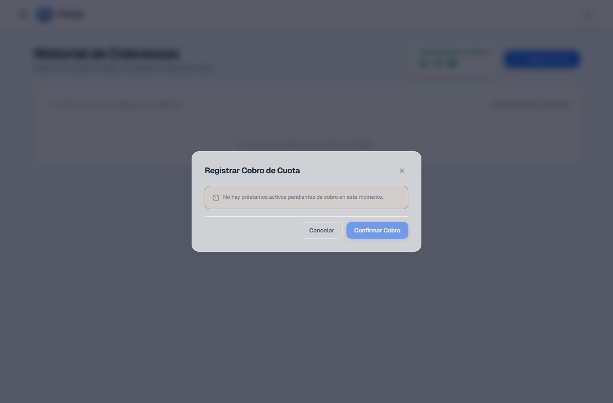
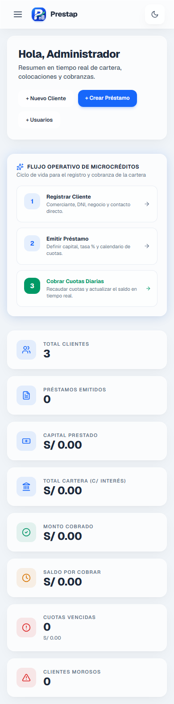
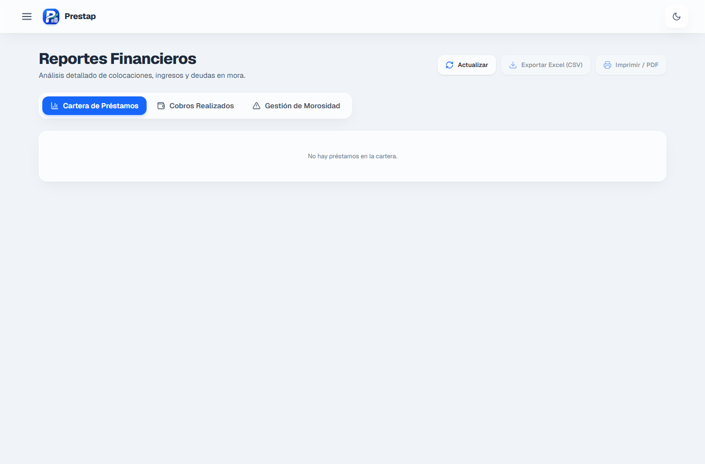
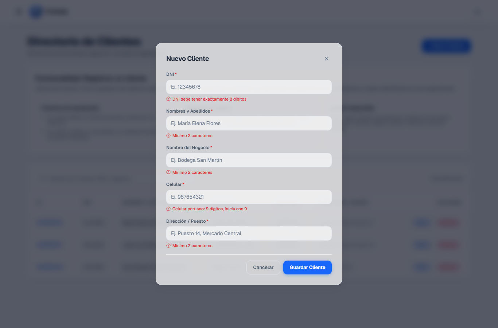

# Mantenimiento de Prestap según ISO/IEC 14764

Prestap es una plataforma web para gestionar clientes, préstamos, cobranzas y
reportes financieros. Los siguientes escenarios son ejemplos hipotéticos de
cómo los cuatro tipos de mantenimiento pueden aplicarse a este sistema.

## Mantenimientos

### Correctivo

Si al registrar una cuota el historial no reflejara el pago, se corregiría el
fallo del flujo de cobro y se comprobaría que el pago quede registrado una sola
vez.

*La instancia capturada no tiene préstamos activos; la imagen muestra el módulo,
no una falla real.*

### Adaptativo

Ante un cambio en Chrome o Android que alterara la navegación, se adaptaría y
verificaría el dashboard para conservar el acceso a las funciones en pantallas
móviles.

### Perfectivo

Para agilizar la preparación de balances, se podrían optimizar las consultas y
añadir filtros por periodo y tipo de reporte, conservando las exportaciones CSV
y PDF.

*El entorno de prueba no contiene préstamos, por lo que el reporte aparece vacío.*

### Preventivo

Antes de que se almacenen datos incompletos, se reforzarían y probarían las
validaciones de DNI, celular y campos obligatorios, junto con pruebas de
regresión para evitar que una modificación futura las elimine.

## Evidencia

Las capturas se tomaron con Playwright y Chromium en una instancia local de
Prestap. Se difuminaron las filas de datos y se anonimizó el saludo del
dashboard. Las imágenes muestran las pantallas actuales relacionadas con cada
escenario; no afirman que los fallos o mejoras hipotéticos ya hayan ocurrido.
