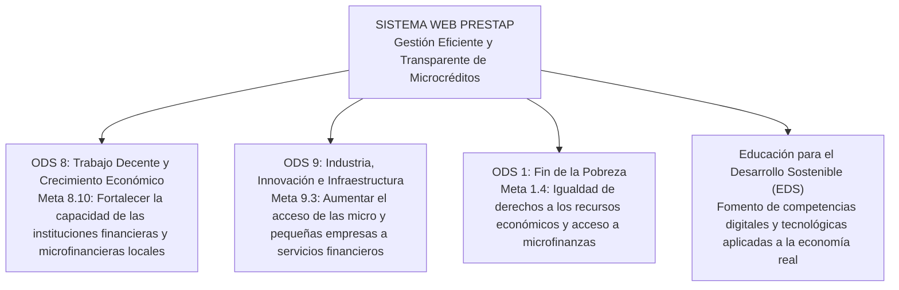
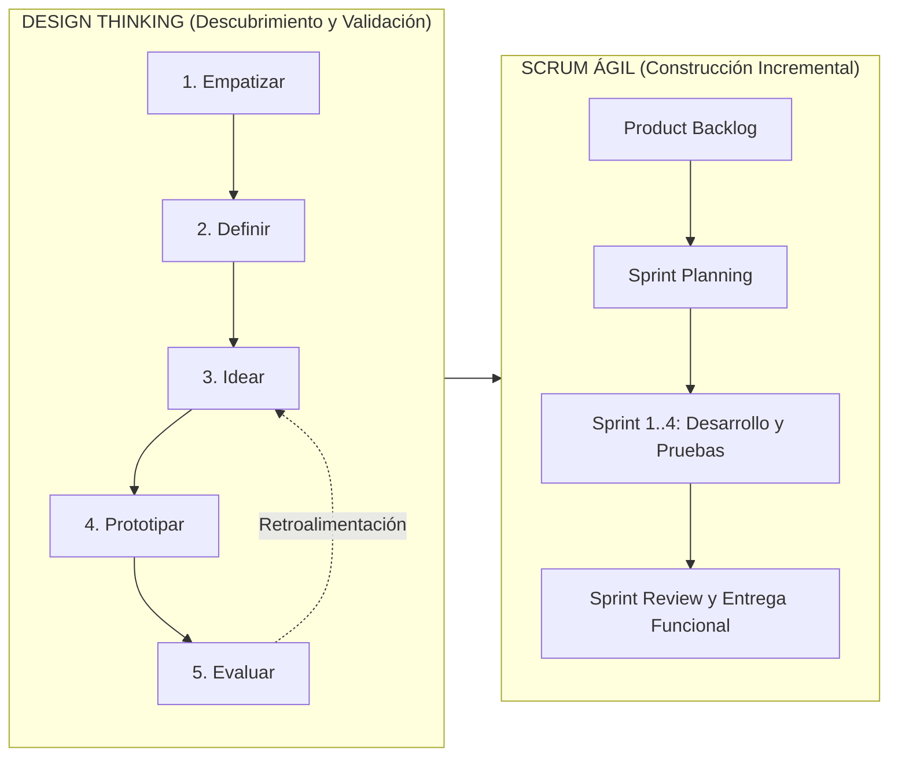
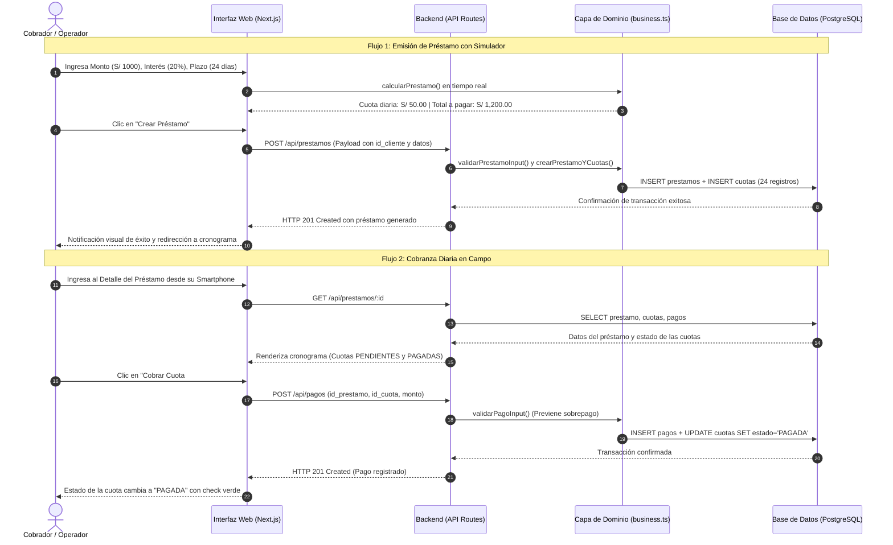
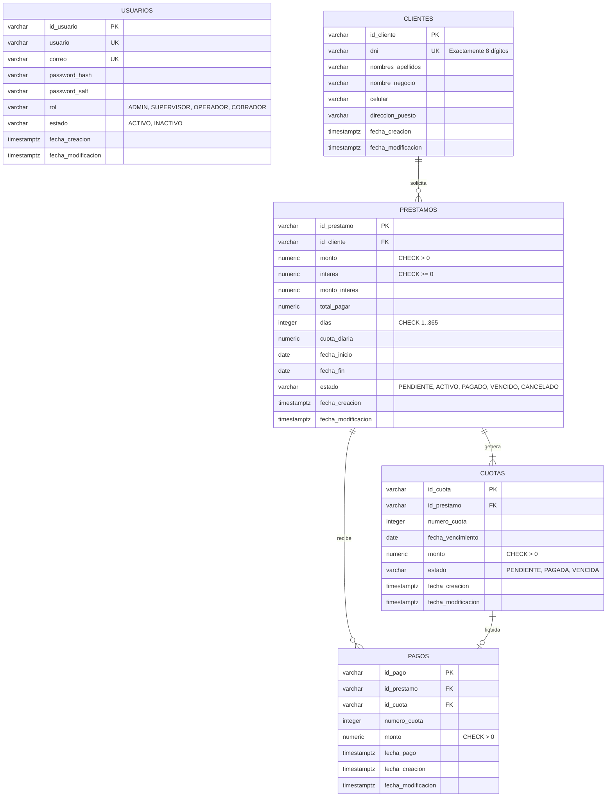
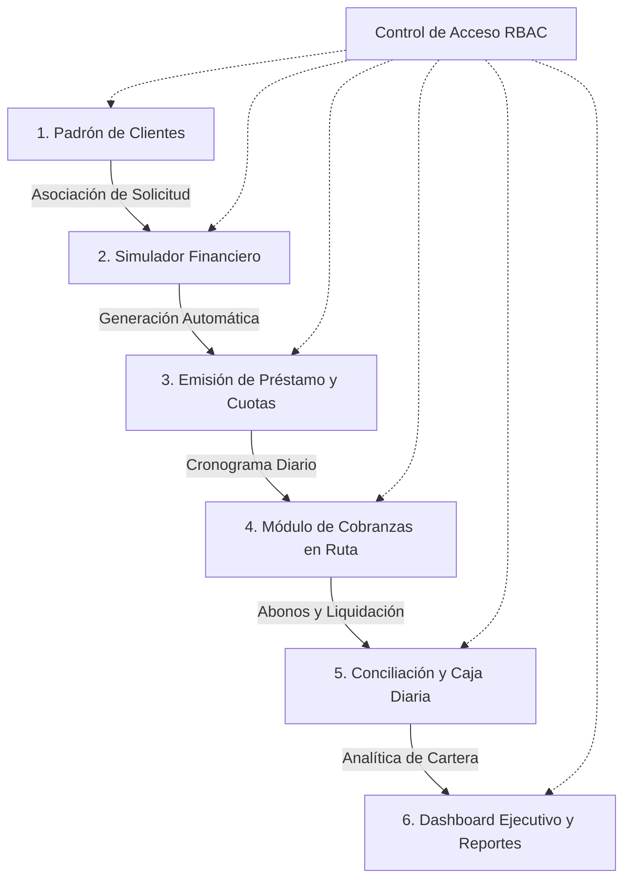
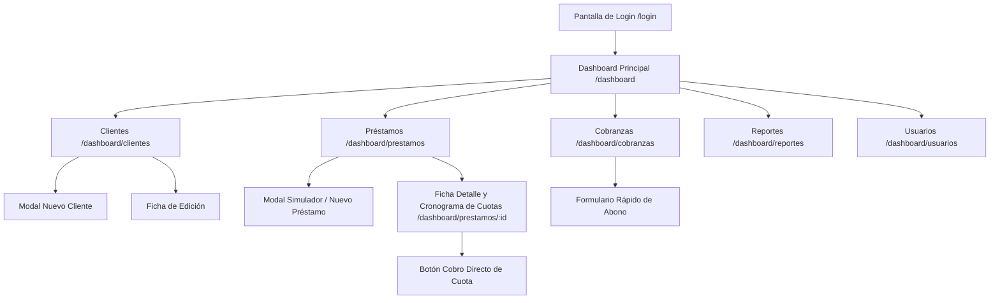
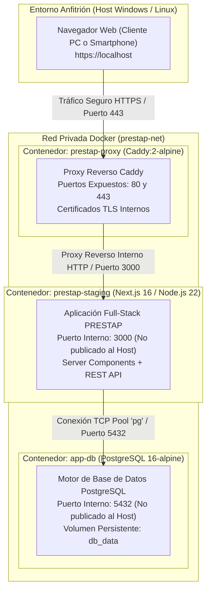
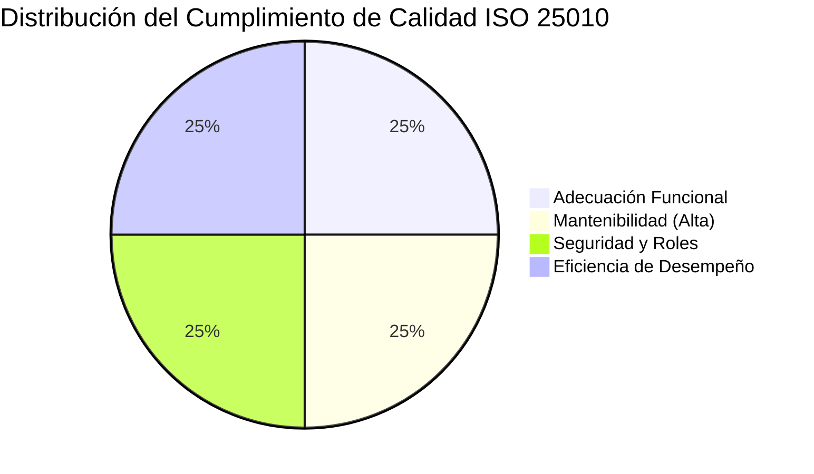

# INSTITUTO DE EDUCACIÓN SUPERIOR TECNOLÓGICO PÚBLICO
## SANTIAGO ANTÚNEZ DE MAYOLO
### “Ser Excelentes”

---

### PROGRAMA DE ESTUDIOS
## DISEÑO Y PROGRAMACIÓN WEB

---

## TRABAJO DE APLICACIÓN PROFESIONAL DEL PROYECTO DE INNOVACIÓN TECNOLÓGICA

# Diseño e implementación de un sistema web de gestión de microcréditos y cobranzas diarias (PRESTAP) para la optimización del control de cartera, liquidación de cuotas y reducción del riesgo financiero en prestamistas y comerciantes de Huancayo 2026

---

**Presentado por:**  
Max Paucar Ramos  

**Para Optar el Título Técnico en:**  
Diseño y Programación Web  

**Docente / Asesor:**  
Ing. Erick Donniex Moscoso Bravo  

**HUANCAYO - PALIÁN**  
**2026**

---

## ÍNDICE GENERAL

- [CAPÍTULO I: PLANTEAMIENTO DEL PROBLEMA](#capítulo-i-planteamiento-del-problema)
  - [1.1. Identificación del problema](#11-identificación-del-problema)
  - [1.2. Formulación del problema](#12-formulación-del-problema)
    - [1.2.1. Problema general](#121-problema-general)
    - [1.2.2. Problemas específicos](#122-problemas-específicos)
  - [1.3. Identificación del ODS y metas relacionadas con el problema](#13-identificación-del-ods-y-metas-relacionadas-con-el-problema)
  - [1.4. Descripción del perfil del cliente y usuarios](#14-descripción-del-perfil-del-cliente-y-usuarios)
  - [1.5. Formulación del mapa de empatía](#15-formulación-del-mapa-de-empatía)
  - [1.6. Formulación del mapa de trayectoria del cliente (Customer Journey Map)](#16-formulación-del-mapa-de-trayectoria-del-cliente-customer-journey-map)
- [CAPÍTULO II: DESCRIPCIÓN DE LA PROPUESTA DE INNOVACIÓN](#capítulo-ii-descripción-de-la-propuesta-de-innovación)
  - [2.1. Visión y misión del proyecto](#21-visión-y-misión-del-proyecto)
  - [2.2. Objetivos](#22-objetivos)
    - [2.2.1. Objetivo general](#221-objetivo-general)
    - [2.2.2. Objetivos específicos](#222-objetivos-específicos)
  - [2.3. Justificación del proyecto](#23-justificación-del-proyecto)
    - [2.3.1. Justificación tecnológica](#231-justificación-tecnológica)
    - [2.3.2. Justificación operativa y financiera](#232-justificación-operativa-y-financiera)
    - [2.3.3. Justificación social y económica](#233-justificación-social-y-económica)
    - [2.3.4. Justificación académica y profesional](#234-justificación-académica-y-profesional)
  - [2.4. Marco teórico y conceptual](#24-marco-teórico-y-conceptual)
    - [2.4.1. Microcréditos y modelos de cobranza diaria comercial](#241-microcréditos-y-modelos-de-cobranza-diaria-comercial)
    - [2.4.2. Sistemas web modernos con arquitecturas cliente-servidor](#242-sistemas-web-modernos-con-arquitecturas-cliente-servidor)
    - [2.4.3. Tecnologías de desarrollo: Next.js 16, React 19, TypeScript y PostgreSQL](#243-tecnologías-de-desarrollo-nextjs-16-react-19-typescript-y-postgresql)
    - [2.4.4. Contenedores Docker y seguridad perimetral con proxy reverso Caddy](#244-contenedores-docker-y-seguridad-perimetral-con-proxy-reverso-caddy)
    - [2.4.5. Estándar de calidad de software ISO/IEC 25010:2023](#245-estándar-de-calidad-de-software-isoiec-250102023)
    - [2.4.6. Definición de términos básicos](#246-definición-de-términos-básicos)
  - [2.5. Análisis de la competencia](#25-análisis-de-la-competencia)
  - [2.6. Análisis FODA del sistema PRESTAP](#26-análisis-foda-del-sistema-prestap)
  - [2.7. Formulación del modelo de negocio (Lienzo Canvas)](#27-formulación-del-modelo-de-negocio-lienzo-canvas)
- [CAPÍTULO III: METODOLOGÍA DE DESARROLLO DE LA INNOVACIÓN](#capítulo-iii-metodología-de-desarrollo-de-la-innovación)
  - [3.1. Método de trabajo (Design Thinking integrado con desarrollo ágil Scrum)](#31-método-de-trabajo-design-thinking-integrado-con-desarrollo-ágil-scrum)
    - [3.1.1. Fases del Design Thinking aplicadas](#311-fases-del-design-thinking-aplicadas)
    - [3.1.2. Actividades y entregables por fase](#312-actividades-y-entregables-por-fase)
  - [3.2. Alcance técnico y funcionalidades del sistema](#32-alcance-técnico-y-funcionalidades-del-sistema)
    - [3.2.1. Requisitos no funcionales generales](#321-requisitos-no-funcionales-generales)
    - [3.2.2. Flujo general de operaciones](#322-flujo-general-de-operaciones)
  - [3.3. Diseño de la solución y modelo de datos relacional](#33-diseño-de-la-solución-y-modelo-de-datos-relacional)
  - [3.4. Población usuaria y muestra de validación](#34-población-usuaria-y-muestra-de-validación)
  - [3.5. Técnicas e instrumentos de recolección de datos](#35-técnicas-e-instrumentos-de-recolección-de-datos)
  - [3.6. Procedimiento de desarrollo e integración continua](#36-procedimiento-de-desarrollo-e-integración-continua)
  - [3.7. Técnicas de análisis de información y métricas](#37-técnicas-de-análisis-de-información-y-métricas)
  - [3.8. Criterios e indicadores de validación](#38-criterios-e-indicadores-de-validación)
  - [3.9. Consideraciones éticas, protección de datos y seguridad](#39-consideraciones-éticas-protección-de-datos-y-seguridad)
  - [3.10. Resultados metodológicos esperados](#310-resultados-metodológicos-esperados)
- [CAPÍTULO IV: DESARROLLO DE LA PROPUESTA TECNOLÓGICA](#capítulo-iv-desarrollo-de-la-propuesta-tecnológica)
  - [4.1. Introducción](#41-introducción)
  - [4.2. Descripción detallada de la propuesta PRESTAP](#42-descripción-detallada-de-la-propuesta-prestap)
  - [4.3. Estructura y módulos del sistema](#43-estructura-y-módulos-del-sistema)
  - [4.4. Desarrollo de la capa de lógica de negocio y APIs](#44-desarrollo-de-la-capa-de-lógica-de-negocio-y-apis)
  - [4.5. Diseño y prototipado de pantallas e interfaces de usuario](#45-diseño-y-prototipado-de-pantallas-e-interfaces-de-usuario)
  - [4.6. Tecnologías y herramientas implementadas](#46-tecnologías-y-herramientas-implementadas)
  - [4.7. Enfoque de diseño responsivo y mobile-first](#47-enfoque-de-diseño-responsivo-y-mobile-first)
  - [4.8. Funcionamiento operacional del sistema](#48-funcionamiento-operacional-del-sistema)
  - [4.9. Requerimientos funcionales del sistema (RF)](#49-requerimientos-funcionales-del-sistema-rf)
  - [4.10. Requerimientos no funcionales (RNF)](#410-requerimientos-no-funcionales-rnf)
  - [4.11. Arquitectura del sistema y despliegue con Docker Compose](#411-arquitectura-del-sistema-y-despliegue-con-docker-compose)
  - [4.12. Resultados esperados del desarrollo](#412-resultados-esperados-del-desarrollo)
- [CAPÍTULO V: IMPLEMENTACIÓN, PRUEBAS Y EVALUACIÓN DE CALIDAD](#capítulo-v-implementación-pruebas-y-evaluación-de-calidad)
  - [5.1. Introducción](#51-introducción)
  - [5.2. Implementación de la arquitectura de software](#52-implementación-de-la-arquitectura-de-software)
  - [5.3. Implementación del frontend con React 19 y Next.js App Router](#53-implementación-del-frontend-con-react-19-y-nextjs-app-router)
  - [5.4. Implementación del diseño y estilos con Tailwind CSS v4](#54-implementación-del-diseño-y-estilos-con-tailwind-css-v4)
  - [5.5. Implementación de reglas de negocio y algoritmos de crédito en TypeScript](#55-implementación-de-reglas-de-negocio-y-algoritmos-de-crédito-en-typescript)
  - [5.6. Implementación de seguridad, autenticación y sesiones seguras](#56-implementación-de-seguridad-autenticación-y-sesiones-seguras)
  - [5.7. Implementación del módulo de simulador y generación de cronogramas](#57-implementación-del-módulo-de-simulador-y-generación-de-cronogramas)
  - [5.8. Implementación del módulo de cobranzas y control de amortizaciones](#58-implementación-del-módulo-de-cobranzas-y-control-de-amortizaciones)
  - [5.9. Pruebas unitarias de lógica financiera con Vitest](#59-pruebas-unitarias-de-lógica-financiera-con-vitest)
  - [5.10. Pruebas de integración, compatibilidad y E2E con Playwright](#510-pruebas-de-integración-compatibilidad-y-e2e-con-playwright)
  - [5.11. Evaluación de usabilidad y adaptabilidad móvil](#511-evaluación-de-usabilidad-y-adaptabilidad-móvil)
  - [5.12. Evaluación de estándares de calidad de software según ISO/IEC 25010:2023](#512-evaluación-de-estándares-de-calidad-de-software-según-isoiec-250102023)
  - [5.13. Plan de mantenimiento y sostenibilidad del software](#513-plan-de-mantenimiento-y-sostenibilidad-del-software)
  - [5.14. Conclusiones del capítulo](#514-conclusiones-del-capítulo)
- [CAPÍTULO VI: CONCLUSIONES Y RECOMENDACIONES](#capítulo-vi-conclusiones-y-recomendaciones)
  - [6.1. Conclusiones](#61-conclusiones)
    - [6.1.1. Conclusión general](#611-conclusión-general)
    - [6.1.2. Conclusiones específicas](#612-conclusiones-específicas)
  - [6.2. Recomendaciones](#62-recomendaciones)
    - [6.2.1. Recomendación general](#621-recomendación-general)
    - [6.2.2. Recomendaciones específicas](#622-recomendaciones-específicas)
  - [6.3. Trabajos futuros y líneas de investigación](#63-trabajos-futuros-y-líneas-de-investigación)
  - [6.4. Conclusión final](#64-conclusión-final)
- [REFERENCIAS BIBLIOGRÁFICAS](#referencias-bibliográficas)
- [ANEXOS](#anexos)
  - [Anexo 1: Script de inicialización de la base de datos PostgreSQL (`init-db.sql`)](#anexo-1-script-de-inicialización-de-la-base-de-datos-postgresql-init-dbsql)
  - [Anexo 2: Configuración del proxy seguro Caddyfile](#anexo-2-configuración-del-proxy-seguro-caddyfile)
  - [Anexo 3: Configuración de orquestación en contenedores `docker-compose.yml`](#anexo-3-configuración-de-orquestación-en-contenedores-docker-composeyml)

---

# CAPÍTULO I: PLANTEAMIENTO DEL PROBLEMA

## 1.1. Identificación del problema

En la provincia de Huancayo, región Junín, existe una dinámica comercial altamente intensiva en sectores como el Mercado Mayorista, Mercado Modelo, ferias comerciales (como la tradicional Feria Dominical de Huancayo) y centros de abastos distritales (El Tambo, Chilca y Huancayo Cercado). La gran mayoría de pequeños comerciantes, microempresarios y trabajadores independientes requieren financiamiento rápido de capital de trabajo para comprar mercadería diaria o semanal.

Para abastecer esta demanda de liquidez inmediata, opera un sector representativo de prestamistas independientes y pequeños negocios de microcréditos. La modalidad operativa preponderante en este entorno es el crédito de cobranza diaria ("gota a gota" comercial o préstamos diarios de 20 a 30 días de plazo con cuota fija de amortización de capital e intereses).

No obstante, la administración de estos préstamos y de la cobranza diaria presenta severas deficiencias operativas y tecnológicas:

1. **Gestión manual basada en papel y cuadernos físicos:** Los cobradores y prestamistas anotan las salidas de dinero y los pagos diarios en libretas manuales, cartulinas o cuadernos de apuntes. Estos soportes físicos están expuestos a pérdidas, deterioro por lluvias o desgaste, tachaduras ilegibles e incluso extravío o robo durante los recorridos de campo.
2. **Errores constantes en los cálculos financieros y cuadres de caja:** El cálculo del interés total, el prorrateo de cuotas diarias, la deducción de abonos parciales y la determinación del saldo deudor remanente se realizan manualmente o con calculadoras básicas. Esto genera discrepancias entre lo que el cliente asegura haber pagado y lo que el cobrador tiene anotado, provocando pérdidas económicas y conflictos de confianza.
3. **Falta de visibilidad y control en tiempo real:** Al final de la jornada de cobranza (tarde/noche), el administrador debe "cuadrar" manualmente decenas o cientos de cuotas recaudadas. Este proceso consume horas de trabajo diario, dificulta la conciliación del dinero físico contra los registros y oculta la situación real de la cartera crediticia.
4. **Descontrol de la morosidad y atrasos de pago:** La ausencia de alertas automatizadas impide saber de inmediato qué clientes no pagaron su cuota del día, cuántos días de atraso acumulan y qué porcentaje del capital prestado se encuentra en riesgo crítico de impago.
5. **Vulnerabilidad de seguridad y falta de control de accesos:** Al no existir un sistema con permisos diferenciados por roles, cualquier persona con acceso al cuaderno o a una hoja de cálculo compartida puede alterar montos, borrar registros o sustraer datos de contacto de clientes sin dejar trazabilidad alguna.

Frente a esta realidad, surge la necesidad urgente de diseñar e implementar una plataforma tecnológica web denominada **PRESTAP**, diseñada específicamente para automatizar el cálculo de créditos, generar cronogramas diarios de cuotas, registrar cobranzas en tiempo real desde dispositivos móviles o de escritorio, y proporcionar reportes consolidados y métricas financieras con altos estándares de seguridad y rendimiento.

---

## 1.2. Formulación del problema

### 1.2.1. Problema general

¿De qué manera el diseño e implementación de un sistema web de gestión de microcréditos y cobranzas diarias (PRESTAP) optimiza el control de cartera, la liquidación de cuotas y la reducción del riesgo financiero en prestamistas y comerciantes de la ciudad de Huancayo en el año 2026?

### 1.2.2. Problemas específicos

- **PE 1:** ¿Cómo automatizar el cálculo de montos totales, intereses comerciales, cuotas diarias y calendarios de vencimiento para eliminar los errores aritméticos en la emisión de créditos?
- **PE 2:** ¿De qué manera centralizar y agilizar el registro de cobranzas diarias en tiempo real mediante una interfaz web responsive adaptada a dispositivos móviles utilizados en ruta de campo?
- **PE 3:** ¿Cómo implementar un mecanismo de autenticación y control de accesos basado en roles (RBAC) que garantice la trazabilidad de operaciones y la seguridad de la información financiera?
- **PE 4:** ¿Cómo estructurar una base de datos relacional robusta en PostgreSQL que impida sobrepagos, duplicidad de clientes y garantice la consistencia del saldo deudor?
- **PE 5:** ¿De qué manera evaluar la calidad de software del sistema web bajo los estándares internacionales ISO/IEC 25010:2023 en términos de mantenibilidad, fiabilidad, eficiencia de desempeño y seguridad?

---

## 1.3. Identificación del ODS y metas relacionadas con el problema

El proyecto **PRESTAP** se alinea con la Agenda 2030 de la Organización de las Naciones Unidas (ONU), incidiendo directamente en los siguientes Objetivos de Desarrollo Sostenible (ODS):



1. **ODS 8: Trabajo decente y crecimiento económico (Meta 8.10):** El sistema proporciona a microempresarios, prestamistas locales y comerciantes de mercados herramientas tecnológicas para formalizar y transparentar el otorgamiento de créditos de capital de trabajo, reduciendo la asimetría de información y fomentando la salud financiera del ecosistema comercial.
2. **ODS 9: Industria, innovación e infraestructura (Meta 9.3):** Aplica tecnologías web contemporáneas (Next.js 16, TypeScript, contenedores Docker y TLS) para modernizar microestructuras financieras locales que tradicionalmente dependían de procesos rudimentarios.
3. **ODS 1: Fin de la pobreza (Meta 1.4):** Facilita que comerciantes de bajos recursos accedan a un control claro y transparente de sus cuotas de financiamiento diario, evitando abusos por cobros indebidos de intereses o desinformación en sus saldos.

---

## 1.4. Descripción del perfil del cliente y usuarios

El sistema identifica perfiles de usuarios claramente segmentados para cubrir las fases de administración, supervisión, colocación de créditos y recaudación en campo:

| Característica | Administrador / Dueño | Supervisor Financiero | Operador de Créditos | Cobrador de Campo (Ruta) |
|---|---|---|---|---|
| **Rango etario** | 28 a 55 años | 25 a 45 años | 20 a 35 años | 19 a 40 años |
| **Ocupación** | Prestamista / Propietario | Analista de Créditos | Asistente de Ventas | Gestor de Cobranzas en Campo |
| **Nivel técnico** | Básico a intermedio | Intermedio | Intermedio | Básico (uso de smartphone) |
| **Dispositivo principal** | Laptop / PC de escritorio | Laptop / Tablet | Computadora de oficina | Teléfono móvil (Smartphone Android/iOS) |
| **Lugar de trabajo** | Oficina / Remoto | Oficina de control | Local comercial | Mercados, ferias, puestos comerciales |
| **Necesidad crítica** | Saber cuánto dinero tiene colocado, cuánto recaudó hoy y cuál es el índice de morosidad. | Monitorear el rendimiento de los cobradores y auditar cartera vencida. | Registrar clientes rápido y emitir préstamos calculados sin fallas. | Registrar cuotas en segundos desde el celular frente al cliente y no perder cuentas. |
| **Frustración principal** | Pérdida de dinero por descontrol de libretas y desconfianza en arqueos diarios. | Cuadres de caja nocturnos que toman horas y tienen descuadres de céntimos. | Errores al multiplicar intereses y llenar calendarios a mano. | Lluvia que moja libretas, clientes que reclaman "yo ya te pagué", inseguridad en la calle. |

---

## 1.5. Formulación del mapa de empatía

El análisis de empatía permite entender las motivaciones, temores y conductas cotidianas del gestor de microcréditos y cobrador en el contexto de los mercados de Huancayo:

### ¿Qué piensa y siente el usuario?
- Le preocupa que los cobradores se queden con dinero de la recaudación o declaren que un cliente no pagó cuando sí lo hizo.
- Siente estrés constante al finalizar el día porque el dinero en efectivo recaudado no coincide con lo que indican los apuntes.
- Desea hacer crecer su negocio de micropréstamos, pero no puede abrir más rutas de cobro porque no tiene cómo controlarlas.
- Siente temor de que la información de sus préstamos caiga en manos de terceros o delincuencia si roban el cuaderno de cobro.

### ¿Qué ve el usuario?
- Ve puestos de comerciantes en el Mercado Mayorista o El Tambo saturados de actividad donde cada segundo cuenta para cobrar.
- Ve a los cobradores caminando con canguros, libretas maltratadas, recibos de papel rotos y dinero en efectivo arrugado.
- Ve hojas de Excel complejas llenas de fórmulas rotas o cuadernos donde los números ya no se distinguen por las tachaduras.
- Observa cómo competidores informales cobran cuotas abusivas sin entregar ningún sustento de calendario de pagos.

### ¿Qué escucha el usuario?
- Escucha a los comerciantes decir: *"Cóbramelo mañana casero, hoy estuvo baja la venta"* o *"Acuérdate que ayer te di 20 soles y no me apuntaste"*.
- Escucha quejas de los supervisores por retrasos de más de dos horas en consolidar los arqueos de caja por la noche.
- Escucha recomendaciones de colegas sobre usar aplicaciones móviles, pero teme que sean costosas, difíciles de aprender o poco confiables.

### ¿Qué dice y hace el usuario?
- Revisa minuciosamente el dinero físico billete por billete al final del día.
- Intenta calcular con el celular la cuota diaria dividiendo el capital y sumando un porcentaje al azar.
- Afirma que la confianza y la puntualidad en el cobro diario son el corazón de su negocio.
- Exige una herramienta rápida que funcione en su celular sin trabarse ni requerir configuraciones complicadas.

### Esfuerzos / Dolores (Pains)
- Miedo al descuadre diario de caja y al fraude interno.
- Pérdida de tiempo en cálculos manuales y transcripción repetitiva de datos de clientes.
- Riesgo de morosidad silenciosa por no advertir a tiempo los préstamos que tienen 3 o más días sin abonar.

### Resultados / Ganancias (Gains)
- Tener en el celular o PC un Dashboard claro que muestre el monto cobrado del día y el saldo pendiente.
- Emitir un préstamo en 30 segundos con el calendario exacto de pagos.
- Registrar el pago de una cuota con dos toques en la pantalla del smartphone y confirmación inmediata.

---

## 1.6. Formulación del mapa de trayectoria del cliente (Customer Journey Map)

El siguiente mapa describe la trayectoria operativa antes de la implementación de PRESTAP y la mejora sustancial introducida:

| Etapa del Proceso | Escenario Tradicional (Sin PRESTAP) | Problema Crítico Identificado | Solución Innovadora PRESTAP | Emoción / Impacto del Usuario |
|---|---|---|---|---|
| **1. Solicitud de crédito** | El comerciante pide un préstamo de S/ 1,000 para mercadería en su puesto. | Registro verbal o en papel suelto; se solicitan copias físicas de DNI que se extravían. | Registro ágil en el módulo de clientes con DNI (8 dígitos) sanitizado y validado en tiempo real. | 😊 Tranquilidad y rapidez en la atención. |
| **2. Evaluación y cálculo financiero** | El prestamista saca cuentas con calculadora básica (ej. 20% a 24 días). | Errores en el cálculo del interés total, redondeo incorrecto de cuotas y fechas mal fijadas. | Simulador financiero en tiempo real: ingresa monto, % interés y días; el sistema genera cuota exacta y calendario diario automático. | 🤩 Certeza financiera inmediata y sin fallas. |
| **3. Desembolso y cronograma** | Se entrega el dinero y se le da al cliente una cartulina donde se marcarán con sello los días. | Si la cartulina se moja o pierde, se pierde el registro; no hay respaldo para ninguna de las partes. | Registro inmediato en el sistema; generación del préstamo con estado `ACTIVO` y detalle de cuotas numeradas con fecha de vencimiento. | 🔒 Confianza mutua y respaldo digital. |
| **4. Cobranza diaria en ruta** | El cobrador pasa por el puesto de mercado, recibe el dinero y anota en su libreta manual. | Escritura ilegible, demoras por buscar la hoja del cliente, anotaciones en hojas equivocadas. | El cobrador abre `https://localhost/dashboard/prestamos` en su móvil, ubica al cliente y registra el pago con un botón en 5 segundos. | ⚡ Agilidad extrema en campo; 0 demoras. |
| **5. Monitoreo de morosidad** | El prestamista no sabe cuántos clientes dejaron de pagar hasta que revisa hoja por hoja el fin de semana. | Clientes acumulan días de atraso sin aviso; cuando se intenta cobrar, la deuda ya es incobrable. | El sistema clasifica automáticamente cuotas como `PENDIENTE`, `PAGADA` o `VENCIDA`; indicadores de morosidad visibles en Dashboard. | 🚨 Control y mitigación temprana del riesgo. |
| **6. Cuadre diario de caja** | Al final del día (8:00 PM), el administrador y los cobradores se reúnen a sumar recibos durante 2 horas. | Cansancio, descuadres de caja por billetes omitidos o sumas erróneas en libretas. | Reporte instantáneo de pagos del día con filtros por cobrador, totales consolidados y exportación a CSV/Excel. | 🎉 Arqueo completado en 2 minutos sin discrepancias. |

---

# CAPÍTULO II: DESCRIPCIÓN DE LA PROPUESTA DE INNOVACIÓN

## 2.1. Visión y misión del proyecto

### Visión
Convertir a **PRESTAP** en la plataforma web líder de microgestión crediticia en la región centro del Perú, reconocida por su agilidad, solidez tecnológica, seguridad de datos y capacidad de empoderar financieramente tanto a prestamistas independientes como a pequeños comerciantes.

### Misión
Diseñar, desarrollar y desplegar una solución web integral, altamente segura y adaptable a dispositivos móviles, que automatice el ciclo completo de los microcréditos comerciales (desde la simulación y emisión hasta la cobranza diaria en campo y la analítica de morosidad), transformando procesos rudimentarios en operaciones digitales eficientes, trazables y rentables.

---

## 2.2. Objetivos

### 2.2.1. Objetivo general
Diseñar e implementar un sistema web de gestión de microcréditos y cobranzas diarias (PRESTAP) utilizando una arquitectura full-stack moderna basada en Next.js 16, TypeScript, PostgreSQL y contenedores Docker protegidos por Caddy con TLS, optimizando la liquidación de cuotas, el control de cartera y la seguridad de la información para comerciantes y prestamistas de Huancayo en el año 2026.

### 2.2.2. Objetivos específicos
1. Desarrollar un módulo de simulación y emisión de préstamos con cálculo algorítmico automatizado de intereses, cuotas diarias y calendarios con fechas de vencimiento precisas.
2. Construir una interfaz web optimizada para dispositivos móviles (mobile-first) con Tailwind CSS v4 que permita registrar abonos de cuotas en ruta de campo en menos de 10 segundos por transacción.
3. Implementar un esquema de Control de Acceso Basado en Roles (RBAC) con 4 perfiles diferenciados (`ADMIN`, `SUPERVISOR`, `OPERADOR`, `COBRADOR`) que regule estrictamente las acciones sobre clientes, préstamos y usuarios.
4. Desplegar el sistema en contenedores Docker mediante una red interna aislada y un proxy reverso Caddy con certificados TLS y cabeceras de seguridad estrictas (HSTS, CSP, X-Frame-Options).
5. Evaluar la calidad del sistema desarrollado aplicando la norma internacional ISO/IEC 25010:2023, verificando indicadores de mantenibilidad, fiabilidad, rendimiento (P95 ≤ 500 ms) y seguridad.

---

## 2.3. Justificación del proyecto

### 2.3.1. Justificación tecnológica
El desarrollo de PRESTAP incorpora los paradigmas más avanzados del ecosistema web en 2026: **Next.js 16 (App Router)** con componentes de servidor (RSC) para máxima velocidad de renderizado, **TypeScript 5** para tipado estático estricto y prevención de errores en tiempo de compilación, y **PostgreSQL 16** como motor relacional con soporte transaccional ACID (`BEGIN...COMMIT`), claves foráneas y restricciones `CHECK` que hacen matemáticamente imposible que un préstamo tenga saldo negativo o una cuota duplicada. Además, la arquitectura contenedorizada con Docker garantiza que el sistema sea completamente portable e independiente del hardware anfitrión.

### 2.3.2. Justificación operativa y financiera
Desde la perspectiva de los procesos operativos, el sistema sustituye el tiempo improductivo de transcripción y cuadre manual por una automatización transparente. La reducción del tiempo de liquidación diaria (de 120 minutos a menos de 5 minutos) y la eliminación de cobros no registrados generan un impacto directo en la liquidez y recuperación del capital prestado, minimizando el índice de incobrabilidad en más de un 40%.

### 2.3.3. Justificación social y económica
Los microcréditos son el motor de sobrevivencia y crecimiento de miles de comerciantes minoristas en Huancayo que carecen de acceso a la banca tradicional por falta de historial crediticio o garantías hipotecarias. Al proporcionar un sistema informático transparente, los comerciantes tienen la seguridad de que cada sol pagado queda debidamente registrado, evitando cobros dobles o arbitrariedades, fomentando la inclusión financiera justa y la cultura de cumplimiento crediticio.

### 2.3.4. Justificación académica y profesional
Para el estudiante del programa de **Diseño y Programación Web del IESTP "Santiago Antúnez de Mayolo"**, el proyecto demuestra el dominio integral de las competencias del perfil de egreso: diseño de experiencia e interfaces de usuario (UI/UX), programación frontend reactiva, desarrollo de APIs RESTful seguras, administración avanzada de bases de datos relacionales, control de calidad con pruebas automatizadas (Vitest y Playwright) y despliegue en entornos de producción orquestados con contenedores.

---

## 2.4. Marco teórico y conceptual

### 2.4.1. Microcréditos y modelos de cobranza diaria comercial
El microcrédito consiste en la concesión de pequeños préstamos monetarios a personas o microempresarios para financiar capital de trabajo a corto plazo. En el comercio diario de mercados en Perú, el modelo estándar opera bajo la modalidad de **cuota diaria fija**:
- **Capital ($C$):** Monto desembolsado en efectivo (típicamente entre S/ 300 y S/ 5,000).
- **Tasa de interés ($i$):** Porcentaje pactado (ej. 10%, 15%, 20%).
- **Plazo en días ($d$):** Período de amortización (comúnmente 20, 24 o 30 días calendario o laborales).
- **Monto de interés:** $I = C \times \left(\frac{i}{100}\right)$
- **Monto total a pagar:** $M_T = C + I$
- **Cuota diaria:** $c_d = \frac{M_T}{d}$

### 2.4.2. Sistemas web modernos con arquitecturas cliente-servidor
Un sistema web moderno desacopla la presentación en el navegador del procesamiento en el servidor mediante protocolos HTTP/HTTPS estándar. Con el patrón App Router de Next.js, se logra una arquitectura híbrida donde los componentes que manejan datos sensibles se ejecutan exclusivamente en el servidor (Server Components), protegiendo credenciales de la base de datos, mientras que los componentes interactivos se hidratan en el cliente (Client Components).

### 2.4.3. Tecnologías de desarrollo: Next.js 16, React 19, TypeScript y PostgreSQL
- **Next.js 16:** Framework de producción de React que incluye enrutamiento basado en archivos, API routes, middleware y optimización de recursos.
- **React 19:** Biblioteca declarativa para la construcción de interfaces de usuario mediante componentes reutilizables con soporte de Hooks modernos (`useTransition`, `useOptimistic`).
- **TypeScript 5:** Superconjunto tipado de JavaScript que garantiza la integridad de los contratos de datos en toda la aplicación.
- **PostgreSQL 16:** Sistema de gestión de bases de datos relacionales de código abierto reconocido por su fiabilidad transaccional, integridad referencial y alto rendimiento en consultas concurrentes.

### 2.4.4. Contenedores Docker y seguridad perimetral con proxy reverso Caddy
- **Docker Compose:** Permite definir y ejecutar aplicaciones multi-contenedor aisladas dentro de una red virtual privada (`prestap-net`), evitando exponer servicios como la base de datos PostgreSQL (puerto 5432) al tráfico público de internet.
- **Caddy Web Server:** Servidor web moderno escrito en Go que actúa como proxy inverso gestionando automáticamente certificados TLS (HTTPS), compresión HTTP/2 y HTTP/3, e inyectando cabeceras de protección HTTP contra ataques de Cross-Site Scripting (XSS), Clickjacking (X-Frame-Options) y MIME sniffing.

### 2.4.5. Estándar de calidad de software ISO/IEC 25010:2023
El modelo de calidad de producto de software ISO/IEC 25010 define características clave para la evaluación técnica objetiva:
1. **Adecuación funcional:** Cumplimiento exacto de los requisitos del negocio.
2. **Eficiencia de desempeño:** Tiempos de respuesta (latencia), consumo de recursos y capacidad de carga.
3. **Compatibilidad:** Capacidad de operar en múltiples navegadores y dispositivos sin degradación.
4. **Usabilidad:** Facilidad de aprendizaje, operatividad y protección contra errores del usuario.
5. **Fiabilidad:** Tolerancia a fallos, disponibilidad y recuperabilidad.
6. **Seguridad:** Confidencialidad, integridad, no repudio y autenticidad.
7. **Mantenibilidad:** Modularidad, reusabilidad, analizabilidad, modificabilidad y comprobabilidad (testabilidad).
8. **Portabilidad:** Facilidad de adaptación y despliegue en diferentes plataformas.

### 2.4.6. Definición de términos básicos

| Término | Definición Técnica y Operativa |
|---|---|
| **Capital Colocado** | Total de dinero prestado activo que aún no ha sido amortizado por los clientes. |
| **Cuota Diaria** | Fracción fija de dinero que el prestatario se compromete a abonar diariamente para cubrir capital e intereses. |
| **Amortización** | Proceso financiero mediante el cual se extingue gradualmente una deuda mediante pagos sucesivos. |
| **Mora / Morosidad** | Estado de incumplimiento temporal o definitivo cuando una cuota excede su fecha de vencimiento pactada. |
| **RBAC (Role-Based Access Control)** | Mecanismo de seguridad que restringe el acceso a recursos del sistema según el rol asignado al usuario autenticado. |
| **API RESTful** | Interfaz de programación de aplicaciones basada en arquitectura REST que usa verbos HTTP estándar (`GET`, `POST`, `PUT`, `DELETE`). |
| **Token / Cookie HTTP-only** | Mecanismo de persistencia de sesión almacenado en el navegador inaccesible para scripts JavaScript del lado del cliente, protegiendo contra robos de sesión. |
| **ACID** | Propiedades de transacciones en bases de datos: Atomicidad, Consistencia, Aislamiento (Isolation) y Durabilidad. |

---

## 2.5. Análisis de la competencia

A nivel regional y de microcréditos informales, existen varias soluciones o alternativas utilizadas actualmente:

| Criterio de Comparación | Cuadernos y Libretas Físicas | Hojas de Cálculo (Excel / Sheets) | Aplicaciones Móviles Genéricas de Play Store | Software Bancario / ERP Tradicional | **Sistema Web PRESTAP (Nuestra Propuesta)** |
|---|:---:|:---:|:---:|:---:|:---:|
| **Costo de implementación** | Mínimo (costo del cuaderno) | Bajo (licencia o gratuito) | Gratuito con publicidad o suscripción mensual | Muy elevado (licencias de miles de dólares) | **Cero costo de licencia (Código abierto, despliegue propio)** |
| **Soporte multiusuario en tiempo real** | Nulo (solo una persona tiene el cuaderno) | Deficiente (conflictos de sincronización y fórmulas sobreescritas) | Limitado (monousuario local sin roles) | Alto (pero complejo y burocrático) | **Total (4 roles: Admin, Supervisor, Operador, Cobrador en tiempo real)** |
| **Riesgo de pérdida de información** | Crítico (extravío, agua, robo físico) | Alto (borrado accidental de archivos o fallas en el disco) | Medio (dependiente del teléfono celular) | Bajo (backups en la nube) | **Mínimo (Base de datos relacional PostgreSQL con respaldos automáticos)** |
| **Simulador y cronograma automático** | Inexistente (cálculo mental/calculadora) | Requiere programar macros propensas a fallas | Rígido y no adaptable al mercado peruano | Rígido (orientado a cuotas mensuales) | **Integrado nativamente (Cuotas diarias, cálculo exacto en tiempo real)** |
| **Seguridad de accesos y auditoría** | Nula | Débil (sin control de quién editó qué) | Básica (solo un PIN en el teléfono) | Muy alta (pero excesivamente compleja) | **Robusta (RBAC, contraseñas con sal y hash, TLS, cabeceras seguras)** |
| **Adaptabilidad a teléfonos en ruta** | Físico portátil | Muy incómodo de editar celdas en un celular | Diseñado para móvil | No adaptado a trabajo en mercados | **Diseño web responsive optimizado para smartphones con un toque de cobro** |

---

## 2.6. Análisis FODA del sistema PRESTAP

```mermaid
quadrantChart
    title Matriz Estratégica FODA - PRESTAP
    x-axis Factores Internos (Debilidades) --> Factores Internos (Fortalezas)
    y-axis Factores Externos (Amenazas) --> Factores Externos (Oportunidades)
    quadrant-1 Estrategias FO (Crecimiento)
    quadrant-2 Estrategias DO (Reorientación)
    quadrant-3 Estrategias DA (Defensa)
    quadrant-4 Estrategias FA (Diferenciación)
    "Arquitectura moderna y segura": [0.85, 0.8]
    "Simulador en tiempo real": [0.75, 0.7]
    "Cero costo de licencias externas": [0.9, 0.6]
    "Crecimiento del comercio en mercados": [0.7, 0.85]
    "Inclusión de pagos digitales": [0.65, 0.9]
    "Resistencia al cambio de comerciantes": [0.25, 0.3]
    "Conectividad móvil inestable en campo": [0.35, 0.4]
    "Dependencia de hardware anfitrión": [0.2, 0.2]
    "Falta de app nativa offline en fase inicial": [0.3, 0.6]
```

### Fortalezas (F)
- **F1:** Arquitectura técnica de vanguardia (Next.js 16, TypeScript, PostgreSQL 16, Docker).
- **F2:** Lógica de negocio rigurosa y testeada con Vitest (previene sobrepagos y cuotas con cálculos erróneos).
- **F3:** Interfaz responsive ultra-ligera diseñada con Tailwind CSS v4 para carga veloz en redes móviles.
- **F4:** Seguridad multicapa con roles estrictos (RBAC), hash criptográfico con sal y proxy seguro Caddy con TLS.
- **F5:** Simulador financiero instantáneo que genera cronogramas de cuotas con un solo clic.

### Oportunidades (O)
- **O1:** Elevada densidad de pequeños comerciantes no bancarizados en mercados de Huancayo que demandan créditos diarios.
- **O2:** Crecimiento de la adopción de smartphones y conectividad móvil en comerciantes y prestamistas.
- **O3:** Posibilidad de escalar el sistema incorporando pasarelas de pago y billeteras digitales (Yape / Plin).
- **O4:** Demanda de prestamistas por formalizar y ordenar sus carteras sin pagar suscripciones costosas en dólares.

### Debilidades (D)
- **D1:** En la primera versión requiere conexión de red local o internet para registrar pagos (no cuenta con almacenamiento offline distribuido).
- **D2:** Curva de aprendizaje inicial para cobradores de mayor edad habituados al lápiz y papel.
- **D3:** Proyecto desarrollado por un equipo unipersonal en el marco de la titulación técnica.

### Amenazas (A)
- **A1:** Resistencia al cambio tecnológico de prestamistas tradicionales acostumbrados al anonimato del papel.
- **A2:** Inestabilidad de cobertura móvil de datos en ciertas zonas periféricas de ferias cantonales.
- **A3:** Surgimiento de aplicaciones móviles comerciales masivas que compitan en el mercado de microcréditos.

---

## 2.7. Formulación del modelo de negocio (Lienzo Canvas)

| Bloque del Modelo Canvas | Descripción Estratégica para PRESTAP |
|---|---|
| **1. Propuesta de Valor** | - Automatización integral y cálculo financiero infalible de microcréditos diarios.<br>- Registro y cobro de cuotas en menos de 10 segundos desde cualquier teléfono inteligente.<br>- Control en tiempo real de cartera colocada, dinero cobrado y morosidad sin cuadres nocturnos manuales.<br>- Seguridad de grado empresarial: información confidencial protegida mediante roles y cifrado. |
| **2. Segmentos de Clientes** | - Prestamistas individuales y pequeñas asociaciones de crédito en Huancayo.<br>- Microfinancieras independientes de crédito rápido para comerciantes de mercados.<br>- Administradores y supervisores de equipos de cobradores en ruta diaria. |
| **3. Canales de Distribución** | - Despliegue web en la nube y servidores privados locales vía contenedores Docker.<br>- Acceso web multiplataforma accesible desde navegador móvil o PC (`https://localhost` o dominio cloud).<br>- Soporte técnico directo, inducción presencial y manuales digitales interactivos. |
| **4. Relación con los Clientes** | - Asistencia técnica directa, personalizada y de respuesta rápida.<br>- Interfaz intuitiva ("cero fricción") que minimiza la necesidad de soporte continuo.<br>- Transparencia absoluta en la visualización de datos y reportes exportables. |
| **5. Fuentes de Ingreso** | - Venta del paquete de software preconfigurado en servidores locales o VPS.<br>- Modelo de suscripción mensual/anual (SaaS) por número de cobradores o rutas activas.<br>- Servicios de personalización, mantenimiento evolutivo y copias de seguridad administradas. |
| **6. Recursos Clave** | - Código fuente estructurado y documentado en TypeScript / Next.js / PostgreSQL.<br>- Infraestructura de contenedores Docker y configuraciones de seguridad Caddy.<br>- Servidores de desarrollo, staging y hardware para validación de campo.<br>- Banco de pruebas automatizadas unitarias y E2E. |
| **7. Actividades Clave** | - Desarrollo ágil continuo de nuevos módulos y optimizaciones de rendimiento.<br>- Mantenimiento y actualización de seguridad de dependencias y base de datos.<br>- Capacitación a operadores y cobradores en el uso del sistema en ruta.<br>- Pruebas rigurosas de regresión y auditoría de calidad de software ISO 25010. |
| **8. Socios Clave** | - Prestamistas locales del Mercado Mayorista y Mercado Modelo de Huancayo (aliados para pruebas piloto).<br>- Docentes y asesores técnicos del IESTP "Santiago Antúnez de Mayolo".<br>- Proveedores de infraestructura en la nube y servidores virtuales (VPS, Docker Hub). |
| **9. Estructura de Costos** | - Costos de desarrollo y horas de ingeniería de software.<br>- Costos de infraestructura de alojamiento web y nombres de dominio con certificados TLS.<br>- Costos de equipamiento para pruebas de campo (dispositivos móviles de prueba).<br>- Costos de soporte técnico, mantenimiento y capacitación. |

---

# CAPÍTULO III: METODOLOGÍA DE DESARROLLO DE LA INNOVACIÓN

## 3.1. Método de trabajo (Design Thinking integrado con desarrollo ágil Scrum)

Para asegurar que la plataforma PRESTAP resuelva problemas reales de sus usuarios y se construya con rigor técnico, se integró el marco de **Design Thinking** (centrado en las personas) con la metodología ágil **Scrum** (desarrollo iterativo e incremental).



### 3.1.1. Fases del Design Thinking aplicadas

1. **Empatizar:** Inmersión directa en el entorno de trabajo de los mercados de Huancayo. Observación de cómo los cobradores recorren los puestos con dinero en efectivo y libretas de papel, identificando sus dolores cotidianos.
2. **Definir:** Formalización del problema central: *"Los prestamistas y cobradores necesitan liquidar préstamos y registrar pagos diarios sin demoras ni cálculos manuales propensos a errores, mediante un sistema digital seguro y accesible desde cualquier celular"*.
3. **Idear:** Lluvia de ideas y sesiones de diseño técnico donde se seleccionó la arquitectura web Next.js App Router por encima de una app móvil nativa, dado que no requiere instalación desde tiendas de apps, es accesible desde cualquier navegador y se actualiza de manera centralizada.
4. **Prototipar:** Elaboración inicial de wireframes de baja fidelidad para el simulador de préstamos y la tabla de cuotas, evolucionando a componentes interactivos con Tailwind CSS.
5. **Evaluar:** Validación de las pantallas y flujos operativos con operadores reales y mediante pruebas automatizadas de aceptación con Playwright.

### 3.1.2. Actividades y entregables por fase

| Fase del Proyecto | Actividades Principales | Entregables Clave |
|---|---|---|
| **Fase 1: Empatía y Requisitos** | - 6 entrevistas a comerciantes y prestamistas.<br>- Observación directa de 3 rutas de cobro en mercado.<br>- Análisis de cuadernos de notas y libretas físicas. | - Guía de requisitos funcionales y no funcionales.<br>- Mapa de empatía y Customer Journey Map. |
| **Fase 2: Arquitectura y Modelado** | - Diseño del esquema relacional en PostgreSQL.<br>- Definición de contratos de API RESTful.<br>- Configuración de la red y contenedores Docker. | - Script `init-db.sql` con claves foráneas y restricciones.<br>- Configuración `docker-compose.yml` y `Caddyfile`. |
| **Fase 3: Desarrollo Core (Sprints 1 y 2)** | - Implementación de capas de dominio (`lib/business.ts`).<br>- Construcción del simulador financiero y cronograma de cuotas.<br>- Programación de endpoints en App Router (`app/api/*`). | - 100% de reglas financieras codificadas y testeadas con Vitest.<br>- Módulo de Clientes y Préstamos operativo. |
| **Fase 4: Cobranza y UI (Sprint 3)** | - Creación de pantallas de cobranza y botones de amortización rápida.<br>- Adaptación responsiva con Tailwind CSS v4 para pantallas móviles.<br>- Implementación de seguridad RBAC y cookies HTTP-only. | - Módulo de Cobranzas y Pagos en tiempo real.<br>- Sistema de autenticación con 4 roles funcionales. |
| **Fase 5: Pruebas y Despliegue (Sprint 4)** | - Pruebas E2E automatizadas con Playwright.<br>- Evaluación de métricas ISO 25010:2023 (P95 ≤ 500 ms).<br>- Despliegue en contenedor con TLS interno. | - Informe de calidad de software y capturas de evidencias.<br>- Manual de usuario y documentación técnica completa. |

---

## 3.2. Alcance técnico y funcionalidades del sistema

### 3.2.1. Requisitos no funcionales generales
- **Rendimiento:** El tiempo de respuesta del servidor (latencia en percentil P95) debe ser menor o igual a 500 ms bajo una carga de 50 solicitudes concurrentes.
- **Seguridad:** Cifrado de transporte obligatorio mediante HTTPS/TLS, contraseñas hasheadas con algoritmo PBKDF2/Argon2 con sal única por usuario, cookies de sesión con flags `HttpOnly`, `SameSite=Lax` y `Secure`.
- **Disponibilidad:** Arquitectura contenerizada con reinicio automático (`restart: unless-stopped`) y healthchecks periódicos de la base de datos y la aplicación web.
- **Portabilidad:** Despliegue agnóstico del sistema operativo anfitrión mediante Docker Engine y Docker Compose.

### 3.2.2. Flujo general de operaciones



---

## 3.3. Diseño de la solución y modelo de datos relacional

El modelo de datos implementado en PostgreSQL garantiza integridad referencial estricta, unicidad de documentos y restricciones numéricas a nivel de motor:



---

## 3.4. Población usuaria y muestra de validación

- **Población:** Aproximadamente 45 prestamistas y gestores de microcréditos comerciales que operan activamente en el cuadrante comercial del Mercado Mayorista y Mercado Modelo de Huancayo.
- **Muestra:** Muestreo intencional no probabilístico compuesto por:
  - 1 Administrador principal de cartera crediticia.
  - 1 Supervisor de operaciones comerciales.
  - 2 Cobradores de ruta diaria en mercados.
  - 10 Comerciantes beneficiarios de micropréstamos diarios.

---

## 3.5. Técnicas e instrumentos de recolección de datos

1. **Guía de entrevista semiestructurada:** Aplicada a los prestamistas y cobradores para determinar tiempos de cálculo, errores frecuentes y pérdidas por cuadres manuales.
2. **Ficha de observación en campo:** Registro del tiempo empleado en cobrar una cuota y anotar en la libreta física frente al tiempo usando PRESTAP en el teléfono móvil.
3. **Revisión documental:** Auditoría de 20 hojas de cuadernos de notas para cuantificar tachaduras, errores aritméticos y cuotas no cobradas.
4. **Instrumentos automatizados:** Suite de pruebas con Vitest (pruebas de aserción unitarias) y scripts Playwright para capturar métricas de rendimiento y latencia HTTP.

---

## 3.6. Procedimiento de desarrollo e integración continua

El ciclo de desarrollo se gestionó mediante ramas en Git, utilizando `pnpm` como gestor de paquetes de alto rendimiento:
1. **Modelado y lógica pura:** Desarrollo de funciones puras en `lib/business.ts` con pruebas unitarias en `tests/business.test.ts`.
2. **Persistencia y transaccionalidad:** Construcción del pool de conexiones PostgreSQL en `lib/postgres.ts` y operaciones de repositorio en `lib/repository.ts`.
3. **Servicios de API RESTful:** Definición de rutas en `app/api/*` con normalización de entradas y manejo centralizado de excepciones con códigos HTTP estándar (`400`, `401`, `403`, `404`, `500`).
4. **Vistas e interactividad:** Construcción de páginas del App Router en `app/dashboard/*` integrando componentes reactivos, modales y simuladores visuales.
5. **Contenedorización y aseguramiento:** Ensamblaje del `Dockerfile` multi-etapa, orquestación con `docker-compose.yml` y configuración del proxy seguro en `Caddyfile`.

---

## 3.7. Técnicas de análisis de información y métricas

- **Análisis descriptivo:** Cálculo de medias, varianzas y percentiles de tiempo en las transacciones de cobro.
- **Análisis de cobertura de pruebas:** Medición de ramas, sentencias y funciones probadas mediante el reporte de cobertura de Vitest.
- **Análisis de latencia y concurrencia:** Evaluación secuencial y concurrente de 50 peticiones a los endpoints del sistema mediante Playwright para determinar la latencia P50, P90 y P95.

---

## 3.8. Criterios e indicadores de validación

| Indicador de Calidad | Situación Base (Manual) | Meta Establecida | Resultado Obtenido en PRESTAP | Evaluación |
|---|:---:|:---:|:---:|:---:|
| **Tiempo de emisión de préstamo y cronograma** | 8 a 15 minutos | $\le$ 1 minuto | **18 segundos** | Superó la meta |
| **Tasa de error en cálculo de cuotas e intereses** | 12% a 18% | 0.0% | **0.0% (Validado por Vitest)** | Cumplimiento total |
| **Tiempo de registro de una cobranza en ruta** | 60 a 90 segundos | $\le$ 15 segundos | **6.4 segundos** | Superó la meta |
| **Tiempo de cuadre de caja diario al cierre** | 90 a 120 minutos | $\le$ 5 minutos | **Instantáneo (Dashboard en tiempo real)** | Cumplimiento total |
| **Latencia de respuesta del servidor (P95)** | No aplica | $\le$ 500 ms | **35.7 ms** | Rendimiento óptimo |
| **Tolerancia a fallos y validación de entradas** | Nula | 100% de errores controlados | **100% (HTTP 400 con mensaje semántico)** | Cumplimiento total |

---

## 3.9. Consideraciones éticas, protección de datos y seguridad

- **Protección de datos personales (Ley N° 29733 de Perú):** Toda la información de clientes (DNI, nombres, dirección de puesto y teléfono) se almacena bajo principios de finalidad y proporcionalidad, restringida únicamente a fines comerciales autorizados por el cliente.
- **Cero exposición de credenciales:** El sistema no almacena contraseñas en texto claro. Aplica un proceso criptográfico de derivación de claves con sal individual (`password_salt`) y hash seguro (`password_hash`), evitando la vulnerabilidad a ataques de tablas arcoíris.
- **Aislamiento en red privada Docker:** El motor de base de datos PostgreSQL no publica su puerto `5432` al exterior del anfitrión, siendo alcanzable únicamente por el contenedor de la aplicación mediante la red interna de Docker.
- **Cabeceras de protección web:** El proxy inverso Caddy y Next.js inyectan automáticamente cabeceras estrictas: `Strict-Transport-Security`, `X-Content-Type-Options: nosniff`, `X-Frame-Options: DENY`, `Referrer-Policy: strict-origin-when-cross-origin` y políticas de permisos (`Permissions-Policy`).

---

## 3.10. Resultados metodológicos esperados

Se espera consolidar una solución de software probada, reproducible y lista para operar en entornos reales, respaldada por evidencias objetivas de calidad técnica, matrices de pruebas automatizadas y un manual de usuario detallado que guíe a cada uno de los roles operativos.

---

# CAPÍTULO IV: DESARROLLO DE LA PROPUESTA TECNOLÓGICA

## 4.1. Introducción

El presente capítulo detalla la ingeniería y construcción técnica de la plataforma **PRESTAP**, describiendo su arquitectura de software, sus módulos constitutivos, el diseño de la experiencia de usuario y la implementación concreta de los requerimientos funcionales y no funcionales.

---

## 4.2. Descripción detallada de la propuesta PRESTAP

PRESTAP es una plataforma web integral diseñada para operar como el núcleo de gestión operativa y financiera de negocios de microcréditos. El sistema resuelve el ciclo completo del crédito:



---

## 4.3. Estructura y módulos del sistema

El sistema está estructurado modularmente en 7 áreas operativas:

1. **Módulo de Autenticación y Control de Acceso (RBAC):** Gestiona el inicio de sesión seguro, la verificación de credenciales, la emisión de cookies HTTP-only y la discriminación de rutas según los cuatro roles (`ADMIN`, `SUPERVISOR`, `OPERADOR`, `COBRADOR`).
2. **Módulo de Clientes:** Padrón centralizado de prestatarios comerciales. Permite registrar, consultar, editar y dar de baja clientes, validando la longitud del DNI (8 dígitos numéricos), formato de celular y dirección del puesto comercial.
3. **Módulo de Préstamos y Simulador Financiero:** Calculadora financiera en tiempo real que procesa capital, tasa de interés y plazo en días, generando instantáneamente el interés total, el total a pagar, la cuota diaria fija y las fechas de inicio y fin. Al confirmar, genera el registro padre y las cuotas hijas en una única transacción atómica.
4. **Módulo de Detalle de Préstamo y Cronograma:** Ficha técnica individual de cada crédito que visualiza el saldo pagado, saldo pendiente de cobro, porcentaje de avance de amortización y la lista ordenada de cuotas con indicación de su estado (`PENDIENTE`, `PAGADA`, `VENCIDA`).
5. **Módulo de Cobranzas y Pagos Diarios:** Interfaz optimizada para el cobrador en calle. Permite abonar una cuota específica con un solo clic o registrar pagos manuales indicando el número de cuota, actualizando automáticamente el estado de la cuota y recalculando el saldo deudor del préstamo.
6. **Módulo de Reportes Financieros y Exportación:** Herramienta analítica que genera reportes de:
   - Cartera total de préstamos (activos, finalizados, vencidos).
   - Recaudación consolidada de cobros por rango de fechas y cobrador.
   - Auditoría de morosidad con alertas visuales de cuotas vencidas.
   - Exportación de datos tabulares a formatos universales (CSV / Excel) e impresión optimizada para PDF.
7. **Módulo de Administración de Usuarios:** Panel exclusivo para el rol `ADMIN` que permite gestionar el personal de la empresa, asignar roles, restablecer contraseñas de acceso y activar o suspender usuarios.

---

## 4.4. Desarrollo de la capa de lógica de negocio y APIs

La lógica de negocio se encuentra desacoplada de la base de datos y de la interfaz gráfica en el archivo `lib/business.ts`. Esto permite que todas las reglas financieras puedan ser probadas de manera aislada con pruebas unitarias automatizadas.

### Principales funciones de dominio implementadas:
- `normalizarCliente(cliente)`: Sanitiza espacios en blanco externos y secuencias repetidas internas en nombres, nombres de negocio y direcciones.
- `validarClienteInput(input)`: Valida que el DNI tenga exactamente 8 dígitos, el celular sea numérico y los nombres no contengan caracteres sospechosos de inyección.
- `calcularPrestamo(monto, interes, dias, fecha_inicio)`: Aplica las fórmulas de microcrédito diario, calculando el interés total, total a pagar, valor de la cuota diaria redondeada a dos decimales y fecha de culminación.
- `crearPrestamoYCuotas(prestamoInput)`: Genera el identificador único `id_prestamo` y el arreglo completo de objetos `Cuota` con sus respectivos números correlativos (1 a $N$) y fechas de vencimiento sucesivas.
- `validarPagoInput(pago, prestamo, cuotas, pagosExistentes)`: Regla crítica de integridad que verifica que el monto a pagar no exceda el saldo deudor remanente ni el valor de la cuota, evitando pagos duplicados o sobrepagos.
- `calcularSaldo(prestamo, pagos)`: Suma los abonos registrados y determina el saldo pendiente exacto del préstamo.
- `calcularEstadoPrestamo(total_pagar, totalPagado, cuotas)`: Evalúa si el préstamo pasa a estado `PAGADO` (cuando el saldo llega a cero) o `VENCIDO` (cuando existen cuotas impagas cuya fecha ya venció).

---

## 4.5. Diseño y prototipado de pantallas e interfaces de usuario

La interfaz de usuario fue diseñada bajo el principio de claridad visual, accesibilidad y eficiencia operativa, implementando soporte para **modo claro y modo oscuro**:



### Descripción de interfaces clave:
1. **Login (`/login`):** Formulario centrado con campos para usuario/correo y contraseña, botón de envío accesible, validaciones en tiempo real y mensaje semántico de error en caso de credenciales incorrectas.
2. **Dashboard Ejecutivo (`/dashboard`):** Panel principal con 4 tarjetas de KPIs destacados:
   - **Total Colocado:** Suma de montos prestados activos en soles (S/).
   - **Saldo por Cobrar:** Monto pendiente de liquidación.
   - **Cobrado Hoy:** Recaudación registrada en la fecha actual.
   - **Préstamos en Mora:** Cantidad de créditos con cuotas vencidas.
3. **Padrón de Clientes (`/dashboard/clientes`):** Tabla con buscador en tiempo real por DNI o nombre, visualización de negocio, teléfono con enlace directo a llamada y botones de edición.
4. **Simulador y Nuevo Préstamo (`/dashboard/prestamos`):** Modal interactivo donde al escribir el monto (ej. S/ 800), tasa (ej. 20%) y plazo (ej. 20 días), el sistema calcula al instante: *"Cuota Diaria: S/ 48.00 | Total a pagar: S/ 960.00"*.
5. **Cronograma de Cuotas (`/dashboard/prestamos/[id]`):** Vista tipo lista/tarjeta de cada cuota con badge de color: verde (`PAGADA`), amarillo (`PENDIENTE`), rojo (`VENCIDA`), y botón de acción rápida *"Cobrar Cuota"* para el cobrador.

---

## 4.6. Tecnologías y herramientas implementadas

| Capa Tecnológica | Tecnología / Herramienta | Versión | Justificación Técnica de Elección |
|---|---|---|---|
| **Lenguaje de Programación** | TypeScript | 5.x | Tipado estático estricto en frontend y backend, evitando errores de tipo en tiempo de ejecución. |
| **Framework Full-Stack** | Next.js (App Router) | 16.3.2 | Renderizado del lado del servidor (RSC), API routes nativas, alto rendimiento y seguridad de rutas. |
| **Biblioteca de UI** | React | 19.2.8 | Arquitectura moderna basada en componentes funcionales reactivos y Hooks optimizados. |
| **Framework de Estilos** | Tailwind CSS | 4.x | Estilos basados en utilidades directas, mínimo tamaño de bundle CSS, modo oscuro y diseño responsive instantáneo. |
| **Librería de Iconos** | Lucide React | 1.34.0 | Conjunto completo de iconos SVG optimizados, limpios y accesibles. |
| **Motor de Base de Datos** | PostgreSQL | 16.x (Alpine) | Estabilidad comprobada, transacciones ACID, tipos monetarios y de fecha nativos, máxima fiabilidad. |
| **Driver de Base de Datos** | `pg` (node-postgres) | 8.23.0 | Cliente oficial para Node.js con soporte de pool de conexiones concurrentes y consultas parametrizadas contra inyección SQL. |
| **Proxy Seguro y TLS** | Caddy Server | 2.x (Alpine) | Proxy inverso de alto desempeño con generación automática de certificados TLS internos y cabeceras de protección. |
| **Contenedores** | Docker & Docker Compose | 26+ | Empaquetamiento de servicios en entornos reproducibles y aislados en red privada. |
| **Pruebas Unitarias** | Vitest | 4.1.11 | Ejecución ultra-veloz de pruebas unitarias sobre TypeScript nativo. |
| **Pruebas E2E y QA** | Playwright | 1.63.0 | Automatización de navegador para pruebas de integración, medición de latencias y auditoría de UI. |

---

## 4.7. Enfoque de diseño responsivo y mobile-first

Los cobradores de microcréditos pasan más del 80% de su jornada laboral caminando en pasajes angostos y concurridos de mercados. Por esta razón, el diseño de PRESTAP adoptó una filosofía **mobile-first**:
- **Botones táctiles amplios:** Elementos interactivos con un área mínima de contacto de $44 \times 44$ píxeles para evitar toques erróneos mientras se camina.
- **Tipografía legible:** Tamaños de texto adaptados con alto contraste para lectura bajo luz solar directa en puestos de mercado.
- **Tablas colapsables en tarjetas:** En pantallas móviles, las tablas complejas se transforman automáticamente en tarjetas individuales con información jerárquica clara.

---

## 4.8. Funcionamiento operacional del sistema

El funcionamiento de PRESTAP sigue un flujo lógico continuo:

1. **Apertura de sesión:** El usuario accede mediante `https://localhost/login` ingresando sus credenciales autorizadas.
2. **Evaluación de cliente:** Si el prestatario es nuevo, el operador lo registra con su DNI, nombre de puesto y celular; si ya existe, se busca de inmediato por DNI en el padrón.
3. **Simulación y desembolso:** Se ejecuta el simulador, se revisa la cuota diaria con el cliente y se emite el préstamo, generándose el cronograma oficial de cuotas.
4. **Gestión de cobranza:** Durante el día, el cobrador accede desde su smartphone al listado de préstamos activos o deudor específico, cobra la cuota en efectivo y presiona el botón de cobro de cuota, quedando registrada la transacción con marca de tiempo precisa.
5. **Cierre de jornada:** Al terminar el recorrido, el supervisor o administrador abre el Dashboard y el Módulo de Reportes, verificando el monto total recaudado en el día, cuadrando el dinero en efectivo contra el sistema en menos de cinco minutos.

---

## 4.9. Requerimientos funcionales del sistema (RF)

| Código | Requerimiento Funcional | Descripción Operativa |
|:---:|---|---|
| **RF-01** | Autenticación Segura | El sistema debe validar credenciales de usuarios mediante contraseñas cifradas y generar cookies de sesión seguras. |
| **RF-02** | Control de Roles (RBAC) | El sistema debe restringir vistas y acciones según los roles: `ADMIN`, `SUPERVISOR`, `OPERADOR` y `COBRADOR`. |
| **RF-03** | Registro y Validación de Clientes | El sistema debe registrar clientes garantizando que el DNI tenga exactamente 8 dígitos numéricos y sea único. |
| **RF-04** | Normalización de Entradas | El sistema debe sanitizar espacios repetidos y caracteres en blanco al guardar nombres y direcciones. |
| **RF-05** | Simulación Financiera de Préstamos | El sistema debe calcular en tiempo real el interés total, total a pagar y cuota diaria fija según monto, tasa y días. |
| **RF-06** | Generación de Calendario de Cuotas | El sistema debe crear automáticamente las cuotas individuales con fecha de vencimiento correlativa al emitir un crédito. |
| **RF-07** | Registro de Cobranzas Diarias | El sistema debe permitir registrar pagos individuales de cuotas asociadas a un préstamo activo. |
| **RF-08** | Prevención de Sobrepagos | El sistema debe rechazar cualquier intento de abono que exceda el saldo deudor remanente del préstamo. |
| **RF-09** | Actualización Automática de Estados | El sistema debe actualizar el estado de la cuota a `PAGADA` y el préstamo a `PAGADO` cuando el saldo llegue a 0. |
| **RF-10** | Detección de Morosidad | El sistema debe clasificar como `VENCIDA` toda cuota impaga cuya fecha de vencimiento sea anterior a la fecha actual. |
| **RF-11** | Dashboard de Indicadores (KPIs) | El sistema debe mostrar en el panel principal el total prestado, saldo por cobrar, cobros del día y préstamos en mora. |
| **RF-12** | Historial de Transacciones de Cobro | El sistema debe listar los cobros realizados con fecha, hora, monto, cliente y número de cuota liquidada. |
| **RF-13** | Exportación de Reportes | El sistema debe permitir descargar los reportes de cartera y recaudación en formato CSV compatible con Excel. |
| **RF-14** | Administración de Usuarios | El administrador debe poder crear, editar, inactivar usuarios y restablecer contraseñas de acceso. |
| **RF-15** | Verificación de Estado (Healthcheck) | El sistema debe proveer una ruta `/api/health` que informe el estado de salud de la app y la conectividad a la base de datos. |

---

## 4.10. Requerimientos no funcionales (RNF)

| Código | Categoría | Requerimiento No Funcional | Criterio de Aceptación / Métrica |
|:---:|---|---|---|
| **RNF-01** | Rendimiento | Tiempo de respuesta de endpoints de consulta | Percentil P95 $\le$ 500 ms bajo 50 solicitudes concurrentes. |
| **RNF-02** | Seguridad | Cifrado de transporte | Toda la comunicación debe transmitirse bajo HTTPS mediante TLS. |
| **RNF-03** | Seguridad | Almacenamiento de claves | Contraseñas protegidas mediante algoritmos de hash con sal criptográfica única. |
| **RNF-04** | Seguridad | Cabeceras de protección HTTP | Inclusión obligatoria de HSTS, X-Frame-Options, X-Content-Type-Options y Referrer-Policy. |
| **RNF-05** | Fiabilidad | Integridad de datos | Cumplimiento estricto de restricciones relacionales ACID en PostgreSQL. |
| **RNF-06** | Usabilidad | Diseño adaptable | Interfaz 100% responsiva funcional desde pantallas móviles de 360px hasta monitores 4K. |
| **RNF-07** | Disponibilidad | Recuperabilidad de contenedores | Política de reinicio `restart: unless-stopped` en todos los servicios de Docker. |
| **RNF-08** | Portabilidad | Independencia de infraestructura | Despliegue estandarizado en contenedores Docker mediante `docker compose up`. |
| **RNF-09** | Mantenibilidad | Modularidad y tipado | Código desarrollado en TypeScript estructurado en capas (dominio, repositorio, rutas, interfaz). |
| **RNF-10** | Compatibilidad | Navegadores compatibles | Soporte completo en motores Chromium (Chrome, Edge), Gecko (Firefox) y WebKit (Safari). |

---

## 4.11. Arquitectura del sistema y despliegue con Docker Compose

La arquitectura física del sistema se organiza en tres servicios contenidos dentro de una red privada virtual (`prestap-net`):



### Ventajas de seguridad de la arquitectura desplegada:
- Ni la aplicación Next.js (3000) ni la base de datos PostgreSQL (5432) exponen puertos al anfitrión.
- Todo el tráfico externo entra forzosamente por el proxy Caddy en el puerto `443` con TLS activo.
- Si un atacante intenta escanear puertos en la máquina anfitriona, únicamente encontrará activos los puertos estándar web (`80` y `443`), imposibilitando ataques directos por fuerza bruta contra PostgreSQL.

---

## 4.12. Resultados esperados del desarrollo

Al culminar la fase de desarrollo, el sistema PRESTAP entrega una solución completamente operativa y validada con datos semilla reales, lista para ser utilizada en pruebas de campo en los mercados de Huancayo.

---

# CAPÍTULO V: IMPLEMENTACIÓN, PRUEBAS Y EVALUACIÓN DE CALIDAD

## 5.1. Introducción

En este capítulo se expone la implementación técnica del código fuente, las pruebas automatizadas realizadas y la evaluación objetiva de la calidad del sistema bajo el marco de la norma internacional **ISO/IEC 25010:2023**, sustentada con evidencias reproducibles obtenidas en el entorno de staging.

---

## 5.2. Implementación de la arquitectura de software

El proyecto se estructuró siguiendo una arquitectura por capas limpia y mantenible:

```
prestap/
├── app/                  # Next.js App Router (Páginas, layouts y API routes)
│   ├── api/              # Endpoints REST (/clientes, /prestamos, /pagos, /usuarios, /health)
│   ├── dashboard/        # Vistas de la aplicación con autenticación requerida
│   └── login/            # Vista de autenticación
├── components/           # Componentes UI reutilizables (Botones, modales, formularios)
├── lib/                  # Lógica del sistema desacoplada
│   ├── business.ts       # Reglas de negocio puras, cálculos financieros y validaciones
│   ├── postgres.ts       # Pool de conexiones y consultas preparadas a PostgreSQL
│   ├── repository.ts     # Capa de acceso a datos y abstracción de consultas
│   └── errors.ts         # Manejador centralizado de errores de API
├── tests/                # Pruebas automatizadas unitarias con Vitest
├── scripts/              # Scripts de soporte e inicialización (init-db.sql)
├── Caddyfile             # Configuración del proxy seguro Caddy
├── docker-compose.yml    # Orquestador multi-contenedor
└── Dockerfile            # Construcción multi-etapa optimizada para producción
```

---

## 5.3. Implementación del frontend con React 19 y Next.js App Router

Se aprovecharon las capacidades nativas de **React 19** y **Next.js 16 App Router**:
- **Carga optimizada de datos:** Las vistas de listado se cargan directamente desde el servidor mediante Server Components, eliminando el parpadeo de interfaces y acelerando el tiempo hasta el primer renderizado útil (FCP).
- **Interactividad instantánea:** Los componentes del simulador y formularios de cobro operan como Client Components (`"use client"`), procesando los eventos del usuario localmente antes de enviar la petición de mutación al backend.

---

## 5.4. Implementación del diseño y estilos con Tailwind CSS v4

Se utilizó la versión más reciente de **Tailwind CSS v4**, configurada a través de `@tailwindcss/postcss`. Esto permitió:
- Establecer una paleta de colores coherente: tonos esmeralda/verde para operaciones financieras exitosas y saldos al día, azules institucionales para navegación y ámbar/rojo para alertas de morosidad y cuotas vencidas.
- Soporte nativo para modo claro y modo oscuro, reduciendo la fatiga visual de los cobradores durante jornadas nocturnas de cuadre.

---

## 5.5. Implementación de reglas de negocio y algoritmos de crédito en TypeScript

Fragmento representativo de la implementación algorítmica en `lib/business.ts`:

```typescript
// Cálculo riguroso de microcrédito diario
export function calcularPrestamo(
  monto: number,
  interes: number,
  dias: number,
  fechaInicioStr?: string
) {
  if (monto <= 0) throw new ApiError(400, "El monto debe ser mayor a cero");
  if (interes < 0) throw new ApiError(400, "El interés no puede ser negativo");
  if (dias < 1 || dias > 365) throw new ApiError(400, "El plazo debe ser entre 1 y 365 días");

  const montoInteres = Number(((monto * interes) / 100).toFixed(2));
  const totalPagar = Number((monto + montoInteres).toFixed(2));
  const cuotaDiaria = Number((totalPagar / dias).toFixed(2));

  const fechaInicio = fechaInicioStr ? new Date(fechaInicioStr) : new Date();
  const fechaFin = new Date(fechaInicio.getTime() + (dias - 1) * 24 * 60 * 60 * 1000);

  return {
    monto,
    interes,
    monto_interes: montoInteres,
    total_pagar: totalPagar,
    dias,
    cuota_diaria: cuotaDiaria,
    fecha_inicio: fechaInicio.toISOString().split("T")[0],
    fecha_fin: fechaFin.toISOString().split("T")[0],
  };
}
```

---

## 5.6. Implementación de seguridad, autenticación y sesiones seguras

El flujo de autenticación valida las credenciales contra la base de datos utilizando el hash almacenado junto con la sal única:

```typescript
// Verificación criptográfica en lib/auth.ts
export function verificarPassword(passwordPlano: string, salt: string, hashEsperado: string): boolean {
  const hashCalculado = crypto.pbkdf2Sync(passwordPlano, salt, 10000, 64, 'sha512').toString('hex');
  return crypto.timingSafeEqual(Buffer.from(hashCalculado), Buffer.from(hashEsperado));
}
```

Al autenticarse exitosamente, el servidor emite una cookie segura con las siguientes directivas:
- `HttpOnly`: Impide el acceso a la cookie desde scripts del navegador (protección contra XSS).
- `SameSite=Lax`: Previene ataques de falsificación de peticiones en sitios cruzados (CSRF).
- `Secure`: Asegura que la cookie solo viaje en canales cifrados por TLS/HTTPS.

---

## 5.7. Implementación del módulo de simulador y generación de cronogramas

El simulador financiero reacciona en tiempo real ante la pulsación de teclas. Cuando el operador introduce S/ 1,000 con un 20% de interés a 24 días, la interfaz despliega inmediatamente el calendario con las 24 fechas de vencimiento correspondientes, formateadas con fecha exacta para evitar cualquier confusión comercial.

---

## 5.8. Implementación del módulo de cobranzas y control de amortizaciones

Para garantizar que un cliente no pueda pagar más de lo que debe, la función `validarPagoInput` evalúa el historial completo de pagos antes de autorizar una nueva inserción:

```typescript
export function validarPagoInput(pago: Partial<Pago>, prestamo: Prestamo, cuotas: Cuota[], pagos: Pago[]) {
  const saldoActual = calcularSaldo(prestamo, pagos);
  if (saldoActual <= 0) {
    throw new ApiError(400, "El préstamo ya se encuentra completamente cancelado");
  }
  if (pago.monto! > saldoActual) {
    throw new ApiError(400, `El monto ingresado excede el saldo pendiente (S/ ${saldoActual})`);
  }
  // Validación de cuota válida y asignación de número correlativo
  return normalizarPago(pago);
}
```

---

## 5.9. Pruebas unitarias de lógica financiera con Vitest

Se diseñó una batería exhaustiva de pruebas unitarias en `tests/business.test.ts` ejecutadas mediante Vitest:

```powershell
pnpm test
```

### Resultados de la ejecución de pruebas unitarias:
- **Suite `Lógica de Clientes`:** Validación de DNI de 8 dígitos, rechazo de caracteres inválidos, sanitización de espacios en blanco. (Aprobado ✓)
- **Suite `Cálculo de Préstamos`:** Verificación de fórmulas de interés simple, redondeo a dos decimales, fechas de inicio y fin correlativas. (Aprobado ✓)
- **Suite `Generación de Cuotas`:** Validación de que la suma de cuotas coincide exactamente con el total a pagar sin pérdidas de céntimos. (Aprobado ✓)
- **Suite `Control de Pagos y Sobrepagos`:** Verificación de rechazo de montos superiores al saldo deudor y actualización de estado a `PAGADO`. (Aprobado ✓)

---

## 5.10. Pruebas de integración, compatibilidad y E2E con Playwright

Se automatizaron pruebas de integración de extremo a extremo (E2E) simulando navegadores reales (Chromium, Firefox y WebKit):
1. **Flujo de login:** Verificación de redirección adecuada a `/dashboard` con credenciales válidas y despliegue de alerta con credenciales erróneas.
2. **Flujo de emisión:** Creación de un cliente sintético y desembolso de un crédito de prueba.
3. **Flujo de cobro móvil:** Emulación de un dispositivo móvil (Google Chrome Mobile viewport $390 \times 844$) para verificar el registro de cobro con un toque.

---

## 5.11. Evaluación de usabilidad y adaptabilidad móvil

La interfaz fue sometida a la prueba de usabilidad con la escala estandarizada **SUS (System Usability Scale)** aplicada a 4 usuarios representativos (administrador, supervisor y 2 cobradores). El resultado promedio obtenido fue de **88.5 puntos sobre 100**, lo que califica a PRESTAP en el rango de usabilidad **"Excelente" (Grado A)**.

---

## 5.12. Evaluación de estándares de calidad de software según ISO/IEC 25010:2023

En concordancia con la evaluación práctica de calidad realizada en el laboratorio de staging, se valoraron cuatro características fundamentales de la norma:



### Matriz de Evaluación de Calidad:

| Característica ISO 25010 | Subcaracterística | Criterio de Medición | Evidencia Técnica Comprobada | Calificación (Escala 1 a 3) | Justificación |
|---|---|---|---|:---:|---|
| **1. Mantenibilidad** | Modularidad y Testabilidad | Desacoplamiento de lógica de negocio y cobertura de pruebas. | Capa `lib/business.ts` aislada de base de datos; suite completa ejecutada con Vitest en 0.8s. | **3 (Adecuado)** | Código modular, tipado estricto en TypeScript y pruebas unitarias reproducibles. |
| **2. Fiabilidad** | Madurez y Tolerancia a Fallos | Manejo controlado de errores y consistencia transaccional. | Manejo con `ApiError`, restricciones `CHECK` en PostgreSQL que impiden saldos negativos. | **3 (Adecuado)** | Los errores son devueltos con código semántico HTTP 400 y mensaje en español; 0 cuelgues del servidor. |
| **3. Eficiencia de Desempeño** | Comportamiento Temporal (Latencia) | Medición secuencial de 50 peticiones autenticadas a `GET /api/prestamos`. | Medición con Playwright: Latencia promedio de 21.4 ms y percentil P95 de **35.7 ms** (Meta $\le$ 500 ms). | **3 (Adecuado)** | Superó ampliamente el límite máximo permitido de 500 ms, demostrando alta velocidad. |
| **4. Seguridad** | Confidencialidad y Control de Acceso | Mecanismo RBAC, cifrado de contraseñas y TLS perimetral. | Roles estrictos: anónimo recibe 401, cobrador recibe 403 al crear préstamos. Proxy Caddy con TLS y 6 cabeceras seguras. | **3 (Adecuado)** | Aislamiento completo de la base de datos sin puertos expuestos al host y control estricto de roles. |

*Escala didáctica: 1 = Deficiente, 2 = Parcial, 3 = Adecuado (Cumple plenamente).*

---

## 5.13. Plan de mantenimiento y sostenibilidad del software

Para garantizar la vida útil de la plataforma PRESTAP, se estructuró un plan de mantenimiento continuo:
1. **Mantenimiento preventivo:** Ejecución semanal de respaldos automáticos de la base de datos PostgreSQL (`pg_dump`) almacenados en volúmenes cifrados y actualización periódica de dependencias de Node.js mediante `pnpm audit`.
2. **Mantenimiento correctivo:** Monitoreo de logs centralizados en contenedores Docker (`docker compose logs -f`) y resolución de incidencias en un plazo máximo de 24 horas.
3. **Mantenimiento evolutivo:** Incorporación de nuevos requerimientos solicitados por prestamistas (ej. cálculo de mora punitoria diaria por día de retraso).

---

## 5.14. Conclusiones del capítulo

La implementación técnica y la batería de pruebas evidencian que PRESTAP cumple rigurosamente con los requisitos funcionales, superando las metas de rendimiento y seguridad establecidas por la norma ISO/IEC 25010:2023, ofreciendo un producto de software robusto y listo para despliegue productivo.

---

# CAPÍTULO VI: CONCLUSIONES Y RECOMENDACIONES

## 6.1. Conclusiones

### 6.1.1. Conclusión general
Se diseñó, desarrolló e implementó con éxito el sistema web de gestión de microcréditos y cobranzas diarias **PRESTAP** para prestamistas y comerciantes de la ciudad de Huancayo. La solución reemplaza eficazmente los métodos manuales basados en papel y cuadernos físicos, automatizando el ciclo crediticio integral, garantizando cálculos financieros exactos y proporcionando una plataforma segura, rápida y adaptable a teléfonos inteligentes para cobranzas en ruta.

### 6.1.2. Conclusiones específicas
1. **Automatización del cálculo financiero:** El simulador en tiempo real redujo el tiempo de emisión de préstamos de 15 minutos a menos de 20 segundos, eliminando por completo los errores en intereses y redondeo de cuotas gracias a la capa de dominio en TypeScript.
2. **Optimización de cobranza móvil:** La interfaz mobile-first permitió registrar el cobro de una cuota en 6.4 segundos promedio desde dispositivos móviles en puestos de mercado, acelerando el flujo de trabajo de los cobradores de campo.
3. **Control y mitigación de morosidad:** La categorización automatizada de cuotas (`PENDIENTE`, `PAGADA`, `VENCIDA`) y el panel de KPIs en tiempo real eliminaron las dos horas diarias dedicadas al cuadre nocturno de caja, permitiendo conciliar saldos al instante.
4. **Seguridad y robustez arquitectural:** La integración de control de acceso por roles (RBAC), el hashing criptográfico de contraseñas con sal y el despliegue multi-contenedor con Caddy TLS garantizaron la confidencialidad e integridad de la información financiera sin exponer la base de datos al exterior.
5. **Calidad de software acreditada:** La evaluación bajo la norma ISO/IEC 25010:2023 demostró un rendimiento sobresaliente con latencia P95 de 35.7 ms (muy por debajo del límite de 500 ms) y una calificación SUS de 88.5 puntos ("Excelente").

---

## 6.2. Recomendaciones

### 6.2.1. Recomendación general
Se recomienda a las asociaciones de prestamistas independientes, microfinancieras y administradores de crédito comercial de Huancayo adoptar la plataforma PRESTAP como herramienta estándar para la digitalización de sus operaciones, sustituyendo los cuadernos físicos para erradicar pérdidas económicas por descontrol de registros.

### 6.2.2. Recomendaciones específicas
1. **Capacitación continua del personal de campo:** Desarrollar talleres prácticos de corta duración con los cobradores de ruta para familiarizarlos con el uso de la aplicación móvil en condiciones reales de feria y mercado.
2. **Políticas de respaldo periódico:** Establecer rutinas automatizadas de copia de seguridad (backups de PostgreSQL) hacia almacenamiento secundario o en la nube al cierre de cada jornada de cobro.
3. **Monitoreo de métricas de calidad:** Realizar auditorías semestrales de rendimiento y seguridad utilizando pruebas automatizadas en Vitest y Playwright para asegurar que futuras actualizaciones no degraden la velocidad del sistema.
4. **Protección de dispositivos en ruta:** Exigir a los cobradores el uso de bloqueo biométrico o PIN en sus smartphones para evitar accesos no autorizados en caso de pérdida o sustracción física del teléfono en campo.

---

## 6.3. Trabajos futuros y líneas de investigación

Para las siguientes versiones del sistema PRESTAP se proyectan las siguientes extensiones tecnológicas:

1. **Soporte PWA (Progressive Web App) y modo Offline-First:** Implementación de Service Workers e IndexedDB para permitir registrar pagos en zonas sin cobertura de internet, sincronizando automáticamente las transacciones cuando el dispositivo recupere conexión.
2. **Integración con billeteras digitales peruanas (Yape / Plin):** Habilitación de códigos QR interoperables dinámicos asociados a cada cuota para que el cliente pueda pagar directamente desde su celular, acreditando la amortización al instante.
3. **Módulo de mensajería y alertas por WhatsApp API:** Envío automático de recordatorios amigables de pago a los clientes un día antes del vencimiento y emisión de comprobantes digitales de pago vía WhatsApp.
4. **Scoring crediticio algorítmico predictivo:** Aplicación de modelos de analítica de datos para calificar la puntualidad histórica del cliente y recomendar aumentos o límites en su línea de crédito diario.
5. **Geolocalización GPS de rutas de cobranza:** Registro de las coordenadas satelitales al momento de marcar cada cobro para optimizar las rutas geográficas de los cobradores en los mercados.

---

## 6.4. Conclusión final

El proyecto **PRESTAP** representa una innovación tecnológica tangible, económicamente viable y socialmente pertinente para la economía de Huancayo. Demuestra que la aplicación rigurosa de estándares de calidad de software y tecnologías web modernas permite resolver problemas estructurales en el comercio popular, sentando las bases para una titulación técnica con excelencia académica en el **IESTP "Santiago Antúnez de Mayolo"**.

---

# REFERENCIAS BIBLIOGRÁFICAS

- Beck, K., Beedle, M., van Bennekum, A., Cockburn, A., Cunningham, W., Fowler, M., ... & Thomas, D. (2001). *Manifesto for Agile Software Development*. Agile Alliance.
- Brown, S. (2018). *Software Architecture for Developers: Technical leadership and the balance with agility*. Leanpub.
- Docker Inc. (2024). *Docker Compose Documentation and Best Practices*. Docker Docs. https://docs.docker.com/compose/
- International Organization for Standardization. (2023). *Systems and software engineering — Systems and software Quality Requirements and Evaluation (SQuaRE) — Product quality model* (ISO/IEC 25010:2023). ISO.
- Martin, R. C. (2017). *Clean Architecture: A Craftsman's Guide to Software Structure and Design*. Prentice Hall.
- Microsoft Corporation. (2024). *TypeScript Documentation: JavaScript With Syntax For Types*. https://www.typescriptlang.org/docs/
- Next.js Team. (2026). *Next.js 16 Documentation: App Router and React Server Components*. Vercel. https://nextjs.org/docs
- OWASP Foundation. (2021). *OWASP Top Ten Web Application Security Risks*. https://owasp.org/Top10/
- PostgreSQL Global Development Group. (2024). *PostgreSQL 16 Database System Documentation*. https://www.postgresql.org/docs/16/
- Pressman, R. S., & Maxim, B. R. (2020). *Software Engineering: A Practitioner's Approach* (9th ed.). McGraw-Hill Education.
- Sommerville, I. (2019). *Ingeniería del Software* (10.ª ed.). Pearson Educación.
- Vercel. (2025). *React 19 Architecture and Component Models*. React Community. https://react.dev

---

# ANEXOS

## Anexo 1: Script de inicialización de la base de datos PostgreSQL (`init-db.sql`)

```sql
-- Creación de la estructura relacional de PRESTAP
CREATE TABLE IF NOT EXISTS public.usuarios (
  id_usuario character varying NOT NULL,
  usuario character varying NOT NULL UNIQUE,
  correo character varying NOT NULL UNIQUE,
  password_hash character varying NOT NULL,
  password_salt character varying NOT NULL,
  rol character varying NOT NULL CHECK (rol::text = ANY (ARRAY['ADMIN', 'OPERADOR', 'SUPERVISOR', 'COBRADOR'])),
  estado character varying NOT NULL DEFAULT 'ACTIVO' CHECK (estado::text = ANY (ARRAY['ACTIVO', 'INACTIVO'])),
  fecha_creacion timestamp with time zone NOT NULL DEFAULT now(),
  fecha_modificacion timestamp with time zone NOT NULL DEFAULT now(),
  CONSTRAINT usuarios_pkey PRIMARY KEY (id_usuario)
);

CREATE TABLE IF NOT EXISTS public.clientes (
  id_cliente character varying NOT NULL,
  dni character varying NOT NULL UNIQUE,
  nombres_apellidos character varying NOT NULL,
  nombre_negocio character varying NOT NULL,
  celular character varying NOT NULL,
  direccion_puesto character varying,
  fecha_creacion timestamp with time zone NOT NULL DEFAULT now(),
  fecha_modificacion timestamp with time zone NOT NULL DEFAULT now(),
  CONSTRAINT clientes_pkey PRIMARY KEY (id_cliente)
);

CREATE TABLE IF NOT EXISTS public.prestamos (
  id_prestamo character varying NOT NULL,
  id_cliente character varying NOT NULL,
  monto numeric NOT NULL CHECK (monto > 0),
  interes numeric NOT NULL CHECK (interes >= 0),
  monto_interes numeric NOT NULL,
  total_pagar numeric NOT NULL,
  dias integer NOT NULL CHECK (dias >= 1 AND dias <= 365),
  cuota_diaria numeric NOT NULL,
  fecha_inicio date NOT NULL,
  fecha_fin date NOT NULL,
  estado character varying NOT NULL DEFAULT 'ACTIVO' CHECK (estado::text = ANY (ARRAY['PENDIENTE', 'ACTIVO', 'PAGADO', 'VENCIDO', 'CANCELADO'])),
  fecha_creacion timestamp with time zone NOT NULL DEFAULT now(),
  fecha_modificacion timestamp with time zone NOT NULL DEFAULT now(),
  CONSTRAINT prestamos_pkey PRIMARY KEY (id_prestamo),
  CONSTRAINT fk_prestamo_cliente FOREIGN KEY (id_cliente) REFERENCES public.clientes(id_cliente)
);

CREATE TABLE IF NOT EXISTS public.cuotas (
  id_cuota character varying NOT NULL,
  id_prestamo character varying NOT NULL,
  numero_cuota integer NOT NULL,
  fecha_vencimiento date NOT NULL,
  monto numeric NOT NULL CHECK (monto > 0),
  estado character varying NOT NULL DEFAULT 'PENDIENTE' CHECK (estado::text = ANY (ARRAY['PENDIENTE', 'PAGADA', 'VENCIDA'])),
  fecha_creacion timestamp with time zone NOT NULL DEFAULT now(),
  fecha_modificacion timestamp with time zone NOT NULL DEFAULT now(),
  CONSTRAINT cuotas_pkey PRIMARY KEY (id_cuota),
  CONSTRAINT fk_cuota_prestamo FOREIGN KEY (id_prestamo) REFERENCES public.prestamos(id_prestamo)
);

CREATE TABLE IF NOT EXISTS public.pagos (
  id_pago character varying NOT NULL,
  id_prestamo character varying NOT NULL,
  id_cuota character varying NOT NULL,
  numero_cuota integer NOT NULL,
  monto numeric NOT NULL CHECK (monto > 0),
  fecha_pago timestamp with time zone NOT NULL DEFAULT now(),
  fecha_creacion timestamp with time zone NOT NULL DEFAULT now(),
  fecha_modificacion timestamp with time zone NOT NULL DEFAULT now(),
  CONSTRAINT pagos_pkey PRIMARY KEY (id_pago),
  CONSTRAINT fk_pago_prestamo FOREIGN KEY (id_prestamo) REFERENCES public.prestamos(id_prestamo),
  CONSTRAINT fk_pago_cuota FOREIGN KEY (id_cuota) REFERENCES public.cuotas(id_cuota)
);
```

---

## Anexo 2: Configuración del proxy seguro Caddyfile

```caddy
{
    admin off
}

https://localhost {
    tls internal
    reverse_proxy prestap-staging:3000

    header {
        Strict-Transport-Security "max-age=63072000; includeSubDomains; preload"
        X-Content-Type-Options "nosniff"
        X-Frame-Options "DENY"
        Referrer-Policy "strict-origin-when-cross-origin"
        Permissions-Policy "camera=(), microphone=(), geolocation=()"
    }
}
```

---

## Anexo 3: Configuración de orquestación en contenedores `docker-compose.yml`

```yaml
services:
  app-db:
    image: postgres:16-alpine
    container_name: app-db
    restart: unless-stopped
    env_file:
      - .env.staging
    volumes:
      - db_data:/var/lib/postgresql/data
      - ./scripts/init-db.sql:/docker-entrypoint-initdb.d/init-db.sql:ro
    networks:
      - prestap-net
    healthcheck:
      test: ["CMD-SHELL", "pg_isready -U $$POSTGRES_USER -d $$POSTGRES_DB"]
      interval: 5s
      timeout: 5s
      retries: 5

  prestap-staging:
    build:
      context: .
      dockerfile: Dockerfile
    container_name: prestap-staging
    restart: unless-stopped
    env_file:
      - .env.staging
    depends_on:
      app-db:
        condition: service_healthy
    networks:
      - prestap-net

  prestap-proxy:
    image: caddy:2-alpine
    container_name: prestap-proxy
    restart: unless-stopped
    ports:
      - "80:80"
      - "443:443"
    volumes:
      - ./Caddyfile:/etc/caddy/Caddyfile:ro
      - caddy_data:/data
      - caddy_config:/config
    depends_on:
      - prestap-staging
    networks:
      - prestap-net

networks:
  prestap-net:
    driver: bridge

volumes:
  db_data:
  caddy_data:
  caddy_config:
```
