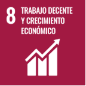
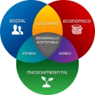
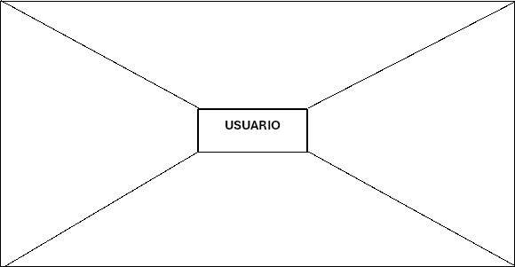

**INSTITUTO DE EDUCACION SUPERIOR TECNOLOGICO PUBLICO**

**SANTIAGO ANTUNEZ DE MAYOLO**

“Ser Excelentes”

**PROGRAMA DE ESTUDIOS**

**DISEÑO Y PROGRAMACIÓN WEB**

**TRABAJO DE APLICACIÓN PROFESIONAL DEL PROYECTO DE INNOVACIÓN TECNOLÓGICA**

Diseño y desarrollo de un sistema web de portafolio personal para mejorar la presentación de proyectos y competencias profesionales de estudiantes del PE de Diseño y Programación Web del IESTP “Santiago Antúnez de Mayolo” 2026

**Presentado:**

Serpa Quispe Yordy Michael

**Para Optar el Título Técnico en Diseño y Programación Web**

HUANCAYO-PALIAN

2026

**ÍNDICE** 

[**CAPÍTULO I: PLANTEAMIENTO DEL PROBLEMA	3**](#_heading=h.qy7ijvi1t095)

[**1.1. Identificación del problema	3**](#_heading=h.bvpahzmftxhe)

[**1.2.1. Planteamiento del Problema general	4**](#_heading=h.pf4kwoomit7y)

[**1.2.1.1. Problemas específicos	4**](#_heading=h.1huf452bfe0w)

[**1.2. Identificación del ODS y EDS al que se relaciona el problema	4**](#_heading=h.5y5uh8f0olmx)

[**1.3. Descripción del perfil del cliente	5**](#_heading=h.au3o1mfnxs22)

[**1.4. Formulación del mapa de empatía	6**](#_heading=h.klpx7gaa3ehu)

[**1.5. Formulación del mapa de trayectoria del cliente	7**](#_heading=h.x0i7ebjor2pd)

[**CAPÍTULO II: DESCRIPCIÓN DE LA PROPUESTA DE INNOVACIÓN	8**](#_heading=h.8zxfk55g83rn)

[**2.1. Visión y misión del proyecto	8**](#_heading=h.did317t7s6zl)

[**2.2. Objetivos	8**](#_heading=h.e45d3yvdefdg)

[**2.3. Justificación	9**](#_heading=h.c8a175fzlc1)

[**2.4. Marco teórico	10**](#_heading=h.g9ntpmm03e06)

[**2.5. Análisis de la competencia	18**](#_heading=h.m96fu91ko407)

[**2.6. Análisis FODA	19**](#_heading=h.1vebj6ic69ak)

[**2.7. Formulación del modelo de negocio	20**](#_heading=h.y93qctqzwa2u)

[**CAPÍTULO III	24**](#_heading=h.wfj4m8z5yret)

[**METODOLOGÍA DE DESARROLLO DE LA INNOVACIÓN	24**](#_heading=h.3dt1cptzm1ly)

[3.1. Método (Design Thinking y desarrollo ágil)	24](#_heading=h.ndziufbrjrup)

[3.1.1. Fases, etapas y herramientas aplicadas	25](#_heading=h.j7xyfivtonkd)

[3.1.2. Actividades	26](#_heading=h.6f4eh79zbgo)

[A. Empatizar: comprensión de usuarios y contexto	26](#_heading=h.9bvqswysacxb)

[B. Definir: problema y requisitos	27](#_heading=h.739v6pqvrn8x)

[C. Idear: selección de la solución	27](#_heading=h.rsqgxtvzaz7q)

[D. Prototipar: diseño y construcción	27](#_heading=h.vfqslym0u0uh)

[E. Evaluar: validación y mejora	28](#_heading=h.bt6cqhoa3b)

[3.2. Alcance técnico y funcionalidades del sistema	28](#_heading=h.sogogqlozoba)

[3.2.1. Requisitos no funcionales	29](#_heading=h.t1qf4wqe9p35)

[3.2.2. Flujo general de funcionamiento	30](#_heading=h.x70udp9fymng)

[3.3. Diseño de la solución y modelo de datos preliminar	30](#_heading=h.3zu161jfv0m5)

[3.4. Población usuaria, participantes y selección	30](#_heading=h.czj1vrfvim3m)

[3.5. Técnicas e instrumentos de recojo de información	31](#_heading=h.e8xtp2aeerrw)

[3.6. Procedimiento de desarrollo y validación	31](#_heading=h.ifia8b131oaz)

[3.7. Técnicas de análisis de información	32](#_heading=h.4ec4uoijkd2u)

[3.8. Criterios e indicadores de validación	32](#_heading=h.5ux8hu5yrr58)

[3.9. Consideraciones éticas, seguridad y protección de datos	33](#_heading=h.b24ws14h3evy)

[3.10. Resultados metodológicos esperados	34](#_heading=h.hcv0vkacw8gk)

[Referencias metodológicas y normativas	34](#_heading=h.12fr9ijxbjwt)

[**CAPÍTULO IV: DESARROLLO DE LA PROPUESTA	36**](#_heading=h.8uvt3tji1e71)

[**4.1. Introducción	36**](#_heading=h.81fqicc27dw9)

[**4.2. Descripción de la propuesta	36**](#_heading=h.koghl2mlab34)

[**4.3. Estructura del portafolio	36**](#_heading=h.ype19z521qon)

[**4.4. Desarrollo de los módulos del sistema	38**](#_heading=h.b7o8kzdxqcm7)

[**4.5. Diseño de las pantallas	40**](#_heading=h.p3ellmrsy7a2)

[**4.6. Tecnologías utilizadas	42**](#_heading=h.ecxbosinpoqc)

[**4.7. Diseño responsivo	42**](#_heading=h.lhpdq2mfn0lf)

[**4.8. Funcionamiento del sistema	42**](#_heading=h.tynpubi03v75)

[**4.9. Requerimientos funcionales	43**](#_heading=h.3kgo862ui6r3)

[**4.10. Requerimientos no funcionales	44**](#_heading=h.fzxz4knaysa0)

[**4.11. Arquitectura del proyecto	44**](#_heading=h.gz94elfq6wd)

[**4.12. Resultado esperado	45**](#_heading=h.8slrzxhib4si)

[**CAPÍTULO V: IMPLEMENTACIÓN, PRUEBAS Y EVALUACIÓN	46**](#_heading=h.tjq61850wcmr)

[**5.1. Introducción	46**](#_heading=h.92pfwqmtrp7n)

[**5.2. Implementación del sistema	46**](#_heading=h.wtirydpzaez4)

[**5.3. Implementación de HTML5	47**](#_heading=h.x5eduxa3dy8j)

[**5.4. Implementación de CSS3	48**](#_heading=h.4dfcq3ys42w5)

[**5.5. Implementación de JavaScript	49**](#_heading=h.e24zu7117ecu)

[**5.6. Implementación del menú de navegación	50**](#_heading=h.h63sivlnpxom)

[**5.7. Implementación del módulo de proyectos	51**](#_heading=h.p6f4x4z1b8gl)

[**5.8. Implementación del formulario de contacto	51**](#_heading=h.hudkhumosowd)

[**5.9. Adaptación a dispositivos móviles	52**](#_heading=h.5yzwl2o28xe)

[**5.10. Pruebas del sistema	53**](#_heading=h.2cm0btpkmub8)

[**5.11. Casos de prueba	53**](#_heading=h.ffkgdh47ph0t)

[**5.12. Pruebas de usabilidad	53**](#_heading=h.c62ztlux4fla)

[**5.13. Pruebas de compatibilidad	54**](#_heading=h.3xqnsjw79wq8)

[**5.14. Evaluación del diseño responsivo	54**](#_heading=h.5torfqas3zvl)

[**5.15. Evaluación de resultados	54**](#_heading=h.zb5cy3hoze76)

[**5.16. Mantenimiento del sistema	55**](#_heading=h.e6r4lpl091e9)

[**5.17. Conclusiones del capítulo	55**](#_heading=h.fbb7zvhkiplq)

[**CAPÍTULO VI: CONCLUSIONES Y RECOMENDACIONES	56**](#_heading=h.luh0jo2d6f4w)

[**6.1. Conclusiones	56**](#_heading=h.jzjomjhxk9s9)

[**6.1.1. Conclusión general	56**](#_heading=h.ddrrrq65i7zt)

[**6.1.2. Conclusiones específicas	56**](#_heading=h.gd0j90gjuof0)

[**6.2. Recomendaciones	57**](#_heading=h.a07b3sq9dm1f)

[**6.2.1. Recomendación general	57**](#_heading=h.e3yqnq8c2tb2)

[**6.2.2. Recomendaciones especificas	57**](#_heading=h.jbk3u55d3xn)

[**6.3. Trabajos futuros	58**](#_heading=h.y3m9eb8zgf9r)

[**6.4. Conclusión final	58**](#_heading=h.7hjr9b5ka1qz)

[**REFERENCIAS BIBLIOGRÁFICAS	59**](#_heading=h.ri1733wgbvgc)

[**ANEXOS	60**](#_heading=h.x4rbuqarx4bw)

#
#
#
#
#
#
#
#
# **CAPÍTULO I: PLANTEAMIENTO DEL PROBLEMA**
1. ## **Identificación del problema**
   Actualmente, los estudiantes del programa de Diseño y Programación Web desarrollan diferentes proyectos académicos relacionados con el diseño de páginas web, programación, bases de datos y desarrollo de aplicaciones. Sin embargo, muchos de estos trabajos se encuentran almacenados de manera dispersa en computadoras, dispositivos móviles, plataformas educativas o servicios de almacenamiento.

   Esta situación dificulta que los estudiantes puedan organizar y presentar de manera profesional sus proyectos, habilidades, conocimientos y experiencias adquiridas durante su formación académica.

   Además, cuando un estudiante desea mostrar sus trabajos a un docente, empresa o posible empleador, puede tener dificultades para encontrar y presentar rápidamente sus proyectos. La ausencia de un espacio web centralizado reduce la visibilidad de sus capacidades profesionales y limita las posibilidades de demostrar sus conocimientos mediante evidencias reales.

   Ante esta problemática, se propone el **diseño y desarrollo de un sistema web de portafolio personal**, donde cada estudiante pueda presentar de forma organizada sus proyectos, habilidades, información académica, experiencia y datos de contacto.

   El sistema permitirá disponer de una plataforma digital accesible desde computadoras, tablets y dispositivos móviles, facilitando la presentación de los trabajos realizados durante la formación profesional.
   1. ## **Planteamiento del Problema general**
- ¿Cómo mejorar la presentación de proyectos y competencias profesionales de los estudiantes de Diseño y Programación Web mediante el diseño y desarrollo de un sistema web de portafolio personal?

- ¿Cómo aprovechar los recursos audiovisuales para el desarrollo de una empresa y satisfacer necesidades tecnológicas en la ciudad de Huancayo-2026?
  1. ## **Problemas específicos**
- ¿Cómo organizar los proyectos académicos y profesionales de los estudiantes en una plataforma web?
- ¿Cómo mejorar la presentación visual de las habilidades y competencias profesionales?
- ¿Cómo facilitar el acceso a la información profesional de los estudiantes?
- ¿Cómo desarrollar un portafolio web adaptable a diferentes dispositivos?
- ¿Cómo validar la funcionalidad y usabilidad del sistema web de portafolio personal?
  1. ## **Identificación del ODS y EDS al que se relaciona el problema**
     El proyecto se relaciona principalmente con los siguientes Objetivos de Desarrollo Sostenible:

1. **ODS 4: Educación de calidad**

   

   El proyecto contribuye al desarrollo de competencias digitales de los estudiantes, permitiéndoles aplicar conocimientos de diseño web, programación y tecnologías digitales en la elaboración de un producto tecnológico.

1. **ODS 8: Trabajo decente y crecimiento económico**

   

   El portafolio digital puede ayudar a los estudiantes a mejorar la presentación de sus capacidades y proyectos ante empresas y organizaciones, facilitando su inserción en el mercado laboral.

1. **EDS relacionada**

   

   La propuesta busca fortalecer las competencias tecnológicas y profesionales de los estudiantes mediante el desarrollo de soluciones digitales aplicadas a una necesidad concreta.

   1. ## **Descripción del perfil del cliente**
      El cliente o usuario objetivo del proyecto está conformado principalmente por estudiantes de Diseño y Programación Web que necesitan presentar sus trabajos académicos y demostrar sus competencias profesionales.

1. **Perfil del usuario**

|**Característica**|**Descripción**|
| - | - |
|**Edad**|17 a 30 años aproximadamente|
|**Ocupación**|Estudiante|
|**Área**|Diseño y Programación Web|
|**Necesidad principal**|Presentar proyectos y competencias|
|**Conocimientos**|HTML, CSS, JavaScript y tecnologías web|
|**Dispositivos**|Computadora, laptop, tablet y celular|
|**Interés**|Tecnología, diseño y desarrollo web|
|**Problema**|Información profesional dispersa|
|**Necesidad tecnológica**|Portafolio web personal|

1. **Necesidad principal**

   Contar con una plataforma web donde pueda organizar y mostrar sus proyectos, habilidades, formación académica y datos de contacto de manera profesional.
   1. ## **Formulación del mapa de empatía**

**USUARIO**

**¿Qué ve?**

Diferentes portafolios profesionales en Internet.

Redes sociales utilizadas para mostrar trabajos.

Plataformas de desarrollo y diseño web.

Páginas web de profesionales y empresas.

**¿Qué escucha?**

Recomendaciones de docentes.

Opiniones de compañeros.

Consejos sobre empleabilidad.

Recomendaciones relacionadas con el desarrollo profesional.

**¿Qué necesita?**

Un portafolio personal.

Una presentación profesional.

Organización de proyectos.

Información académica y profesional.

Un sistema adaptable a dispositivos móviles.

**¿Qué dice y hace?**

Busca mejorar sus habilidades.

Realiza proyectos académicos.

Comparte algunos trabajos mediante enlaces o archivos.

Busca oportunidades de prácticas y empleo.

**¿Qué le preocupa?**

No tener una presentación profesional.

Perder o desorganizar sus proyectos.

No poder mostrar rápidamente sus habilidades.

Tener dificultades para acceder a oportunidades laborales

1. ## **Formulación del mapa de trayectoria del cliente**

|**Etapa**|**Situación actual**|**Problema**|**Propuesta de solución**|
| :-: | :-: | :-: | :-: |
|**Inicio**|Realiza proyectos académicos|Los trabajos están dispersos|Registrar los proyectos|
|**Organización**|Guarda archivos en diferentes lugares|Dificultad para encontrarlos|Organizar proyectos en el portafolio|
|**Presentación**|Busca mostrar sus trabajos|Presentación poco profesional|Crear páginas para cada proyecto|
|**Compartir**|Envía archivos o enlaces|Información limitada|Compartir el enlace del portafolio|
|**Evaluación**|Docente o empresa revisa los trabajos|Información desorganizada|Presentación clara y profesional|
|**Resultado**|Tiene poca visibilidad|Menores oportunidades|Mayor visibilidad profesional|

#
#
#
#
#
#
#
#
#
#
#
# **CAPÍTULO II: DESCRIPCIÓN DE LA PROPUESTA DE INNOVACIÓN**
1. ## **Visión y misión del proyecto**
   1. **Visión**

      Ser una solución web moderna, accesible y funcional que permita a los estudiantes de Diseño y Programación Web presentar de manera profesional sus proyectos, conocimientos y competencias, facilitando su visibilidad académica y profesional.

   1. **Misión**

      Diseñar y desarrollar un sistema web de portafolio personal que permita organizar, mostrar y compartir proyectos, habilidades, formación académica y datos profesionales de manera clara, atractiva y adaptable a diferentes dispositivos.
1. ## **Objetivos**
   1. **Objetivo general**

      Diseñar y desarrollar un sistema web de portafolio personal para mejorar la presentación de proyectos y competencias profesionales de los estudiantes de Diseño y Programación Web.

   1. **Objetivos específicos**
- Analizar las necesidades de los estudiantes respecto a la presentación y organización de sus proyectos.
- Diseñar una interfaz web moderna, sencilla y fácil de utilizar.
- Implementar el sistema utilizando tecnologías como HTML5, CSS3 y JavaScript.
- Crear secciones para presentar información personal, habilidades, proyectos, formación académica y datos de contacto.
- Aplicar diseño responsive para permitir el acceso desde computadoras, tablets y teléfonos móviles.
- Evaluar la funcionalidad, usabilidad y presentación visual del portafolio web.
  1. ## **Justificación**
     1. **Justificación tecnológica**

El desarrollo del portafolio personal permitirá aplicar conocimientos relacionados con diseño y programación web mediante el uso de HTML5, CSS3 y JavaScript. Además, permitirá implementar técnicas de diseño responsive, navegación web y organización de contenidos.

1. **Justificación académica**

El proyecto permite demostrar los conocimientos adquiridos durante la formación profesional en Diseño y Programación Web mediante la elaboración de un producto tecnológico funcional.

1. **Justificación profesional**

proyectos y competencias de manera organizada ante docentes, empresas y posibles empleadores. De esta manera, el estudiante puede utilizar sus propios trabajos como evidencia de sus conocimientos.

1. **Justificación social**

El proyecto facilita el acceso a información profesional mediante Internet y contribuye al desarrollo de competencias digitales de los estudiantes.
1. ## **Marco teórico**
   1. **Sistema web**

      Un sistema web es una aplicación informática que funciona mediante tecnologías web y puede ser utilizada a través de un navegador. Permite gestionar y presentar información de manera dinámica, facilitando el acceso desde diferentes dispositivos conectados a Internet o a una red local.

      Un sistema web puede estar compuesto por diferentes elementos, como:

- Interfaz de usuario. 
- Páginas web. 
- Base de datos. 
- Servidor web. 
- Lenguajes de programación. 
- Tecnologías de diseño y desarrollo web. 

En el presente proyecto, el sistema web será utilizado para implementar el portafolio personal de los estudiantes.

1. **Portafolio personal**

   Un portafolio personal es un espacio donde una persona presenta información sobre su perfil, formación, habilidades, experiencias y trabajos realizados.

   En el ámbito académico, el portafolio permite evidenciar los conocimientos y competencias adquiridas durante el proceso de formación.

   Un portafolio personal puede contener:

- Información personal. 
- Perfil profesional. 
- Formación académica. 
- Habilidades. 
- Competencias. 
- Proyectos realizados. 
- Certificaciones. 
- Experiencia. 
- Datos de contacto. 

Para los estudiantes de Diseño y Programación Web, el portafolio constituye una herramienta para mostrar sus trabajos relacionados con el desarrollo de sitios web, diseño gráfico, programación y otros proyectos tecnológicos.

1. **Diseño responsive**

   El diseño responsive permite que una página web se adapte a diferentes tamaños de pantalla.

   El portafolio será diseñado para funcionar correctamente en:

   Computadoras.

   Laptops.

   Tablets.

   Teléfonos móviles.

1. **UX/UI**

   La experiencia de usuario (UX) busca que el usuario pueda utilizar el sistema de manera sencilla y satisfactoria.

   La interfaz de usuario (UI) se relaciona con los elementos visuales que permiten interactuar con el sistema.

   En el proyecto se considerarán ambos aspectos para desarrollar una interfaz clara, ordenada y fácil de utilizar.

1. **Portafolio digital**

   El portafolio digital es la versión electrónica del portafolio tradicional. Su contenido puede ser presentado mediante páginas web, imágenes, documentos, videos, enlaces y otros recursos digitales.

   Entre sus principales características se encuentran:

- Accesibilidad. 
- Organización de información. 
- Presentación visual. 
- Interactividad. 
- Facilidad de actualización. 
- Disponibilidad mediante dispositivos digitales. 

El uso de un portafolio digital permite que los estudiantes puedan presentar sus proyectos sin depender exclusivamente de documentos impresos.

1. **Diseño web**

   El diseño web comprende el proceso de planificación y creación de la interfaz visual de un sitio o sistema web.

   Un buen diseño web debe considerar aspectos como:

- Distribución de los elementos. 
- Colores. 
- Tipografía. 
- Imágenes. 
- Navegación. 
- Espaciado. 
- Adaptabilidad a diferentes dispositivos. 
- Facilidad de uso. 

En el proyecto, el diseño web será importante para presentar los proyectos y competencias de los estudiantes de una forma clara y ordenada.

1. **Desarrollo web**

   El desarrollo web comprende las actividades necesarias para construir y poner en funcionamiento una aplicación o sitio web.

   Se puede dividir principalmente en:

   Frontend: corresponde a la parte visual e interactiva que utiliza el usuario.

   Backend: corresponde a la lógica del sistema, procesamiento de información y comunicación con la base de datos.

   Para el desarrollo de un portafolio pueden utilizarse tecnologías como:

- HTML5. 
- CSS3. 
- JavaScript. 
- PHP. 
- MySQL. 

  1. **HTML5**

     HTML5 (HyperText Markup Language) es un lenguaje de marcado utilizado para estructurar el contenido de las páginas web.

     Permite definir elementos como:

- Títulos. 
- Párrafos. 
- Imágenes. 
- Enlaces. 
- Formularios. 
- Listas. 
- Tablas. 
- Secciones. 

Dentro del proyecto, HTML5 puede utilizarse para estructurar las diferentes secciones del portafolio personal.

1. **CSS3**

   CSS3 (Cascading Style Sheets) es una tecnología utilizada para definir la presentación visual de los documentos HTML.

   Permite establecer:

- Colores. 
- Tamaños. 
- Fuentes. 
- Márgenes. 
- Espaciados. 
- Bordes. 
- Fondos. 
- Animaciones. 
- Distribución de elementos. 

CSS3 permitirá mejorar la presentación visual del portafolio y proporcionar una interfaz organizada y atractiva.

1. **JavaScript**

   JavaScript es un lenguaje de programación utilizado principalmente para proporcionar interactividad a las páginas web.

   Puede utilizarse para:

- Validar formularios. 
- Crear menús interactivos. 
- Mostrar y ocultar elementos. 
- Crear animaciones. 
- Manipular contenido HTML. 
- Responder a acciones realizadas por el usuario. 

En el portafolio personal, JavaScript puede contribuir a mejorar la interacción entre el usuario y el sistema.

1. **PHP**

   PHP (Hypertext Preprocessor) es un lenguaje de programación utilizado para desarrollar aplicaciones web del lado del servidor.

   PHP permite:

- Procesar formularios. 
- Gestionar sesiones. 
- Conectarse con bases de datos. 
- Procesar información. 
- Generar contenido dinámico. 

En el presente proyecto, PHP puede utilizarse para desarrollar la lógica del sistema y gestionar la información almacenada.

1. **Base de datos**

   Una base de datos es un conjunto organizado de información que puede ser almacenada, consultada y administrada mediante un sistema informático.

   En un portafolio personal, una base de datos puede almacenar información como:

- Datos del estudiante. 
- Proyectos. 
- Habilidades. 
- Cursos. 
- Certificaciones. 
- Experiencias. 
- Información de contacto. 

  1. **MySQL**

     MySQL es un sistema de gestión de bases de datos relacionales que permite almacenar y administrar información.

     Para el proyecto, MySQL puede utilizarse para almacenar los datos relacionados con los estudiantes y sus respectivos portafolios.

     Por ejemplo, se pueden crear tablas como:

- estudiantes 
- proyectos 
- habilidades 
- experiencias 
- certificaciones 
- contactos 

  1. **Competencias profesionales**

     Las competencias profesionales comprenden los conocimientos, habilidades y capacidades que una persona desarrolla para desempeñarse adecuadamente en una actividad profesional.

     En estudiantes de Diseño y Programación Web pueden incluir:

     Conocimientos

- Desarrollo web. 
- Diseño de interfaces. 
- Programación. 
- Bases de datos. 
- Tecnologías web. 

Habilidades

- Diseño de páginas web. 
- Programación. 
- Resolución de problemas. 
- Trabajo en equipo. 
- Manejo de herramientas digitales. 

Actitudes

- Responsabilidad. 
- Creatividad. 
- Organización. 
- Compromiso. 
- Capacidad de aprendizaje. 

El portafolio permitirá evidenciar estas competencias mediante proyectos y trabajos realizados durante la formación académica.

1. **Presentación de proyectos**

   La presentación de proyectos consiste en organizar y mostrar información relacionada con los trabajos desarrollados por una persona o grupo.

   En un portafolio web, cada proyecto puede incluir:

- Nombre del proyecto. 
- Descripción. 
- Objetivo. 
- Tecnologías utilizadas. 
- Imágenes. 
- Funcionalidades. 
- Resultados. 
- Enlace al proyecto. 

Una presentación organizada permite que el visitante comprenda las características y capacidades demostradas mediante cada proyecto.

1. **Experiencia de usuario**

   La experiencia de usuario (UX) comprende la percepción y experiencia que tiene una persona al utilizar un sistema, aplicación o sitio web.

   Un portafolio debe facilitar que el visitante pueda:

1. Ingresar al sitio. 
1. Conocer el perfil del estudiante. 
1. Revisar sus competencias. 
1. Visualizar sus proyectos. 
1. Consultar información académica. 
1. Encontrar los medios de contacto. 

Por ello, la organización de los contenidos y la facilidad de navegación son aspectos importantes en el desarrollo del sistema.

1. **Diseño responsivo**

   El diseño responsivo permite que una página web adapte su contenido y estructura a diferentes tamaños de pantalla.

   Esto permite visualizar el portafolio desde:

- Computadoras. 
- Laptops. 
- Tablets. 
- Teléfonos inteligentes. 

Para un portafolio personal, esta característica permite mejorar la accesibilidad y facilitar la consulta de los proyectos desde diferentes dispositivos.

1. **Usabilidad**

   La usabilidad se relaciona con la facilidad con la que los usuarios pueden utilizar un sistema para alcanzar sus objetivos.

   Un portafolio con buena usabilidad debe presentar:

- Menús claros. 
- Información organizada. 
- Navegación sencilla. 
- Textos legibles. 
- Botones identificables. 
- Contenido accesible. 

La usabilidad será considerada para facilitar la consulta de los proyectos y competencias profesionales de los estudiantes.

1. **Calidad del software**

   La calidad del software comprende las características que permiten determinar si un sistema satisface los requisitos establecidos y las necesidades de sus usuarios.

   Para evaluar un sistema web pueden considerarse aspectos como:

- Funcionalidad. 
- Usabilidad. 
- Rendimiento. 
- Seguridad. 
- Compatibilidad. 
- Mantenibilidad. 

Estos aspectos pueden servir como referencia para evaluar el sistema web de portafolio personal.

1. **Definición de términos básicos**

|**Término**|**Definición**|
| - | - |
|**Sistema web**|Aplicación que funciona mediante tecnologías web y puede utilizarse desde un navegador.|
|**Portafolio**|Conjunto organizado de información y trabajos que permite mostrar las capacidades de una persona.|
|**Portafolio digital**|Portafolio presentado mediante medios digitales.|
|**Proyecto**|Trabajo desarrollado con un objetivo determinado y que puede formar parte del portafolio.|
|**Competencia profesional**|Conjunto de conocimientos, habilidades y capacidades necesarias para desarrollar una actividad profesional.|
|**Frontend**|Parte visual de una aplicación web con la que interactúa el usuario.|
|**Backend**|Parte del sistema encargada de la lógica y procesamiento en el servidor.|
|**HTML5**|Lenguaje de marcado utilizado para estructurar páginas web.|
|**CSS3**|Tecnología utilizada para definir el diseño y presentación de páginas web.|
|**JavaScript**|Lenguaje utilizado para agregar comportamiento e interactividad a las páginas web.|
|**PHP**|Lenguaje de programación utilizado principalmente para desarrollar aplicaciones web del lado del servidor.|
|**MySQL**|Sistema de gestión de bases de datos relacionales.|
|**Base de datos**|Conjunto organizado de información almacenada y administrada electrónicamente.|
|**Usabilidad**|Facilidad con la que un usuario puede utilizar un sistema para lograr un objetivo.|
|**Diseño responsivo**|Técnica que permite adaptar una página web a diferentes tamaños de pantalla.|

1. ## **Análisis de la competencia**
   Actualmente existen diferentes plataformas que permiten crear portafolios personales o mostrar trabajos profesionales.

   Entre las principales alternativas se encuentran:

|**Competencia**|**Característica**|**Ventaja**|**Desventaja**|
| :- | :- | :- | :- |
|Portafolios personales|Sitios web individuales|Personalización|Requieren desarrollo|
|Redes profesionales|Presentación profesional|Gran alcance|Menor personalización|
|Plataformas de proyectos|Publicación de trabajos|Comunidad de usuarios|Dependencia de la plataforma|
|Redes sociales|Publicación de contenido|Fácil difusión|No están enfocadas exclusivamente en portafolios|

**Ventaja de la propuesta**

La propuesta permitirá crear un portafolio personalizado y orientado específicamente a las necesidades de los estudiantes de Diseño y Programación Web.
1. ##  **Análisis FODA**
   **Fortalezas**

- Uso de tecnologías web conocidas.
- Bajo costo de desarrollo.
- Fácil actualización.
- Diseño personalizado.
- Permite mostrar proyectos reales.
- Acceso desde diferentes dispositivos.

**Oportunidades**

- Mayor uso de herramientas digitales.
- Crecimiento del trabajo tecnológico.
- Necesidad de profesionales con presencia digital.
- Posibilidad de utilizar el portafolio para buscar prácticas profesionales.
- Posibilidad de ampliar el sistema posteriormente.

**Debilidades**

- Requiere conocimientos básicos de desarrollo web.
- El contenido debe actualizarse constantemente.
- Puede requerir hosting y dominio para publicarse.
- La calidad depende de los proyectos que registre el usuario.

**Amenazas**

- Existencia de plataformas gratuitas.
- Cambios constantes en las tecnologías web.
- Problemas de conexión a Internet.
- Competencia con otras plataformas profesionales.
  1. ## **Formulación del modelo de negocio**
     **Propuesta de valor**

     Ofrecer a los estudiantes una plataforma web donde puedan presentar de manera profesional, organizada y atractiva sus proyectos y competencias.

     **Segmento de clientes**

- Estudiantes de Diseño y Programación Web.
- Egresados.
- Desarrolladores web principiantes.
- Diseñadores web.
- Profesionales que necesitan mostrar sus proyectos.

**Canales**

- Sitio web.
- Redes sociales.
- Enlaces compartidos.
- Código QR.
- Correo electrónico.

**Relación con los usuarios**

- Interfaz sencilla.
- Información organizada.
- Actualización del portafolio.
- Formulario de contacto.
- Soporte y mantenimiento.

**Actividades clave**

- Diseño de interfaz.
- Programación del sitio.
- Registro de proyectos.
- Actualización de información.
- Pruebas de funcionamiento.
- Mantenimiento.

**Recursos clave**

- Computadora.
- Internet.
- Editor de código.
- Navegador web.
- Hosting.
- Dominio.
- Conocimientos de HTML, CSS y JavaScript.

**Socios clave**

- Institución educativa.
- Docentes.
- Compañeros de estudio.
- Empresas tecnológicas.
- Proveedores de hosting y dominio.

**Estructura de costos**

- Dominio.
- Hosting.
- Internet.
- Mantenimiento.
- Herramientas tecnológicas.

**Fuentes de beneficio**

En una primera etapa, el proyecto tendrá principalmente una finalidad académica y profesional. Posteriormente, podría convertirse en una solución que permita ofrecer servicios de creación y personalización de portafolios web.
#
#
#
#
#
#
#
#

# **CAPÍTULO III**
# **METODOLOGÍA DE DESARROLLO DE LA INNOVACIÓN**
El presente capítulo describe la metodología que orientará el diseño, construcción y validación del sistema web de portafolio personal. Se adopta un enfoque de innovación centrado en las personas, con Design Thinking como método principal y prácticas ágiles de desarrollo de software para organizar la construcción incremental del producto mínimo viable. La metodología articula la comprensión de las necesidades de estudiantes y docentes con la implementación de funcionalidades verificables y la mejora basada en evidencias.

La propuesta se desarrolla en concordancia con el Reglamento de Investigación del Instituto de Educación Superior Tecnológico Público Santiago Antúnez de Mayolo, Código 002-2025, particularmente con el esquema de proyecto de innovación tecnológica en modalidad de aplicación profesional (Anexo N.º 02), que contempla el método, sus fases, etapas, herramientas y actividades, así como el desarrollo, validación e implementación de la solución.
## **3.1. Método (Design Thinking y desarrollo ágil)**
Se emplea Design Thinking porque permite comprender las experiencias, dificultades y expectativas de los usuarios antes de definir la solución tecnológica. Su aplicación seguirá cinco fases iterativas: empatizar, definir, idear, prototipar y evaluar. Los resultados de cada fase serán documentados para mantener la trazabilidad entre la necesidad identificada, los requisitos del sistema, las decisiones de diseño y las pruebas.

Como complemento, se utilizará una organización ágil mediante iteraciones cortas. En cada iteración se priorizará funcionalidades, se construirá una parte operativa, se realizarán pruebas y se recogerá retroalimentación. Esta combinación no reemplaza el método Design Thinking: permite convertir los hallazgos de diseño en incrementos funcionales del sistema.
### **3.1.1. Fases, etapas y herramientas aplicadas**

|**Fase**|**Propósito y actividades**|**Herramientas**|**Producto / evidencia**|
| - | - | - | - |
|1\. Empatizar|Conocer cómo los estudiantes organizan y presentan sus proyectos, evidencias y competencias; identificar cómo los docentes revisan avances y expedientes.|Entrevistas semiestructuradas, observación del proceso actual, encuesta breve, mapa de empatía y mapa de trayectoria del usuario.|Necesidades, dificultades, expectativas y oportunidades priorizadas.|
|2\. Definir|Analizar la información recopilada y formular el problema desde la perspectiva de los usuarios. Delimitar perfiles, contexto y criterios de éxito.|Agrupación de hallazgos, diagrama de afinidad, persona/usuario tipo, pregunta ¿Cómo podríamos…?, matriz de necesidades.|Problema focalizado, perfiles de usuario y requisitos iniciales.|
|3\. Idear|Generar y comparar alternativas para organizar portafolios, evidencias, revisiones docentes y seguimiento de entregas.|Lluvia de ideas, bocetos, matriz impacto-esfuerzo, priorización MoSCoW y casos de uso.|Alternativa seleccionada, mapa funcional y backlog priorizado.|
|4\. Prototipar|Representar la experiencia y construir progresivamente una versión funcional del sistema.|Wireframes, prototipo navegable, modelo entidad-relación, arquitectura por capas, repositorio Git y tablero de tareas.|Prototipo de interfaz, diseño técnico y producto mínimo viable.|
|5\. Evaluar|Comprobar facilidad de uso, comprensión, cumplimiento de requisitos y utilidad para estudiantes y docentes.|Pruebas de tareas, entrevistas de validación, lista de cotejo, pruebas funcionales, registro de incidencias y malla receptora.|Hallazgos, ajustes priorizados y versión validada para piloto.|
### **3.1.2. Actividades**
### **A. Empatizar: comprensión de usuarios y contexto**
Los usuarios principales serán: a) estudiantes del Programa de Estudios de Diseño y Programación Web, quienes crearán y actualizarán su portafolio; b) docentes asesores o revisores, quienes observarán evidencias, formularán observaciones y registrarán revisiones; y c) personal autorizado que requiera consultar el estado de expedientes, de acuerdo con los permisos que se definan. Se considerarán también las necesidades relacionadas con las Experiencias Formativas en Situaciones Reales de Trabajo (EFSRT), cuando corresponda al registro de evidencias y seguimiento académico.

- Entrevistar a estudiantes para conocer cómo almacenan actualmente sus trabajos, qué dificultades tienen para demostrar sus competencias y cómo controlan fechas de entrega.
- Entrevistar a docentes para identificar criterios de revisión, tipos de observación, estados de aprobación y necesidades de seguimiento.
- Observar, con autorización, el flujo de presentación y revisión de proyectos o expedientes, registrando tiempos, duplicidad de archivos y puntos donde se pierde información.
- Elaborar un mapa de empatía por perfil y un mapa de trayectoria que describa las etapas desde la creación de un proyecto hasta su revisión y cierre.
- La información se registrará sin exponer datos personales innecesarios. Las entrevistas y observaciones se realizarán con consentimiento y los resultados se presentarán de forma agregada.
### **B. Definir: problema y requisitos**
Con los hallazgos se formulará el problema central: los estudiantes necesitan un medio digital organizado y verificable para presentar proyectos y competencias profesionales, mientras que los docentes requieren mecanismos claros para revisar evidencias y dar seguimiento oportuno a entregas y expedientes. La solución deberá reducir la dispersión de archivos, facilitar la consulta y mantener un historial de cambios y revisiones.

Pregunta guía de innovación: ¿Cómo podríamos ofrecer a los estudiantes y docentes del Programa de Estudios de Diseño y Programación Web una plataforma accesible que organice las evidencias del portafolio, facilite su revisión y permita controlar versiones, fechas y estados de expedientes?

Los requisitos se documentarán en historias de usuario con criterios de aceptación. Cada requisito tendrá identificador, prioridad, actor, descripción, condición de aceptación y evidencia de prueba. Se distinguirán requisitos funcionales y no funcionales.
### **C. Idear: selección de la solución**
Se generarán alternativas de solución y se compararán según valor para el usuario, factibilidad técnica, costo, tiempo, seguridad y facilidad de mantenimiento. Se priorizará un sistema web responsivo, con acceso según roles, almacenamiento estructurado de evidencias y paneles diferenciados para estudiantes y docentes. Las funciones de control de versiones, revisión, alertas y seguimiento se incorporarán como componentes integrados, no como herramientas aisladas.
### **D. Prototipar: diseño y construcción**
Se elaborarán primero bocetos de baja fidelidad y luego un prototipo navegable de las pantallas principales: inicio de sesión, panel del estudiante, perfil profesional, proyectos, evidencias, historial de versiones, bandeja de revisión docente, calendario de vencimientos y seguimiento de expedientes. El prototipo se revisará con usuarios antes de consolidar la interfaz.

La construcción técnica seguirá una arquitectura web cliente-servidor. Como stack de referencia se considera frontend HTML5, CSS3, JavaScript y componentes responsivos; backend PHP con Laravel; base de datos MySQL; y control de código fuente Git. Estas tecnologías constituyen una propuesta técnica inicial y podrán ajustarse según los recursos disponibles y la validación institucional. El despliegue se realizará inicialmente en un entorno de prueba, con configuración separada para desarrollo y piloto.
### **E. Evaluar: validación y mejora**
Se solicitará a estudiantes y docentes realizar tareas representativas con el prototipo y el producto mínimo viable. Se observará si pueden completar las acciones sin asistencia, si comprenden los estados y si la información presentada resulta suficiente. Las incidencias se clasificarán por severidad y se priorizarán antes de cada nueva iteración. La validación no se considerará una aprobación institucional automática; los resultados serán presentados a los responsables designados para su evaluación.
## **3.2. Alcance técnico y funcionalidades del sistema**
El sistema tendrá como finalidad central crear, organizar, presentar y revisar portafolios personales digitales de estudiantes. El alcance funcional previsto comprende los siguientes módulos:

Gestión de usuarios y roles. Registro o habilitación de cuentas, autenticación, recuperación o restablecimiento administrado según política institucional, perfiles y permisos diferenciados. Roles mínimos: estudiante, docente revisor y administrador.

Perfil y portafolio digital. Ficha de presentación profesional con datos autorizados, resumen, formación, competencias técnicas y transversales, herramientas dominadas, certificaciones, proyectos y enlaces externos. El estudiante podrá configurar qué información será pública o privada.

Portafolio digital de evidencias. Carga y clasificación de archivos, imágenes, documentos, enlaces, capturas, demostraciones y productos de aprendizaje. Cada evidencia tendrá título, descripción, categoría, fecha, competencia relacionada, proyecto asociado y visibilidad. Se aplicarán límites de formato y tamaño.

Control de versiones. Registro de cada actualización de una evidencia o expediente con número o identificador de versión, fecha, autor y descripción del cambio. Se conservará el historial para consultar versiones anteriores y evitar que una nueva entrega sobreescriba silenciosamente la anterior.

Revisión docente. Bandeja de elementos pendientes, visualización de evidencias, comentarios por elemento, rúbrica o lista de cotejo configurable, resultado de revisión y estado: pendiente, en revisión, observado, requiere corrección o aprobado. Toda revisión quedará asociada al docente y a una fecha.

Alertas de vencimiento. Configuración de fechas límite y avisos previos para entregas, revisiones y documentos próximos a vencer. Las alertas se mostrarán en el panel y, si la infraestructura lo permite, podrán enviarse por correo institucional. Se registrará el estado de notificación para evitar duplicados.

Seguimiento de expedientes. Registro de expedientes o conjuntos documentales, responsable, fecha de presentación, plazo, estado, observaciones, documentos faltantes y trazabilidad de movimientos. Se podrá consultar el avance y detectar expedientes pendientes o vencidos.

Panel e informes. Resumen de proyectos publicados, evidencias registradas, revisiones pendientes, observaciones por atender, expedientes por estado y próximos vencimientos. Exportación de reportes autorizados cuando sea pertinente.
### **3.2.1. Requisitos no funcionales**
- Usabilidad y accesibilidad: interfaz clara, navegación consistente, textos comprensibles y diseño adaptable a computadoras, tabletas y teléfonos.
- Seguridad: contraseñas almacenadas mediante hash seguro, consultas parametrizadas, validación del lado servidor, protección contra acceso no autorizado, control de sesiones y verificación de permisos en cada operación.
- Privacidad: visibilidad configurable de los portafolios; los expedientes y evidencias académicas no serán públicos por defecto. Solo se expondrán datos con autorización.
- Integridad y trazabilidad: registro de autor, fecha, estado y cambios relevantes; copias de seguridad y restricciones para eliminar evidencias que formen parte de una revisión cerrada.
- Rendimiento: optimización del tamaño de archivos, paginación de listados y consultas eficientes para mantener tiempos de respuesta adecuados en el entorno de prueba.
- Mantenibilidad: código organizado, documentación técnica, control de versiones del código fuente y separación de configuración por entorno.
### **3.2.2. Flujo general de funcionamiento**
- 1.	El estudiante ingresa al sistema y completa o actualiza su perfil profesional.
- 2.    Registra un proyecto, describe el objetivo, tecnologías utilizadas, rol desempeñado y competencias demostradas.
- 3.    Adjunta evidencias y las clasifica; el sistema valida formato, tamaño y campos obligatorios.
- 4.    Al enviar a revisión, el sistema crea una versión identificable y registra la fecha de presentación.
- 5.    El docente revisa el contenido, añade comentarios y registra el resultado mediante el estado correspondiente.
- 6.    Si existen observaciones, el estudiante realiza ajustes y genera una nueva versión, conservando el historial.
- 7.    El sistema monitorea fechas límite y muestra alertas de vencimiento; el expediente refleja el estado actualizado.
- 8.    Una vez cumplidos los criterios, el docente marca la evidencia o expediente como aprobado o cerrado, según el flujo autorizado.
## **3.3. Diseño de la solución y modelo de datos preliminar**
El diseño lógico contempla, como mínimo, las entidades Usuario, Rol, Perfil, Proyecto, Competencia, Evidencia, VersionEvidencia, Revision, Comentario, Expediente, DocumentoExpediente, FechaLimite y Notificacion. Las relaciones permitirán asociar varios proyectos a un estudiante, múltiples evidencias a cada proyecto, versiones sucesivas a cada evidencia y una o más revisiones a las entregas. Los expedientes agruparán documentos y conservarán estados e hitos de seguimiento.

La base de datos deberá mantener claves primarias y foráneas, restricciones de integridad y marcas de tiempo. Los archivos se almacenarán en una ubicación controlada; en la base de datos se conservarán sus metadatos y la referencia segura al archivo. No se recomienda guardar contraseñas en texto plano ni permitir que el nombre original del archivo determina directamente su ruta de almacenamiento.
## **3.4. Población usuaria, participantes y selección**
La población de referencia estará constituida por estudiantes matriculados y docentes vinculados al Programa de Estudios de Diseño y Programación Web del Instituto durante el periodo de ejecución 2026. La cantidad exacta se establecerá con los registros oficiales proporcionados por la coordinación del programa. La muestra para entrevistas y pruebas de usabilidad será intencional y no probabilística, seleccionando participantes que representen los perfiles de uso y que acepten participar.

Para la prueba piloto se procurará incluir estudiantes con distintos niveles de experiencia en la elaboración de proyectos y al menos docentes que realicen actividades de asesoría o revisión. El número definitivo se consignará en el informe de ejecución, junto con los criterios de inclusión, exclusión y las autorizaciones correspondientes. No se inventan cantidades de participantes mientras no se disponga del padrón institucional.
## **3.5. Técnicas e instrumentos de recojo de información**

|**Técnica**|**Instrumento**|**Información que permitirá obtener**|
| - | - | - |
|Entrevista semiestructurada|Guía de preguntas para estudiantes y docents|Necesidades, dificultades, expectativas, criterios de revisión y alertas requeridas.|
|Observación|Ficha de observación del proceso actual|Pasos, tiempos aproximados, duplicidad de documentos y puntos críticos.|
|Encuesta breve|Cuestionario de percepción y necesidades|Frecuencia de problemas, preferencias de uso y valoración de la solución.|
|Prueba de usabilidad|Guión de tareas y lista de cotejo|Éxito de tarea, errores, asistencia requerida y comprensión de la interfaz.|
|Pruebas funcionales|Casos de prueba y registro de incidencias|Cumplimiento de requisitos, resultados esperados y defectos detectados.|
## **3.6. Procedimiento de desarrollo y validación**
1. Preparación: solicitar autorización, identificar participantes, definir alcance del piloto y elaborar instrumentos.
1. Diagnóstico: aplicar entrevistas, observación y encuesta; organizar los hallazgos y construir mapas de empatía y trayectoria.
1. ` `Especificación: formular historias de usuario, requisitos, criterios de aceptación y prioridades.
1. Diseño: elaborar prototipos, diagramas de navegación, modelo de datos y estructura técnica.
1. ` `Construcción incremental: implementar módulos priorizados, registrar cambios en Git y documentar versiones del sistema.
1. Verificación técnica: ejecutar pruebas unitarias, de integración, funcionales, de seguridad básica y de compatibilidad en navegadores seleccionados.
1. Validación con usuarios: ejecutar tareas de creación de portafolio, carga y actualización de evidencia, revisión docente y seguimiento de vencimientos/expedientes.
1. ` `Mejora y cierre del piloto: analizar observaciones, corregir defectos críticos, documentar limitaciones y entregar manual básico de usuario y documentación técnica.
## **3.7. Técnicas de análisis de información**
La información cualitativa de entrevistas y observaciones se organizará por categorías: organización de evidencias, presentación profesional, revisión docente, control de versiones, cumplimiento de plazos y seguimiento de expedientes. Se identificarán patrones y necesidades recurrentes mediante matrices de afinidad y síntesis por perfil.

Los datos cuantitativos de encuestas y pruebas se resumirán mediante frecuencias, porcentajes y medidas descriptivas. Para la evaluación de tareas se calculará, cuando corresponda, la proporción de tareas completadas correctamente, la cantidad de errores y el nivel de asistencia requerido. Los resultados se compararán con los criterios de aceptación establecidos antes del piloto. No se afirmará una mejora causal sin contar con medición inicial y posterior, instrumentos comparables y condiciones de evaluación documentadas.
## **3.8. Criterios e indicadores de validación**

|**Dimensión**|**Indicador propuesto**|**Evidencia**|
| - | - | - |
|Presentación profesional|Porcentaje de participantes que completan el perfil y publican un proyecto con sus evidencias.|Lista de cotejo y registro de prueba.|
|Gestión de evidencias|Porcentaje de cargas válidas y correctamente clasificadas.|Casos de prueba y bitácora.|
|Trazabilidad|Porcentaje de actualizaciones que generan una versión consultable.|Historial de versiones.|
|Revisión docente|Porcentaje de entregas revisadas con estado y comentario registrados.|Registro de revisión.|
|Alertas|Porcentaje de vencimientos de prueba para los que se genera alerta dentro del plazo configurado.|Registro de notificaciones.|
|Seguimiento|Porcentaje de expedientes cuyo estado, responsable y documentos pendientes pueden identificarse.|Panel y ficha de expediente.|
|Usabilidad|Porcentaje de tareas completadas sin ayuda y valoración de facilidad de uso.|Guión de tareas y cuestionario.|

Las metas numéricas se establecerán después del diagnóstico y antes de la prueba piloto, con aprobación del equipo responsable. Cada indicador deberá contar con fórmula, fuente de datos, periodo de medición y responsable para evitar interpretaciones ambiguas.
## **3.9. Consideraciones éticas, seguridad y protección de datos**
- Participación voluntaria: explicar finalidad, actividades y uso de la información; solicitar consentimiento para entrevistas, encuestas y pruebas.
- ` `Minimización de datos: recopilar únicamente los datos necesarios para el funcionamiento académico y la evaluación del proyecto.
- ` `Confidencialidad: restringir el acceso a expedientes, comentarios y evidencias mediante roles y permisos; no publicar información personal sin autorización expresa.
- Propiedad intelectual: respetar la autoría de proyectos, imágenes, documentos y código; incorporar mecanismos para indicar autoría y fuentes.
- Seguridad técnica: aplicar hash de contraseñas, validación de entradas y archivos, consultas preparadas, control de sesiones, permisos por rol, copias de respaldo y registro de operaciones relevantes.
- ` `Uso responsable: las observaciones docentes serán formativas y respetuosas; los reportes no se utilizarán para exponer públicamente el desempeño individual.
- Retención y eliminación: definir con la institución los periodos de conservación, respaldo y eliminación de archivos, atendiendo las normas institucionales y la legislación peruana aplicable.
- El tratamiento de datos personales deberá adecuarse a la Ley N.º 29733, Ley de Protección de Datos Personales, y su reglamentación vigente. La puesta en producción requerirá revisión y autorización institucional, así como la definición de responsables de administración y custodia de la información.
## **3.10. Resultados metodológicos esperados**
Al concluir la aplicación de esta metodología se espera disponer de: (i) diagnóstico sustentado de necesidades de estudiantes y docentes; (ii) mapa de empatía y mapa de trayectoria; (iii) requisitos e historias de usuario priorizadas; (iv) prototipo validado; (v) producto mínimo viable del sistema web con los módulos descritos; (vi) evidencias de pruebas técnicas y de usabilidad; (vii) registro de observaciones y mejoras; y (viii) documentación de usuario y técnica para el piloto.

El alcance de este capítulo corresponde a la metodología propuesta. Los resultados de entrevistas, cantidades reales de participantes, métricas obtenidas, capturas del sistema y conclusiones de validación deberán completarse con datos recogidos durante la ejecución; no se presentan como resultados ya alcanzados.
## Referencias metodológicas y normativas
·         Instituto de Educación Superior Tecnológico Público Santiago Antúnez de Mayolo. (2025). Reglamento de Investigación (Código 002-2025, versión 002), especialmente Anexo N.º 02: Estructura de proyecto de innovación tecnológica (modalidad aplicación profesional), pp. 27–31.

·         Brown, T. (2009). Change by design: How design thinking transforms organizations and inspires innovation. Harper Business.

·         International Organization for Standardization. (2018). ISO 9241-11:2018 Ergonomics of human-system interaction—Part 11: Usability: Definitions and concepts.

·         International Organization for Standardization. (2023). ISO/IEC 25010:2023 Systems and software engineering—Systems and software Quality Requirements and Evaluation (SQuaRE)—Product quality model.

·         Perú. Ley N.º 29733, Ley de Protección de Datos Personales, y normas reglamentarias vigentes.

#

# **CAPÍTULO IV: DESARROLLO DE LA PROPUESTA**
1. ## **Introducción**
   El presente capítulo describe el desarrollo de la propuesta planteada para la creación de un **portafolio personal web**, cuyo propósito es presentar de manera organizada la información personal, formación académica, habilidades, proyectos y datos de contacto del usuario.

   La propuesta busca desarrollar un sitio web moderno, accesible, responsivo y de fácil navegación, utilizando tecnologías de desarrollo web como **HTML5, CSS3 y JavaScript**. El sistema permitirá mostrar información profesional mediante diferentes módulos y secciones, facilitando la presentación de proyectos y competencias del usuario.
1. ## **Descripción de la propuesta**
   La propuesta consiste en diseñar y desarrollar un sistema web de portafolio personal, orientado a presentar información profesional y académica de manera visual e interactiva.

   El portafolio estará compuesto por diferentes secciones que permitirán al visitante conocer al propietario del sitio, sus conocimientos, proyectos desarrollados y medios de contacto.

**Objetivo de la propuesta**

Desarrollar un portafolio personal web funcional, atractivo y responsivo que permita mostrar información académica, habilidades, proyectos y datos de contacto de manera organizada.
1. ## **Estructura del portafolio**
   La estructura general del portafolio estará conformada por los siguientes módulos:

|**N.º**|**Módulo**|**Descripción**|
| - | - | - |
|1|Inicio|Presentación principal del usuario|
|2|Sobre mí|Información personal y profesional|
|3|Habilidades|Tecnologías y competencias adquiridas|
|4|Proyectos|Presentación de proyectos realizados|
|5|Formación|Estudios y preparación académica|
|6|Servicios|Servicios o actividades que puede realizar|
|7|Contacto|Formulario y datos de contacto|

PORTAFOLIO PERSONAL WEB

│

├── Inicio

│   ├── Nombre

│   ├── Profesión

│   └── Botón "Ver proyectos"

│

├── Sobre mí

│   ├── Fotografía

│   ├── Descripción personal

│   └── Objetivos profesionales

│

├── Habilidades

│   ├── HTML5

│   ├── CSS3

│   ├── JavaScript

│   ├── PHP

│   └── MySQL

│

├── Proyectos

│   ├── Sistema de inventario

│   ├── Sistema de ventas

│   └── Otros proyectos

│

├── Formación académica

│

├── Servicios

│

└── Contacto

`    `├── Nombre

`    `├── Correo

`    `├── Mensaje

`    `└── Botón enviar
1. ## **Desarrollo de los módulos del sistema**
   1. **Módulo Inicio**

Será la página principal del portafolio. Mostrará una presentación breve del usuario, su especialidad y una imagen representativa.

**Elementos principales:**

- Nombre del usuario. 
- Descripción profesional. 
- Fotografía o imagen. 
- Botón para visualizar proyectos. 
- Menú de navegación. 

  1. **Módulo Sobre mí**

Permitirá presentar información personal y profesional del propietario del portafolio.

Contendrá:

- Presentación personal. 
- Perfil profesional. 
- Objetivos. 
- Intereses relacionados con la tecnología. 
- Fotografía. 

  1. ` `**Módulo Habilidades**

Presentará las principales habilidades técnicas adquiridas.

Por ejemplo:

|**Tecnología**|**Nivel**|
| - | - |
|HTML5|Intermedio|
|CSS3|Intermedio|
|JavaScript|Básico/Intermedio|
|PHP|Intermedio|
|MySQL|Intermedio|
|Laravel|Básico/Intermedio|

Las habilidades podrán representarse mediante **tarjetas, barras de progreso o porcentajes**.

1. ` `**Módulo Proyectos**

Permitirá mostrar los proyectos desarrollados por el usuario.

Cada proyecto podrá contener:

- Nombre del proyecto. 
- Imagen. 
- Descripción. 
- Tecnologías utilizadas. 
- Fecha. 
- Botón para visualizar el proyecto. 

**Ejemplo**

**Sistema de Inventario**

Sistema web desarrollado para administrar productos, categorías, stock y movimientos de inventario.

**Tecnologías:** HTML5, CSS3, JavaScript, PHP y MySQL.

1. **Módulo Formación académica**

Permitirá presentar los estudios realizados por el usuario.

Puede organizarse cronológicamente:

FORMACIÓN ACADÉMICA

2026

│

├── Estudios superiores

│

├── Cursos de programación

│

└── Cursos de desarrollo web

1. **Módulo Servicios**

Esta sección permitirá indicar las actividades o servicios que puede realizar el propietario del portafolio.

Por ejemplo:

- Diseño de páginas web. 
- Desarrollo de sistemas web. 
- Diseño de interfaces. 
- Desarrollo de bases de datos. 
- Mantenimiento de sitios web. 

  1. **Módulo Contacto**

Permitirá que los visitantes puedan comunicarse con el propietario del portafolio.

**Campos**

- Nombre. 
- Correo electrónico. 
- Asunto. 
- Mensaje. 
- Botón **Enviar**. 
- También podrán incorporarse enlaces a redes profesionales o repositorios de código.
  1. ## **Diseño de las pantallas**
     El diseño será desarrollado considerando principios de **usabilidad, accesibilidad, consistencia visual y diseño responsivo**.

     **Pantalla principal**

     ┌───────────────────────────────────────────────┐

     │ LOGO       INICIO  SOBRE MÍ  PROYECTOS  CONTACTO │

     ├───────────────────────────────────────────────┤

     │                                               │

     │        HOLA, SOY YORDY SERPA                  │

     │        Desarrollador Web                       │

     │                                               │

     │        [ VER PROYECTOS ]                       │

     │                                               │

     │                         [ FOTO ]              │

     │                                               │

     ├───────────────────────────────────────────────┤

     │              SOBRE MÍ                         │

     │     Información personal y profesional        │

     ├───────────────────────────────────────────────┤

     │              HABILIDADES                      │

     │ [HTML] [CSS] [JS] [PHP] [MYSQL]              │

     ├───────────────────────────────────────────────┤

     │              PROYECTOS                        │

     │ [Proyecto 1] [Proyecto 2] [Proyecto 3]      │

     ├───────────────────────────────────────────────┤

     │              CONTACTO                         │

     │ Nombre:  [\_\_\_\_\_\_\_\_\_\_\_\_\_\_\_\_\_\_\_\_]               │

     │ Correo:  [\_\_\_\_\_\_\_\_\_\_\_\_\_\_\_\_\_\_\_\_]               │

     │ Mensaje: [\_\_\_\_\_\_\_\_\_\_\_\_\_\_\_\_\_\_\_\_]               │

     │          [ ENVIAR ]                            │

     └───────────────────────────────────────────────┘

     La navegación permitirá acceder rápidamente a las diferentes secciones del portafolio.

INICIO

│

┌─────────────┼─────────────┐

↓             ↓             ↓

SOBRE MÍ    HABILIDADES    PROYECTOS

│             │             │

└─────────────┼─────────────┘

↓

FORMACIÓN

│

↓

SERVICIOS

│

↓

CONTACTO

El menú será visible en la parte superior de la página y permitirá desplazarse entre las diferentes secciones.
## **4.6. Tecnologías utilizadas**
Para el desarrollo del portafolio se utilizarán las siguientes tecnologías:

|**Tecnología**|**Utilización**|
| - | - |
|**HTML5**|Estructura de las páginas|
|**CSS3**|Diseño y presentación visual|
|**JavaScript**|Interactividad y funcionalidades|
|**PHP**|Procesamiento del servidor, si se requiere|
|**MySQL**|Almacenamiento de información, si se implementa|
|**Visual Studio Code**|Editor de código|
|**Git/GitHub**|Control y almacenamiento del código fuente|
## **4.7. Diseño responsivo**
El sistema será desarrollado bajo el principio de **diseño responsivo**, permitiendo que el portafolio pueda visualizarse correctamente desde:

- Computadoras. 
- Laptops. 
- Tablets. 
- Smartphones. 
- Se utilizarán técnicas como:
- CSS Grid. 
- Flexbox. 
- Media Queries. 
- Unidades relativas. 
- Menús adaptables. 
## **4.8. Funcionamiento del sistema**
El funcionamiento general será el siguiente:

USUARIO

│

↓

Ingresa al sitio web

│

↓

Página Inicio

│

↓

Selecciona una sección

│

┌──────┼───────┐

↓      ↓       ↓

Sobre   Proyectos Habilidades

│      │       │

└──────┼───────┘

↓

Contacto

│

↓

Envía información

El visitante podrá navegar libremente por las diferentes secciones y consultar la información disponible.
## **4.9. Requerimientos funcionales**

|**Código**|**Requerimiento**|
| - | - |
|RF01|El sistema debe mostrar la página principal.|
|RF02|El sistema debe permitir visualizar información personal.|
|RF03|El sistema debe mostrar las habilidades del usuario.|
|RF04|El sistema debe mostrar los proyectos realizados.|
|RF05|El sistema debe mostrar la formación académica.|
|RF06|El sistema debe mostrar los servicios disponibles.|
|RF07|El sistema debe permitir acceder a la sección de contacto.|
|RF08|El sistema debe permitir enviar información mediante un formulario de contacto.|
|RF09|El sistema debe adaptarse a diferentes tamaños de pantalla.|

## **4.10. Requerimientos no funcionales**

|**Código**|**Requerimiento**|
| - | - |
|RNF01|La interfaz debe ser fácil de utilizar.|
|RNF02|El sistema debe presentar un diseño atractivo y consistente.|
|RNF03|El sitio debe ser responsivo.|
|RNF04|Las páginas deben tener un tiempo de carga adecuado.|
|RNF05|El código debe estar organizado y ser mantenible.|
|RNF06|El sistema debe funcionar en navegadores modernos.|
|RNF07|La información debe presentarse de forma clara y ordenada.|
## **4.11. Arquitectura del proyecto**
La organización de archivos propuesta será:

PORTAFOLIO/

│

├── index.html

│

├── css/

│   └── estilos.css

│

├── js/

│   └── script.js

│

├── img/

│   ├── perfil.jpg

│   ├── proyecto1.jpg

│   ├── proyecto2.jpg

│   └── proyecto3.jpg

│

└── README.md

Esta estructura permitirá mantener separados el contenido, los estilos, la lógica y los recursos multimedia del sistema.
## **4.12. Resultado esperado**
Al finalizar el desarrollo se espera obtener un **portafolio personal web funcional, responsivo y visualmente atractivo**, que permita presentar de manera organizada la información académica y profesional del usuario.

El sistema permitirá fortalecer la presencia digital del propietario y facilitará la presentación de sus conocimientos, habilidades y proyectos ante posibles empleadores, clientes o instituciones educativas.

#
#
#
#
#
#
#
#
#
#
# **CAPÍTULO V: IMPLEMENTACIÓN, PRUEBAS Y EVALUACIÓN**
1. ## **Introducción**
   En este capítulo se presenta la implementación del portafolio personal web desarrollado a partir de la propuesta establecida en el capítulo anterior. Se describen las actividades realizadas para convertir el diseño planteado en un sistema web funcional.

   La implementación comprende la creación de la estructura HTML5, aplicación de estilos mediante CSS3, incorporación de funcionalidades utilizando JavaScript, organización de los recursos del proyecto y realización de pruebas para comprobar el correcto funcionamiento del sistema.

   Finalmente, se realizará la evaluación del portafolio considerando aspectos relacionados con la funcionalidad, usabilidad, compatibilidad, eficiencia y capacidad de adaptación a diferentes dispositivos.
1. ## **Implementación del sistema**
   La implementación se realizó siguiendo la estructura definida en el Capítulo IV.

   El proyecto está organizado de la siguiente manera:

PORTAFOLIO-WEB/

│

├── index.html

│

├── css/

│   └── estilos.css

│

├── js/

│   └── script.js

│

├── img/

│   ├── perfil.jpg

│   ├── proyecto1.jpg

│   ├── proyecto2.jpg

│   └── proyecto3.jpg

│

└── README.md

Esta estructura permite mantener organizados los archivos y facilita el mantenimiento posterior del sistema.
1. ## **Implementación de HTML5**
   HTML5 fue utilizado para construir la estructura principal del portafolio.

   Se utilizaron etiquetas semánticas como:

- <header>
- <nav>
- <main>
- <section>
- <article>
- <footer>

Estas etiquetas permiten organizar correctamente el contenido del sitio web.

La estructura principal será:

<header>

`    `<nav>

`        `<!-- Menú -->

`    `</nav>

</header>

<main>

`    `<section id="inicio">

`        `<!-- Inicio -->

`    `</section>

`    `<section id="sobre-mi">

`        `<!-- Sobre mí -->

`    `</section>

`    `<section id="habilidades">

`        `<!-- Habilidades -->

`    `</section>

`    `<section id="proyectos">

`        `<!-- Proyectos -->

`    `</section>

`    `<section id="formacion">

`        `<!-- Formación -->

`    `</section>

`    `<section id="contacto">

`        `<!-- Contacto -->

`    `</section>

</main>

<footer>

`    `<!-- Información final -->

</footer>
1. ## **Implementación de CSS3**
   CSS3 se utilizó para definir la apariencia visual del portafolio.

   Se aplicaron propiedades para:

- Colores. 
- Tipografías. 
- Márgenes. 
- Espaciados. 
- Bordes. 
- Sombras. 
- Animaciones. 
- Distribución de elementos. 
- Diseño responsivo. 
- También se utilizaron **Flexbox y CSS Grid** para organizar los componentes.

Ejemplo:

.proyectos {

`    `display: grid;

`    `grid-template-columns: repeat(3, 1fr);

`    `gap: 20px;

}

.proyecto {

`    `padding: 20px;

`    `border-radius: 10px;

`    `box-shadow: 0 4px 10px rgba(0,0,0,0.1);

}
1. ## **Implementación de JavaScript**
   JavaScript será utilizado para agregar interactividad al sistema.

   Entre las funcionalidades implementadas se consideran:

- Menú adaptable. 
- Navegación dinámica. 
- Validación del formulario. 
- Botones interactivos. 
- Animaciones. 
- Mensajes al usuario. 

Ejemplo de validación:

function validarFormulario() {

`    `const nombre = document.getElementById("nombre").value;

`    `const correo = document.getElementById("correo").value;

`    `const mensaje = document.getElementById("mensaje").value;

`    `if (nombre === "" || correo === "" || mensaje === "") {

`        `alert("Complete todos los campos.");

`        `return false;

`    `}

`    `alert("Mensaje enviado correctamente.");

`    `return true;

}

function validarFormulario() {

`    `const nombre = document.getElementById("nombre").value;

`    `const correo = document.getElementById("correo").value;

`    `const mensaje = document.getElementById("mensaje").value;

`    `if (nombre === "" || correo === "" || mensaje === "") {

`        `alert("Complete todos los campos.");

`        `return false;

`    `}

`    `alert("Mensaje enviado correctamente.");

`    `return true;

}
1. ## **Implementación del menú de navegación**
   El menú permite acceder a las diferentes secciones del portafolio.

   ┌─────────────────────────────────────────────┐

   │ INICIO | SOBRE MÍ | HABILIDADES | PROYECTOS │

   │ FORMACIÓN | SERVICIOS | CONTACTO            │

   └─────────────────────────────────────────────┘

   Cada opción permitirá desplazarse hacia la sección correspondiente.

   Por ejemplo:

   <a href="#inicio">Inicio</a>

   <a href="#sobre-mi">Sobre mí</a>

   <a href="#habilidades">Habilidades</a>

   <a href="#proyectos">Proyectos</a>

   <a href="#contacto">Contacto</a>
1. ## **Implementación del módulo de proyectos**
   Los proyectos serán presentados mediante tarjetas.

   

   `    `

   `    `<h3>Sistema de Inventario</h3>

   `    `

   `        `Sistema web para gestionar productos,

   `        `categorías y stock.

   `    `

   `    `
HTML5 - CSS3 - JavaScript - MySQL

   `    `<a href="#">Ver proyecto</a>

   

   Esta estructura permitirá agregar nuevos proyectos posteriormente sin modificar la estructura general del sistema.
1. ## **Implementación del formulario de contacto**
   El formulario permitirá recopilar información de los visitantes.

   <form id="formulario">

   `    `<label>Nombre</label>

   `    `<input type="text" id="nombre">

   `    `<label>Correo electrónico</label>

   `    `<input type="email" id="correo">

   `    `<label>Asunto</label>

   `    `<input type="text" id="asunto">

   `    `<label>Mensaje</label>

   `    `<textarea id="mensaje"></textarea>

   `    `<button type="submit">

   `        `Enviar

   `    `</button>

   </form>

   Se verificará que los campos obligatorios hayan sido completados antes de procesar la información.
1. ## **Adaptación a dispositivos móviles**
   Se utilizarán Media Queries para adaptar el contenido a pantallas pequeñas.

   @media (max-width: 768px) {

       .proyectos {

   `        `grid-template-columns: 1fr;

   `    `}

   `    `nav ul {

   `        `flex-direction: column;

   `    `}

       .inicio {

   `        `text-align: center;

   `    `}

   }

   @media (max-width: 768px) {

       .proyectos {

   `        `grid-template-columns: 1fr;

   `    `}

   `    `nav ul {

   `        `flex-direction: column;

   `    `}

       .inicio {

   `        `text-align: center;

   `    `}

   }

   De esta manera, los elementos se reorganizarán automáticamente cuando el usuario acceda desde un teléfono móvil o tablet.
1. ## **Pruebas del sistema**
   Las pruebas tienen como finalidad verificar que las funcionalidades implementadas cumplan con los requerimientos establecidos.

   Se realizaron pruebas sobre:

- Navegación. 
- Visualización. 
- Formulario. 
- Botones. 
- Enlaces. 
- Diseño responsivo. 
- Compatibilidad con navegadores.
  1. ## **Casos de prueba**

|**Código**|**Caso de prueba**|**Resultado esperado**|**Estado**|
| - | - | - | - |
|CP01|Ingresar al sitio|Se muestra Inicio|Correcto|
|CP02|Seleccionar Sobre mí|Se muestra la información|Correcto|
|CP03|Seleccionar Habilidades|Se muestran las habilidades|Correcto|
|CP04|Seleccionar Proyectos|Se muestran los proyectos|Correcto|
|CP05|Seleccionar Formación|Se muestra la formación|Correcto|
|CP06|Seleccionar Contacto|Aparece el formulario|Correcto|
|CP07|Enviar formulario vacío|Aparece validación|Correcto|
|CP08|Completar formulario|Se acepta la información|Correcto|
|CP09|Visualizar en celular|Diseño adaptable|Correcto|
|CP10|Abrir en navegador|Sitio funcional|Correcto|
1. ## **Pruebas de usabilidad**
   La usabilidad permitirá determinar si los usuarios pueden navegar por el sistema de manera sencilla.

   Se evaluarán los siguientes aspectos:

|**Criterio**|**Resultado**|
| - | - |
|Facilidad de navegación|Satisfactorio|
|Claridad de información|Satisfactorio|
|Diseño visual|Satisfactorio|
|Facilidad de uso|Satisfactorio|
|Organización del contenido|Satisfactorio|
|Acceso a proyectos|Satisfactorio|
|Formulario de contacto|Satisfactorio|
1. ## **Pruebas de compatibilidad**
   El portafolio será probado en diferentes navegadores web.

   |**Navegador**|**Resultado**|
   | - | - |
   |Google Chrome|Correcto|
   |Microsoft Edge|Correcto|
   |Mozilla Firefox|Correcto|
   |Opera|Correcto|

   También se comprobará la visualización en diferentes tamaños de pantalla.
1. ## **Evaluación del diseño responsivo**
   Se verificará el funcionamiento del sistema en:

   |**Dispositivo**|**Resultado**|
   | - | - |
   |Computadora|Correcto|
   |Laptop|Correcto|
   |Tablet|Correcto|
   |Smartphone|Correcto|

   El contenido deberá adaptarse automáticamente al tamaño de pantalla sin perder funcionalidad ni legibilidad.
1. ## **Evaluación de resultados**
   Después de realizar las pruebas, se espera comprobar que el portafolio cumple con los objetivos establecidos.

- Los principales resultados esperados son:
- Correcta navegación entre las secciones. 
- Presentación organizada de la información. 
- Visualización correcta de los proyectos. 
- Funcionamiento del formulario. 
- Diseño adaptable. 
- Interfaz sencilla. 
- Compatibilidad con navegadores modernos.
  1. ## **Mantenimiento del sistema**
     Para garantizar el funcionamiento continuo del portafolio se recomienda realizar mantenimiento periódico.

  - **Mantenimiento correctivo**

    Permitirá solucionar errores encontrados durante el funcionamiento.

  - **Mantenimiento perfectivo**

    Permitirá incorporar nuevas funcionalidades, mejorar el diseño o agregar nuevos proyectos.

  - **Mantenimiento adaptativo**

    Permitirá adaptar el sistema a nuevas versiones de navegadores, dispositivos y tecnologías.
  1. ## **Conclusiones del capítulo**
     La implementación permitió convertir el diseño planteado en una propuesta funcional de portafolio personal web. Se estableció una estructura organizada utilizando HTML5, CSS3 y JavaScript, permitiendo integrar diferentes módulos orientados a presentar información personal, académica y profesional.

     Las pruebas propuestas permiten verificar el funcionamiento de los principales componentes del sistema, incluyendo la navegación, presentación de proyectos, formulario de contacto, compatibilidad y adaptación a dispositivos móviles.

     Finalmente, la propuesta constituye una herramienta digital que permitirá presentar de manera profesional las habilidades y proyectos desarrollados por el usuario, pudiendo ser ampliada posteriormente con nuevas funcionalidades y tecnologías.

# **CAPÍTULO VI: CONCLUSIONES Y RECOMENDACIONES**
1. ## **Conclusiones**
   1. ### **Conclusión general**
      Se logró desarrollar una propuesta de **portafolio personal web** orientada a mejorar la presentación de información académica, profesional, habilidades y proyectos del usuario. El sistema fue planteado utilizando tecnologías de desarrollo web como **HTML5, CSS3 y JavaScript**, permitiendo obtener una estructura organizada, interactiva y adaptable a diferentes dispositivos.

      El desarrollo del portafolio permitió integrar los conocimientos adquiridos durante la formación académica relacionados con diseño web, programación, organización de información y desarrollo de interfaces.
   1. ### **Conclusiones específicas**
   - Se logró diseñar una estructura organizada del portafolio mediante diferentes módulos, entre ellos **Inicio, Sobre mí, Habilidades, Proyectos, Formación, Servicios y Contacto**. Esta organización facilita que los visitantes puedan encontrar rápidamente la información que necesitan.
- La utilización de **HTML5 y CSS3** permitió desarrollar una interfaz visual organizada, utilizando elementos como menús, tarjetas, botones, imágenes y diferentes secciones. Esto contribuyó a mejorar la presentación y distribución de la información.
- La incorporación de **JavaScript** permitió agregar funcionalidades interactivas al portafolio, principalmente en la navegación y validación de información ingresada mediante el formulario de contacto.
- Se implementó un diseño responsivo que permite que el portafolio pueda visualizarse en diferentes dispositivos, como computadoras, laptops, tablets y teléfonos móviles, manteniendo una estructura funcional y legible.
- Las pruebas realizadas permitieron verificar el funcionamiento de las principales secciones del sistema. Se comprobó la navegación, visualización de proyectos, funcionamiento del formulario de contacto y adaptación de la interfaz a diferentes tamaños de pantalla.
1. ## **Recomendaciones**
   1. ###  **Recomendación general**
      Se recomienda mantener actualizado el portafolio personal, incorporando periódicamente nuevos proyectos, conocimientos, certificaciones y experiencias adquiridas, con la finalidad de conservar una presentación profesional y actualizada.
   1. ### **Recomendaciones especificas** 
- Se recomienda revisar periódicamente la información publicada para evitar datos desactualizados y mantener correctamente los enlaces hacia proyectos, redes profesionales y repositorios de código.
- Se recomienda continuar mejorando el diseño visual de acuerdo con las nuevas tendencias de desarrollo web, procurando mantener una interfaz sencilla, clara y fácil de utilizar.
- En caso de incorporar una base de datos y un sistema administrativo, se recomienda implementar mecanismos de seguridad como autenticación, validación de datos, contraseñas protegidas y consultas preparadas.
- Se recomienda que futuras versiones del proyecto puedan incorporar tecnologías y frameworks modernos para ampliar las funcionalidades del portafolio, por ejemplo, un backend, una base de datos, un panel administrativo o una API.
- Se recomienda realizar mantenimiento preventivo, correctivo, adaptativo y perfectivo para garantizar el correcto funcionamiento del sistema y su compatibilidad con nuevas versiones de navegadores y dispositivos.
  1. ## **Trabajos futuros**
     Como futuras mejoras del proyecto se propone:

- Incorporar un panel administrativo. 
- Implementar una base de datos MySQL. 
- Permitir registrar y modificar proyectos. 
- Incorporar un sistema de autenticación. 
- Implementar un formulario de contacto conectado a un backend. 
- Agregar modo oscuro. 
- Incorporar animaciones y transiciones. 
- Integrar un blog personal. 
- Incorporar enlaces a GitHub y otras plataformas profesionales. 
- Publicar el portafolio en un servidor web. 
  1. ## **Conclusión final**
     El desarrollo del portafolio personal web representa una solución tecnológica que permite centralizar y presentar información académica y profesional de manera accesible y organizada. La aplicación de tecnologías web permitió construir una propuesta funcional que puede ser utilizada como medio de presentación personal y profesional.

     Asimismo, el proyecto puede continuar evolucionando mediante la incorporación de nuevas tecnologías, funcionalidades y mecanismos de almacenamiento de información, convirtiéndose progresivamente en una plataforma web más completa.

# **REFERENCIAS BIBLIOGRÁFICAS**
Para sustentar el desarrollo del portafolio personal web, se pueden considerar las siguientes fuentes:

- Duckett, J. (2014). *HTML and CSS: Design and Build Websites*. John Wiley & Sons. 
- Duckett, J. (2014). *JavaScript and JQuery: Interactive Front-End Web Development*. John Wiley & Sons. 
- Freeman, A. (2014). *Pro HTML5 Programming*. Apress. 
- Mozilla Developer Network. *HTML: HyperText Markup Language*. Documentación sobre HTML, estructura y desarrollo de páginas web. 
- Mozilla Developer Network. *CSS: Cascading Style Sheets*. Documentación sobre hojas de estilos y diseño web. 
- Mozilla Developer Network. *JavaScript*. Documentación sobre programación e interactividad en aplicaciones web. 
- W3C. *HTML Standard*. World Wide Web Consortium. 
- W3C. *CSS Specifications*. World Wide Web Consortium. 

# **ANEXOS**
**ANEXO 1. Estructura del proyecto**

La estructura de archivos utilizada para el desarrollo del portafolio es:

PORTAFOLIO-WEB/

│

├── index.html

│

├── css/

│   └── estilos.css

│

├── js/

│   └── script.js

│

├── img/

│   ├── perfil.jpg

│   ├── proyecto1.jpg

│   ├── proyecto2.jpg

│   └── proyecto3.jpg

│

└── README.md

PORTAFOLIO-WEB/

│

├── index.html

│

├── css/

│   └── estilos.css

│

├── js/

│   └── script.js

│

├── img/

│   ├── perfil.jpg

│   ├── proyecto1.jpg

│   ├── proyecto2.jpg

│   └── proyecto3.jpg

│

└── README.md

**ANEXO 2. Interfaz principal**

**Figura 1. Página principal del portafolio personal**

La página principal presenta el nombre del usuario, una breve descripción profesional, una imagen de perfil y botones de navegación hacia los proyectos y la sección de contacto.

**[Insertar aquí captura de pantalla de la página Inicio]**

**ANEXO 3. Sección Sobre mí**

**Figura 2. Sección de información personal**

En esta sección se presenta información relacionada con el perfil, objetivos profesionales, intereses y conocimientos del usuario.

**[Insertar aquí captura de pantalla de la sección Sobre mí]**

**ANEXO 4. Sección Habilidades**

**Figura 3. Presentación de habilidades técnicas**

La sección permite mostrar las principales tecnologías y competencias adquiridas.

Ejemplo:

HTML5       ██████████████████ 90%

CSS3        █████████████████   85%

JavaScript  ███████████████     75%

PHP         ███████████████     75%

MySQL       ████████████████    80%

Laravel     ██████████████      70%

**ANEXO 5. Sección Proyectos**

**Figura 4. Presentación de proyectos**

Los proyectos se presentan mediante tarjetas que contienen una imagen, nombre, descripción y tecnologías utilizadas.

**[Insertar aquí captura de pantalla de Proyectos]**

**ANEXO 6. Sección Contacto**

**Figura 5. Formulario de contacto**

El formulario permite ingresar los datos del visitante y enviar un mensaje.

Nombre:

[\_\_\_\_\_\_\_\_\_\_\_\_\_\_\_\_\_\_\_\_\_\_\_\_\_\_\_\_]

Correo:

[\_\_\_\_\_\_\_\_\_\_\_\_\_\_\_\_\_\_\_\_\_\_\_\_\_\_\_\_]

Asunto:

[\_\_\_\_\_\_\_\_\_\_\_\_\_\_\_\_\_\_\_\_\_\_\_\_\_\_\_\_]

Mensaje:

[\_\_\_\_\_\_\_\_\_\_\_\_\_\_\_\_\_\_\_\_\_\_\_\_\_\_\_\_]

`        `[ ENVIAR ]

**ANEXO 7. Diseño responsivo**

**Figura 6. Visualización del portafolio en dispositivo móvil**

Se verificó que los elementos del portafolio se adapten correctamente a diferentes tamaños de pantalla.

**[Insertar aquí captura desde celular o vista responsive del navegador]**

**ANEXO 8. Casos de prueba**

|**Código**|**Prueba**|**Resultado esperado**|**Resultado**|
| - | - | - | - |
|CP01|Abrir página principal|Se muestra correctamente|Aprobado|
|CP02|Navegar a Sobre mí|Se muestra información|Aprobado|
|CP03|Revisar habilidades|Se muestran habilidades|Aprobado|
|CP04|Revisar proyectos|Se muestran proyectos|Aprobado|
|CP05|Revisar formación|Se muestra información|Aprobado|
|CP06|Abrir contacto|Aparece formulario|Aprobado|
|CP07|Enviar formulario vacío|Muestra validación|Aprobado|
|CP08|Completar formulario|Acepta los datos|Aprobado|
|CP09|Visualizar en celular|Se adapta correctamente|Aprobado|
|CP10|Probar navegación|Los enlaces funcionan|Aprobado|

**ANEXO 9. Tecnologías utilizadas**

**Figura 7. Tecnologías utilizadas en el desarrollo**

PORTAFOLIO WEB

│

┌──────────┼──────────┐

↓          ↓          ↓

HTML5       CSS3    JavaScript

│          │          │

Estructura   Diseño   Interactividad

│

↓

PORTAFOLIO

WEB

**ANEXO 10. Evidencia del código fuente**

En este anexo se pueden incluir capturas del código desarrollado.

**HTML5**

**Figura 8. Código HTML5 del portafolio**

**[Insertar captura del código index.html]**

**CSS3**

**Figura 9. Código CSS3**

**[Insertar captura del archivo estilos.css]**

**JavaScript**

**Figura 10. Código JavaScript**

**[Insertar captura del archivo script.js]**

**ANEXO 11. Evidencia de ejecución**

**Figura 11. Ejecución del portafolio web**

Se presenta la evidencia de la ejecución del sistema en un navegador web, verificando que las diferentes secciones se visualicen correctamente.

**[Insertar captura de la página funcionando en Google Chrome/Edge]**

**ANEXO 12. Repositorio del proyecto**

En caso de que el proyecto haya sido publicado en GitHub, se deberá colocar el enlace correspondiente al repositorio.

**Repositorio:**GitHub\
**Proyecto:** Portafolio Personal Web

También se recomienda incluir una captura del repositorio como evidencia.
65

