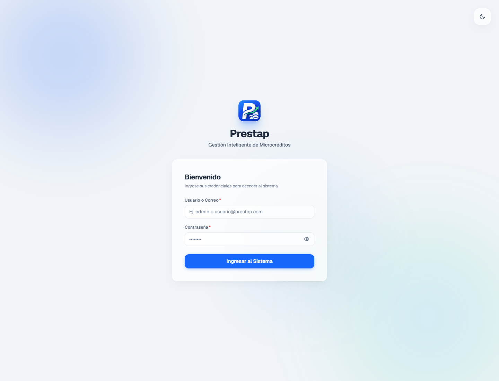
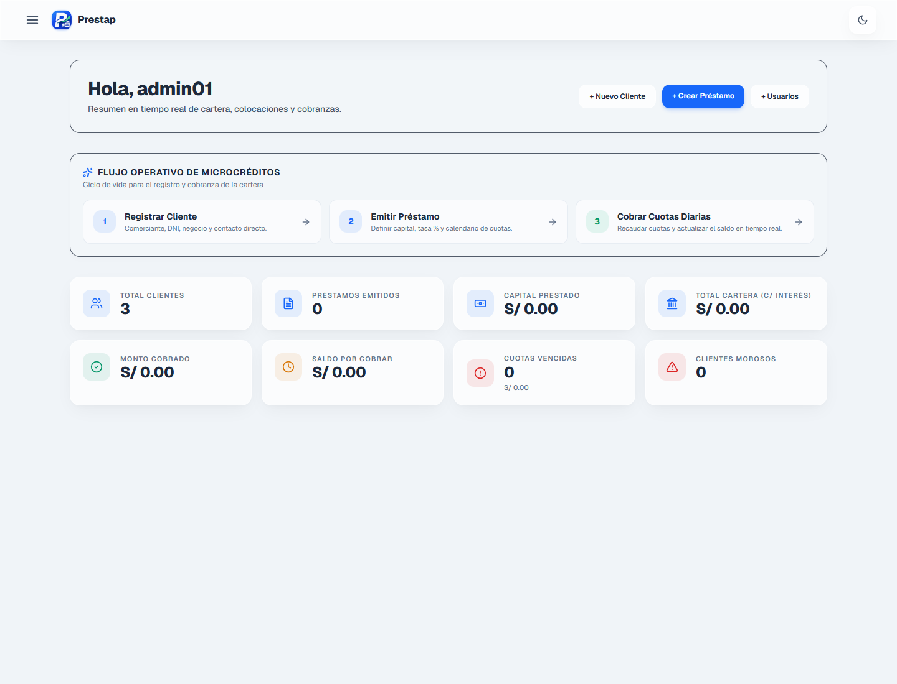
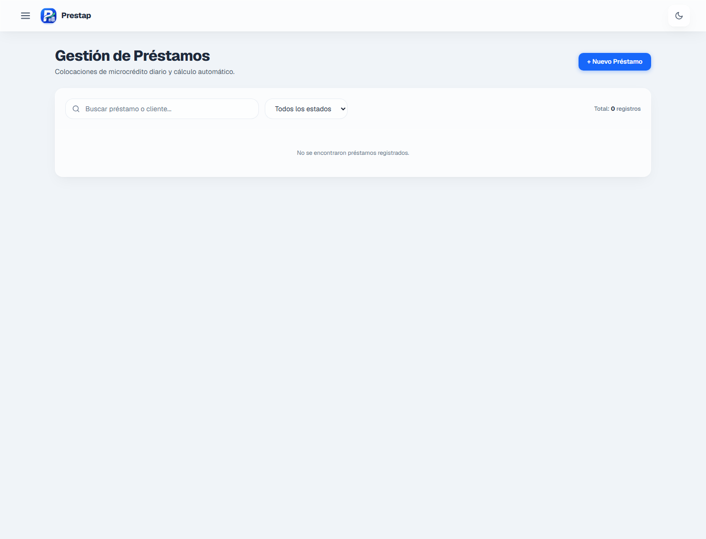
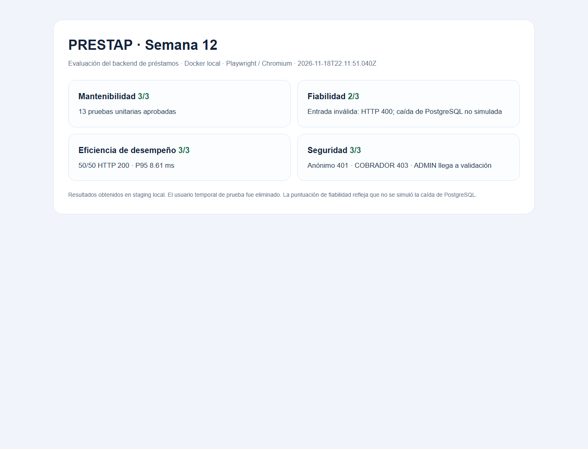

# Semana 12 — Estándares de calidad de software

**Proyecto:** PRESTAP — Sistema de gestión de préstamos y cobranzas  
**Unidad didáctica:** Gestión de aplicaciones web · **Semestre:** VI · **Periodo:** 2026-II  
**Estudiante:** Max Paucar Ramos · **Docente:** Ing. Erick Donniex Moscoso Bravo  
**Fecha de evaluación:** 18 de noviembre de 2026

> Evaluación práctica orientativa basada en cuatro características de ISO/IEC 25010:2023. Las puntuaciones de 1 a 3 son didácticas; no representan una certificación ISO.

## I. Propósito de la práctica

Evaluar un componente real del backend de PRESTAP según mantenibilidad, fiabilidad, eficiencia de desempeño y seguridad, sustentando las valoraciones con comprobaciones reproducibles y mejoras verificables.

## II. Producto de la práctica

- Ficha de alcance y condiciones de prueba.
- Matriz de calidad con resultados, evidencias y puntajes justificados.
- Plan priorizado de dos acciones de mejora con responsable, fecha y verificación.
- Anexos con capturas Playwright, registros de pruebas y fragmentos técnicos sin secretos.

## III. Equipos y materiales

PRESTAP en Docker Compose local, Chromium controlado por Playwright, pnpm/Vitest, terminal PowerShell y navegador HTTPS local. Se usaron datos semilla y una cuenta sintética temporal; no se guardaron contraseñas, cookies, tokens ni datos personales.

## IV. Referencia y escala

Se evaluaron únicamente las cuatro características indicadas en la práctica. La escala usada es la escala didáctica de la guía:

| Puntaje | Interpretación | Decisión |
|---:|---|---|
| 1 | Deficiente: no cumple o existe una falla importante demostrada. | Corregir con prioridad. |
| 2 | Parcial: cumple en parte o falta evidencia significativa. | Planificar una mejora y volver a probar. |
| 3 | Adecuado: cumple el criterio y la evidencia es suficiente para esta prueba. | Mantener y monitorear. |

## V. Procedimiento

### Actividad 1 — Alcance y línea base

| Campo | Respuesta |
|---|---|
| Componente evaluado | API de préstamos: `POST /api/prestamos` (validación, autorización y reglas de negocio); se usa `GET /api/prestamos` para la medición de desempeño. |
| Arquitectura y tecnología | Aplicación web cliente-servidor con API REST. Next.js App Router 16.3.2, Node.js 22 en contenedor, PostgreSQL 16 y proxy Caddy. Reglas de negocio en `lib/business.ts`. |
| Entorno y versión desplegada | Staging local en Docker Compose sobre Windows; acceso por `https://localhost`, certificado interno de Caddy. La app escucha en el puerto 3000 interno; el proxy publica 80/443. PostgreSQL escucha en 5432 dentro de la red Compose. |
| Datos / usuario de prueba | Datos semilla locales. Autenticación ADMIN para la prueba autorizada y cuenta COBRADOR temporal creada durante la prueba y eliminada al finalizar. Sin datos personales reales ni credenciales incluidas en este informe. |
| Condiciones de ejecución | Chromium mediante Playwright; conexión local a través de HTTPS/Caddy; medición secuencial de 50 solicitudes autenticadas a `GET /api/prestamos`. |
| Criterio general de éxito | Reglas de negocio cubiertas por pruebas; errores controlados; P95 ≤ 500 ms y 0 errores en 50 solicitudes; usuario sin permisos recibe 403 y anónimo 401 al intentar crear un préstamo. |

### Puesta en marcha usada

Se inició el sistema antes de la evaluación, conservando los volúmenes existentes:

```powershell
docker compose up -d --build
docker compose ps
curl.exe -k -I https://localhost
```

Resultado: los servicios `app-db` y `prestap-staging` quedaron saludables, y `prestap-proxy` inició; `https://localhost/login` respondió HTTP 200. `GET /api/health` devolvió HTTP 200 con `ok=true` y PostgreSQL local. La configuración actual de Compose publica HTTPS por Caddy; no publica el puerto 8080 descrito en guías anteriores.

### Actividad 2 — Caso resuelto en clase

| Característica | Evidencia del caso de pedidos | Puntaje |
|---|---|---:|
| Mantenibilidad | La regla de descuento está duplicada en cuatro módulos y una corrección requiere cambiar cuatro archivos. | 1 |
| Fiabilidad | Ante la caída de la base de datos, la solicitud devuelve un 500 no controlado y no existe manejo útil. | 1 |
| Eficiencia de desempeño | P95 de 610 ms en 50 solicitudes, sin errores, frente a un límite de 500 ms; hay consultas repetidas. | 2 |
| Seguridad | Un vendedor recibe HTTP 200 y puede ver el reporte administrativo. | 1 |

**Decisión:** atender primero el acceso no autorizado; luego controlar el fallo de base de datos, centralizar la regla duplicada y optimizar las consultas. La prioridad depende del impacto y la urgencia, no de sumar las puntuaciones.

### Actividad 3 — Evaluación real de PRESTAP

| Característica | Criterio y prueba ejecutada | Resultado / evidencia | Puntaje | Hallazgo |
|---|---|---|---:|---|
| Mantenibilidad | La lógica de préstamos y su validación deben estar centralizadas y probarse automáticamente. Revisión de `app/api/prestamos/route.ts`, `lib/business.ts` y ejecución de `pnpm test -- tests/business.test.ts`. | La ruta reutiliza reglas de `lib/business.ts`; las 13 pruebas de `tests/business.test.ts` pasaron. Registro: [pruebas unitarias](./evidencias/pruebas-unitarias.txt). | **3** | La regla de negocio es localizable y comprobable. Conviene conservar las pruebas al modificarla. |
| Fiabilidad | Una entrada inválida debe producir un error JSON controlado sin persistir datos, y el servicio debe indicar el estado de PostgreSQL. | Un `POST /api/prestamos` con monto inválido devolvió HTTP 400 y un mensaje de validación; no escribió registros. Healthcheck: HTTP 200, PostgreSQL local, `ok=true`. La caída de PostgreSQL no se provocó. | **2** | Se confirma el manejo de validación, pero no la recuperación ante pérdida de base de datos. `lib/db.ts` usa fallback a JSON cuando captura errores de acceso; en staging debe verificarse que ese comportamiento no oculte una escritura fallida. |
| Eficiencia de desempeño | En el mismo staging, 50 solicitudes autenticadas a `GET /api/prestamos`, P95 ≤ 500 ms y 0 errores. | **50/50 HTTP 200; 0 errores; promedio 5,11 ms; P50 4,45 ms; P95 8,61 ms; máximo 10,45 ms.** Cumple el límite declarado. | **3** | El tiempo observado está dentro del objetivo en esta ejecución local; no es una prueba de concurrencia. |
| Seguridad | En `POST /api/prestamos`, ADMIN supera autorización, COBRADOR recibe 403 y una solicitud anónima recibe 401. Verificar también cabeceras HTTPS. | ADMIN llegó a validación (HTTP 400 por el cuerpo inválido); COBRADOR recibió 403; sin sesión recibió 401. Están presentes HSTS, `X-Content-Type-Options`, `X-Frame-Options`, `Referrer-Policy` y `Permissions-Policy`. | **3** | La autorización se aplica en el backend antes de procesar la operación. La cuenta temporal COBRADOR se eliminó al terminar. |

Los resultados Playwright completos, incluyendo fecha, métricas, códigos HTTP y cabeceras, están en [resultados.json](./evidencias/resultados.json). Las capturas muestran el ingreso, el dashboard y el módulo de préstamos sin mostrar credenciales.

### Actividad 4 — Acciones de mejora priorizadas

| Prioridad | Hallazgo / característica | Acción concreta | Responsable y fecha | Verificación esperada | Estado |
|---:|---|---|---|---|---|
| 1 | Fiabilidad parcial: no se probó la caída de PostgreSQL y el acceso a datos puede usar fallback JSON. | Definir un comportamiento explícito para staging cuando PostgreSQL no esté disponible y agregar una prueba reversible de fallo de dependencia; el error público debe ser controlado y el detalle quedar en logs del servidor, sin éxito aparente ni escritura alternativa. | Max Paucar Ramos · 25/11/2026 | Con PostgreSQL de prueba detenido, la solicitud falla de forma controlada, no se escribe en JSON y el log registra el fallo sin exponer secretos. | Pendiente |
| 2 | La autorización del endpoint está comprobada manualmente con Playwright. | Mantener automatizada la matriz de acceso para `POST /api/prestamos` (anónimo, COBRADOR y rol autorizado) dentro de las pruebas de integración del proyecto. | Max Paucar Ramos · 25/11/2026 | Repetir las solicitudes y comprobar 401, 403 y llegada del rol autorizado a la validación; verificar que la cuenta de prueba se limpie incluso si una aserción falla. | Pendiente |

### Actividad 5 — Revisión de trazabilidad

Revisión de trazabilidad realizada de forma independiente para esta entrega. No se inventa el nombre ni la firma de otro equipo: la revisión formal por pares del aula debe ser confirmada por un equipo real si el docente la solicita.

| Criterio de revisión | Resultado | Observación concreta |
|---|---|---|
| Alcance y condiciones permiten repetir la prueba. | Cumple | Se especifican ruta, entorno, navegador y volumen de solicitudes. |
| Los cuatro criterios son claros y medibles. | Cumple | Incluyen pruebas, códigos esperados y umbral de P95. |
| Cada puntuación coincide con el resultado. | Cumple | Fiabilidad queda en 2 por no probar indisponibilidad; las otras puntuaciones se sustentan en resultados registrados. |
| Las evidencias tienen contexto y no exponen datos sensibles. | Cumple | Se evita capturar credenciales, cookies y datos personales; el rol de prueba es sintético y temporal. |
| Cada mejora responde a un hallazgo y puede verificarse. | Cumple | Las acciones priorizan la limitación de fiabilidad y la regresión de autorización. |

## VI. Resultados

| Resultado final | Respuesta del equipo |
|---|---|
| Característica con mejor resultado y evidencia principal | Mantenibilidad, eficiencia y seguridad empataron con 3. Evidencia: 13 pruebas unitarias aprobadas, P95 de 8,61 ms en 50 solicitudes y respuestas 401/403 según sesión y rol. |
| Característica más débil y efecto en el backend | Fiabilidad (2). No se probó la caída de PostgreSQL y el fallback a JSON podría ocultar una escritura fallida o separar datos entre almacenes. |
| Mejora que se ejecutará primero y motivo | Definir y probar el comportamiento cuando PostgreSQL no esté disponible; evita reportar una operación como exitosa sin persistencia confiable. |
| Limitación de la evaluación realizada | Una sola máquina/red local, carga secuencial y solo 50 solicitudes a `GET /api/prestamos`; no se simuló indisponibilidad de la base ni se evaluó la aplicación completa. |

## VII. Control y verificación

- [x] Se delimitó la evaluación al flujo de préstamos y sus reglas relacionadas.
- [x] Se evaluaron mantenibilidad, fiabilidad, eficiencia y seguridad.
- [x] Cada criterio se declaró antes de asignar el puntaje y cada puntaje se apoya en una prueba o limitación declarada.
- [x] El rendimiento registra entorno, 50 solicitudes, P95 y errores.
- [x] La prueba de fiabilidad fue segura y reversible: entrada inválida, HTTP 400 y ninguna escritura; no se detuvo PostgreSQL.
- [x] La autorización se verificó en el backend con sesión anónima y roles ADMIN/COBRADOR.
- [x] La cuenta temporal se limpió; no se guardaron secretos ni datos personales en las evidencias.
- [x] Las mejoras se relacionan con hallazgos y tienen verificación esperada.

## VIII. Conclusiones

**1. ¿Qué evidencia cambió o confirmó la percepción inicial del equipo sobre la calidad del backend?**  
Las 13 pruebas unitarias aprobaron y la API respondió 50 de 50 veces con HTTP 200 y P95 de 8,61 ms, lo que confirmó el buen resultado de mantenibilidad y desempeño en este staging. La respuesta 400 controlada confirmó la validación del backend. La inspección del fallback a JSON y la ausencia de una prueba de caída de PostgreSQL mostraron que la fiabilidad aún no está demostrada ante fallos de la dependencia.

**2. ¿Qué característica requiere atención prioritaria y por qué afecta al usuario o al mantenimiento del sistema?**  
La fiabilidad. Si PostgreSQL no está disponible, el fallback a JSON puede ocultar un fallo de persistencia o separar los datos; esto puede afectar la consistencia de préstamos y cobranzas. La mejora prioritaria es definir el comportamiento de error en staging y probarlo sin datos reales.

**3. ¿Cómo comprobarán que la mejora priorizada produjo un resultado real?**  
En un entorno de prueba reversible, se hará que PostgreSQL no esté disponible y se repetirá una solicitud de préstamo. Se verificará una respuesta HTTP controlada, un registro seguro en logs y que no exista escritura alternativa en JSON; luego se restablecerá la base y se repetirá el healthcheck.

## IX. Anexos y reproducción

### Anexo 1 — Capturas y resultados Playwright









- [Resultados HTTP, autorización, cabeceras y rendimiento](./evidencias/resultados.json)

### Anexo 2 — Resultado de pruebas unitarias

- [Salida de las 13 pruebas unitarias](./evidencias/pruebas-unitarias.txt)

### Anexo 3 — Fragmentos técnicos revisados

Autorización del endpoint de préstamos, antes de leer el cuerpo de la solicitud:

```ts
await requireRole(["ADMIN", "OPERADOR", "SUPERVISOR"]);
const input = await request.json();
```

Errores de dominio manejados por la API:

```ts
} catch (error) {
  return jsonError(error);
}
```

Hallazgo de fiabilidad en el acceso a datos: en `lib/db.ts`, el `catch` de `leerTabla` devuelve `leerTablaLocalJson<T>(tabla)`. Se registra como hallazgo para definir y verificar el comportamiento de staging ante una caída; no se modificó el sistema como parte de esta evaluación.

### Anexo 4 — Registro de revisión

La tabla de la Actividad 5 registra la revisión de trazabilidad y sus observaciones. La validación formal por otro equipo no se simula ni se firma en nombre de terceros.

### Reproducción

- [Carpeta de evidencias Playwright](./evidencias/)
- [Script reproducible de Playwright](./capturar-evidencias.mjs)
- Comando de pruebas unitarias: `pnpm test -- tests/business.test.ts`.

Para repetir los resultados, primero inicia Docker y actualiza el registro de pruebas unitarias; después establece las credenciales locales de prueba solo en el entorno de la terminal (no las escribas en archivos ni capturas) y ejecuta:

```powershell
pnpm test -- tests/business.test.ts 2>&1 | Tee-Object -FilePath ".\semana 12\evidencias\pruebas-unitarias.txt"
$env:PRESTAP_QA_USER = "<usuario-local-de-prueba>"
$env:PRESTAP_QA_PASSWORD = "<contraseña-local-de-prueba>"
node ".\semana 12\capturar-evidencias.mjs"
Remove-Item Env:PRESTAP_QA_USER, Env:PRESTAP_QA_PASSWORD
```

El script usa `https://localhost`, habilita el certificado interno solo para el navegador automatizado, prueba una cuenta COBRADOR temporal y la elimina. No imprime ni guarda usuario, contraseña, cookie o token.

## Referencias

- International Organization for Standardization. (2023). *ISO/IEC 25010:2023, Systems and software engineering — Systems and software Quality Requirements and Evaluation (SQuaRE) — Product quality model.*
- International Organization for Standardization. (2014). *ISO/IEC 25000:2014, Systems and software engineering — Systems and software Quality Requirements and Evaluation (SQuaRE) — Guide to SQuaRE.*
